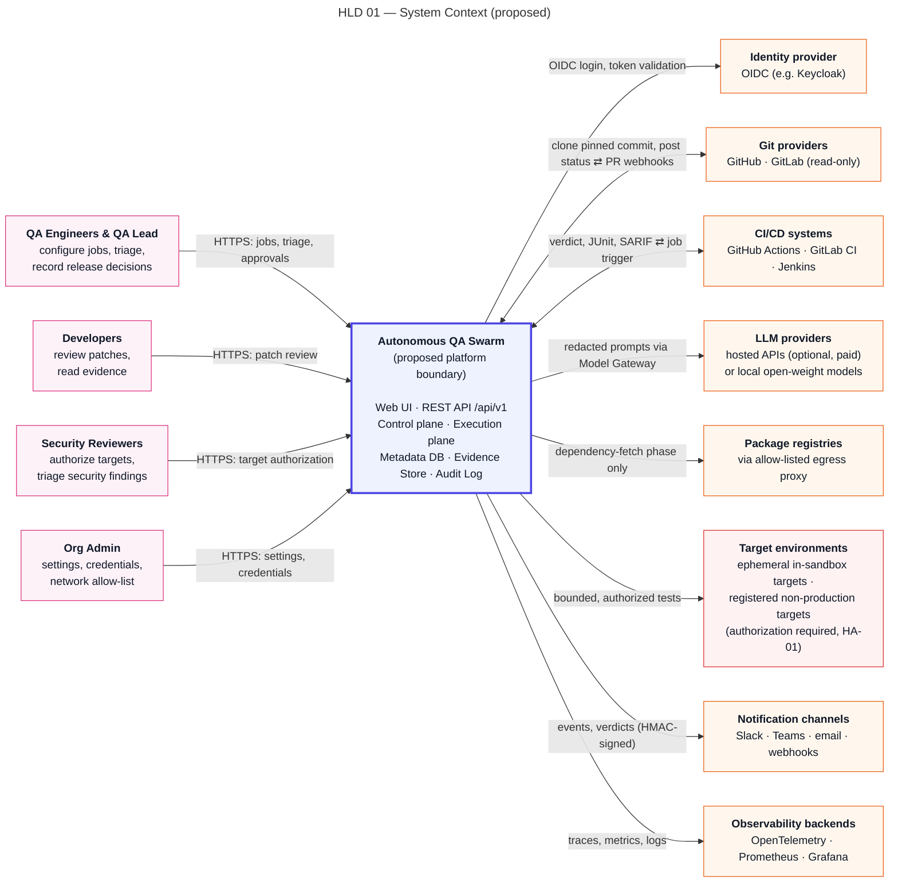

# System Context

> Autonomous QA Swarm · Documentation v0.1 (Concept) · Status: Proposed — nothing described here is implemented yet.

This document defines what Autonomous QA Swarm is proposed to be responsible for, where its boundary lies, and which people and external systems it will interact with. It is the starting point for the [high-level design](02-high-level-design.md), the [component architecture](04-component-architecture.md) and the [security architecture and threat model](../10-security-and-threat-model/01-security-architecture-and-threat-model.md). Every element described here has the status **Proposed** unless marked **Planned (MVP)** or **Future**; no element is **Implemented / Verified**, a label that will only be applied once code exists and its acceptance tests pass.

## System purpose

Autonomous QA Swarm is a proposed open-source, self-hostable platform in which specialized AI agents, coordinated by a deterministic workflow engine, plan and run tests against a pinned revision of a code repository inside isolated sandboxes, correlate the resulting evidence, propose fixes for human review and independently verify them. Its output is an evidence-backed QA report and a release-readiness recommendation (`READY`, `READY_WITH_RISKS`, `NOT_READY` or `INCONCLUSIVE`); the release decision itself is always recorded by a named human (HA-10).

Two principles shape the context boundary:

- **"Agents propose, deterministic services dispose, humans approve."** Agents never execute code, never hold credentials and never change a repository. Their typed proposals are validated by the Policy Engine and run by the Execution Service in disposable sandbox workers.
- **"No evidence, no defect."** A finding cannot be reported as Confirmed without reproducible evidence captured by deterministic tooling.

The platform does not claim to find all defects or to provide complete security coverage. It produces measurable quality-gate results (QG-01 to QG-08), confidence levels and an explicit statement of residual risk and coverage limits.

## System boundary

### Inside the boundary

The following are proposed to be owned and operated as part of the platform:

- **Experience layer:** Web UI and API Gateway (`/api/v1`).
- **Control plane:** Workflow Engine (part of the Orchestrator Agent, AG-01), Policy Engine, the LLM agents AG-02 to AG-11, Source Intake Service, Model Gateway, Secrets Broker, Notification Service.
- **Execution plane:** Execution Service, Sandbox Workers, Target Environment Manager and the egress proxy used during the dependency-fetch phase.
- **Data plane:** Metadata DB (PostgreSQL), Evidence Store (S3-compatible, content-addressed), Audit Log (append-only, hash-chained).
- **Ephemeral targets:** applications under test that the Target Environment Manager starts inside the sandbox boundary for the duration of a job.

### Outside the boundary

Everything else is an external actor: people using the platform, CI systems that trigger jobs, Git providers that host source code, LLM providers, registered external non-production targets, the organization's identity provider, notification channels, observability backends the operator may already run, and public package registries. The platform treats each of these with an explicitly stated trust level and never extends its own privileges to them.

### Explicitly out of scope

The platform will not deploy software, will not commit, push or merge to any repository (FR-041), will not test production environments, and will not perform exploitation beyond proof of reachability (SEC-018). Pull-request export of verified patches is a **Future** capability gated by HA-12.

## Context diagram

Figure HLD 01 System Context shows the platform boundary and the external actors grouped by type: human roles, CI systems, Git providers, LLM providers, target environments, the identity provider, notification channels, observability backends and package registries reached only through the egress proxy.

*Figure HLD 01 — System Context (proposed).*

## External actors

### Human roles

All human access goes through the Web UI or the REST API, authenticated by OIDC bearer tokens issued by the organization's identity provider and authorized by role-based access control (SEC-009, SEC-010). The roles are those defined for RBAC.

| Actor | Interaction | Protocol | Trust level | Data exchanged | Direction |
|---|---|---|---|---|---|
| Org Admin | Manages members, credentials (HA-11), network allow-lists (HA-04), target registration (HA-01) | HTTPS, OIDC | Authenticated, privileged | Settings, credential references, allow-list entries | Bidirectional |
| QA Lead | Configures profiles, approves plans (HA-05) and performance runs (HA-03), overrides gates (HA-09), records release decisions (HA-10) | HTTPS, OIDC | Authenticated, privileged | Jobs, approvals, gate results, decisions | Bidirectional |
| QA Engineer | Creates and monitors jobs, triages functional findings, reviews generated tests | HTTPS, OIDC, SSE | Authenticated | Jobs, test results, findings, evidence | Bidirectional |
| Developer | Reviews findings and approves patches for verification as code owner (HA-06) | HTTPS, OIDC | Authenticated | Findings, patches, verification results | Bidirectional |
| Security Reviewer | Authorizes DAST (HA-02), attests targets (HA-01), marks false positives (HA-07), co-accepts security risk (HA-08) | HTTPS, OIDC | Authenticated, privileged | Security findings, suppressions, authorizations | Bidirectional |
| Viewer | Reads dashboards and reports | HTTPS, OIDC | Authenticated, read-only | Reports, gate results | Inbound to user |
| CI Service Account | Creates jobs from pipelines and polls status | HTTPS, OIDC client credentials | Authenticated machine identity, least privilege | Job requests, status, report exports | Bidirectional |

The HA-10 release decision is recorded by a user holding the QA Lead role; an organization that has a dedicated release manager grants that person the QA Lead role (for example through an identity-provider group mapping).

### Systems

| Actor | Interaction | Protocol | Trust level | Data exchanged | Direction |
|---|---|---|---|---|---|
| CI systems (Jenkins, GitHub Actions) | Trigger jobs on events; receive status and machine-readable results | HTTPS REST, webhooks | Semi-trusted; authenticated as CI Service Account | Repository, ref, profiles; JUnit XML, SARIF, verdict | Bidirectional |
| Git providers (GitHub, GitLab) | Source Intake resolves refs and fetches snapshots with read-only tokens | HTTPS (Git smart HTTP, provider REST API) | Untrusted content, authenticated channel | Refs, commit SHAs, source archives | Inbound |
| Hosted LLM providers | Model Gateway sends redacted prompts, receives completions | HTTPS REST | Semi-trusted; output treated as untrusted | Redacted prompts, structured completions, token counts | Bidirectional |
| Local LLM runtimes (Ollama, vLLM) | Same as hosted, inside the operator network | HTTP/HTTPS REST | Semi-trusted; output treated as untrusted | Same as hosted | Bidirectional |
| Ephemeral targets | Started inside the sandbox boundary per job; exercised by tests and scanners | In-sandbox HTTP | Untrusted (built from repository code) | Test traffic, responses, logs | Bidirectional |
| Registered non-production targets | Exercised only after HA-01 attestation; active checks need HA-02, non-Smoke load needs HA-03 | HTTPS | Untrusted; operator-attested authorization | Test traffic, responses, health checks | Bidirectional |
| Identity provider (OIDC, e.g. Keycloak) | Authenticates users and service accounts; MFA delegated to it | OIDC / OAuth 2.0 over HTTPS | Trusted for identity assertions | ID tokens, access tokens, group claims | Inbound |
| Notification channels (webhooks, email, Slack, Teams) | Receive job, approval-request and verdict notifications | HTTPS webhooks, SMTP | Untrusted destination | Event summaries and links, no secrets or raw evidence | Outbound |
| Observability backends (OpenTelemetry collector, Prometheus, Grafana, Loki or OpenSearch) | Receive platform traces, metrics and logs | OTLP, Prometheus scrape, HTTPS | Trusted operator infrastructure | Redacted telemetry with correlation IDs | Outbound |
| Package registries (e.g. PyPI, npm) via egress proxy | Workers fetch dependencies during the dependency-fetch phase only | HTTPS through allow-listed proxy | Untrusted content | Package archives and metadata | Inbound |
| Secrets backend (OpenBao or HashiCorp Vault) | Stores credentials behind the Secrets Broker | HTTPS API, mTLS proposed | Trusted | Credential material, short-lived tokens | Bidirectional |

The secrets backend may be deployed inside the boundary as part of the reference stack or supplied by the operator; in both cases only the Secrets Broker talks to it.

## Trust levels

Trust levels in the tables above have the following meaning in this design:

- **Trusted:** the operator's own infrastructure, relied upon for its declared function (identity assertions, secret storage, telemetry storage). Still accessed over TLS 1.2+ (SEC-012).
- **Authenticated / privileged:** a known identity whose actions are authorized per role and recorded in the Audit Log; privileged roles can grant approvals HA-01 to HA-12.
- **Semi-trusted:** a known counterparty whose responses may be wrong or manipulated. LLM output is always schema-validated (SEC-015) and never executed or acted on without Policy Engine validation.
- **Untrusted:** content that may be hostile, including repository code, test output, target responses and downloaded packages. It is handled only inside sandboxes or as inert data, and repository text is treated as data, never as instructions to agents (SEC-014).

## Data flows across the boundary

The most sensitive boundary crossings, and the controls proposed for each, are:

1. **Source in:** Source Intake validates the repository URL (HTTPS only, DNS-pinned, private-address rejection; SEC-002), resolves the ref to an immutable commit SHA and stores a read-only snapshot with its SHA-256 checksum. The control plane never executes repository code (SEC-001).
2. **Prompts out:** the Model Gateway is the single egress point to LLM providers. It redacts secrets (SEC-008), enforces a provider allow-list and per-job token budgets (SEC-021, NFR-015), and logs prompt and response hashes for provenance.
3. **Dependencies in:** sandbox workers reach package registries only during a separate dependency-fetch phase through an allow-listed egress proxy; during test execution the network is off (SEC-004), and cloud metadata addresses and private ranges are blocked (SEC-005).
4. **Test traffic out:** traffic to a registered external target is allowed only for a valid TargetAuthorization; active security checks and load above Smoke need their own approvals (SEC-016, SEC-017).
5. **Results out:** CI systems and notification channels receive summaries, verdicts and links. Evidence is downloaded only through signed, short-lived URLs after authorization (SEC-019).

## Key context constraints

- **Self-hosted, single organization in the MVP.** The **Planned (MVP)** deployment serves one organization; multi-tenant SaaS is **Future**. Tenant-owned rows still carry `org_id` with row-level security from the start (SEC-011).
- **Open-source operability.** The full pipeline must run with free and open-source components only (NFR-018). Hosted LLMs, cloud object storage and SaaS CI are optional adapters whose cost is the operator's responsibility.
- **Supported sources.** The MVP targets GitHub and GitLab repositories (public, and private through read-only app tokens held as credential references) written in Python and JavaScript/TypeScript. Other languages, such as the sample `northwind/ledger-service` Java repository, are shown as unsupported until Phase 4.
- **Non-production targets only.** Ephemeral in-sandbox targets are the default. External targets must be registered and attested (HA-01); DAST (Deep profile) and Stress, Soak and Spike profiles are outside the MVP.
- **No credentials to agents.** The Secrets Broker issues short-lived, scoped tokens only to Source Intake and the Target Environment Manager. The only credentials that reach workers are authorized, short-lived, non-production target test-user values (SEC-007).
- **Bounded execution.** Jobs default to a 4 h wall-clock limit (max 12 h); tasks default to 30 min (max 2 h); captured output is capped at 50 MiB per task.
- **LLM provider variability.** Output quality, latency and availability differ between hosted and local models. The design depends on schema validation, corrective retries and deterministic oracles rather than on any specific model behaving well.
- **Network reach.** The deployment must be able to reach the configured Git providers, LLM providers (unless local models are used) and package registries via the proxy; air-gapped operation requires local models and a mirrored registry.

## Related documents

- [High-level design](02-high-level-design.md) describes the layers and architecture decisions that realize this context.
- [Integrations](06-integrations.md) details the Git, CI, notification and model-provider adapters.
- [Identity, secrets, audit and data protection](../10-security-and-threat-model/02-identity-secrets-audit-and-data-protection.md) covers the identity provider and Secrets Broker flows.
- [Safe-use policies](../10-security-and-threat-model/04-safe-use-policies.md) defines what authorized, non-destructive testing means for targets.
