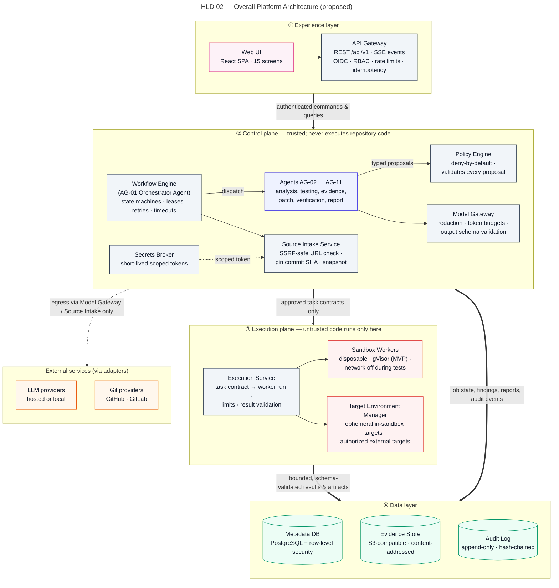
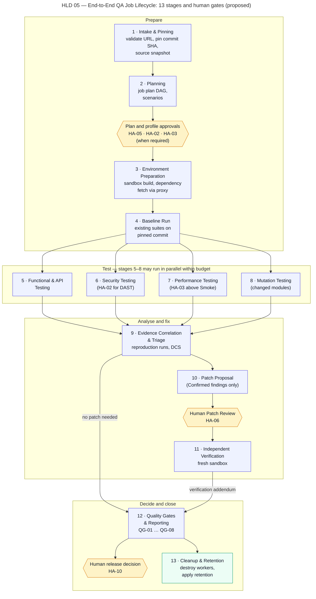

# High-Level Design

> Autonomous QA Swarm · Documentation v0.1 (Concept) · Status: Proposed — nothing described here is implemented yet.

This document describes the proposed high-level architecture of Autonomous QA Swarm: its architectural style, its four layers, the end-to-end flow of a QA job through the 13 pipeline stages, the architecture decisions AD-01 to AD-10, the reference deployment topologies and the approach to scalability and availability. It builds on the [system context](01-system-context.md) and is refined in the [low-level design](03-low-level-design.md) and [component architecture](04-component-architecture.md). All content is **Proposed**; items intended for the MVP are marked **Planned (MVP)** and later items **Future**. No part of this design is **Implemented / Verified**.

## Architectural style

### Modular monolith control plane with a separate execution plane

The platform is proposed as two deployable parts with very different trust and scaling profiles:

- A **control plane** built as a modular monolith: one Python 3.12 / FastAPI application, internally divided into modules (API Gateway, Workflow Engine, Policy Engine client, Source Intake, agents, Model Gateway, Secrets Broker client, Notification Service, reporting). Modules talk to each other through in-process interfaces and the PostgreSQL-backed task queue, and the same image can be started in different roles (API, scheduler, agent runner) to scale them independently.
- An **execution plane** of Execution Service hosts and disposable Sandbox Workers that run all repository code, tests, scanners, mutants and load generators. It is deployed on separate hosts or a separate Kubernetes node pool and has no route to the control-plane database or the Secrets Broker.

### Rationale

The split follows the trust boundary, not team structure. Repository code is untrusted and must never run where credentials, the database or LLM keys live (SEC-001). Inside the control plane, a microservice decomposition would add network hops, distributed transactions, service discovery and per-service deployment pipelines before any real scaling need is demonstrated. A modular monolith keeps the job state machine transactional in one database, keeps local development and the single-host deployment simple (NFR-013), and leaves clear module seams so that a module such as the Model Gateway can be extracted later if measured load or isolation needs justify it. This is recorded as AD-01.

## Layers

Figure HLD 02 Platform Architecture shows the four layers and the main components in each.

*Figure HLD 02 — Overall Platform Architecture (proposed).*

### Experience layer

| Component | Responsibilities |
|---|---|
| Web UI | React + TypeScript SPA implementing the 15 screens SCR-01 to SCR-15; renders live progress from Server-Sent Events; never holds secrets |
| API Gateway | REST `/api/v1`; OIDC bearer validation; RBAC; rate limits (SEC-022); `Idempotency-Key` handling for `POST /jobs`; RFC 9457 problem+json errors; SSE endpoint `GET /jobs/{job_id}/events` |

### Control layer

| Component | Responsibilities |
|---|---|
| Workflow Engine (AG-01) | Job and task state machines, task queue with leases, retries, timeouts, cancellation, DAG dependency enforcement |
| Orchestrator Agent planner (AG-01) | LLM-assisted plan drafting; the resulting DAG is validated deterministically before use |
| Agents AG-02 to AG-11 | Produce typed proposals and analyses; no code execution, no credentials, no repository writes |
| Policy Engine | Deny-by-default validation of every proposal and task contract against scope, target authorization, budgets and network rules (OPA/Rego) |
| Source Intake Service | SSRF-safe URL validation, ref resolution, commit pinning, read-only snapshot with SHA-256 |
| Model Gateway | Single LLM egress: templating, redaction, token budgets, schema validation, provenance hashes |
| Secrets Broker | Holds credentials (OpenBao or Vault); issues short-lived scoped tokens to Source Intake and Target Environment Manager only |
| Notification Service | Webhooks, email, Slack and Teams notifications |

### Execution layer

| Component | Responsibilities |
|---|---|
| Execution Service | Converts approved task contracts into worker runs; enforces resource and network limits; collects bounded output; validates worker results; destroys workers |
| Sandbox Workers | Disposable rootless containers under gVisor (MVP) running builds, tests, scanners, mutants and load generators |
| Target Environment Manager | Starts ephemeral in-sandbox targets or binds an authorized external non-production target |
| Egress proxy | Allow-listed access to package registries during the dependency-fetch phase only |

### Data layer

| Component | Responsibilities |
|---|---|
| Metadata DB | PostgreSQL 16+; all entities from the [data model](../07-data-model/01-data-model-and-erd.md); `org_id` with row-level security; also hosts the task queue |
| Evidence Store | S3-compatible object storage; content-addressed by SHA-256; immutable; retention-managed (default 90 days) |
| Audit Log | Append-only, hash-chained AuditEvent records (default retention 1 year) |
| Observability Stack | OpenTelemetry, Prometheus, Grafana, Loki or OpenSearch; correlation IDs across all components (NFR-014) |

## End-to-end flow of a QA job

Figure HLD 05 QA Job Lifecycle shows the 13 stages, the gates between them and where human approvals occur. The narrative below uses the sample job QJ-1042 (illustrative only) on `northwind/payments-api`, ref `release/2.8`, with Functional Standard, Security Standard and Performance Baseline profiles.

*Figure HLD 05 — End-to-End QA Job Lifecycle: 13 stages and human gates (proposed).*

### Job creation and admission

A QA Engineer or the CI Service Account calls `POST /jobs` with an `Idempotency-Key`. The API Gateway authenticates, authorizes and checks the key: a repeat within 24 h returns the original response, and an active job with the same repository, commit SHA and profile hash returns `409` with a link unless a QA Lead sets `force_new=true`. The job is stored as `created` and moves to `validating`, where the Policy Engine checks profiles, targets and approvals and Source Intake performs stage 1. A job referencing an unauthorized target or a revoked credential ends `blocked` without any execution; the sample job QJ-1037 illustrates this outcome. Otherwise the job becomes `queued` until planning capacity is available.

### Stages

| No. | Stage | Owner | Gate or check before the next stage |
|---|---|---|---|
| 1 | Intake & Pinning | Source Intake Service | Commit SHA pinned; snapshot checksum recorded |
| 2 | Planning | Orchestrator Agent + Requirements Analysis Agent | DAG validated by Policy Engine; optional Plan Approval (HA-05) |
| 3 | Environment Preparation | Execution Service / Target Environment Manager | Build succeeded in sandbox; dependencies fetched via proxy; target healthy |
| 4 | Baseline Run | Functional Testing Agent | Existing suites executed on pinned commit; flaky reruns applied |
| 5 | Functional & API Testing | Functional Testing Agent, API Testing Agent | Results schema-validated; generated tests only run if approved |
| 6 | Security Testing | Security Testing Agent | Profile scope checked; DAST only with HA-02 and HA-05 |
| 7 | Performance Testing | Performance Testing Agent | Profile approval (HA-03 above Smoke); abort rules active |
| 8 | Mutation Testing | Mutation Testing Agent | Changed modules only; max 500 mutants |
| 9 | Evidence Correlation & Triage | Evidence and Defect Analysis Agent | Findings fingerprinted, deduplicated, scored (DCS); reproduction runs done |
| 10 | Patch Proposal | Patch Proposal Agent | Human Patch Review (HA-06) |
| 11 | Independent Verification | Independent Verification Agent | Fresh sandbox; verdict `verified` or `verification_failed` |
| 12 | Quality Gates & Reporting | QA Report Agent | QG-01 to QG-08 evaluated; verdict recommended; HA-10 decision recorded by a human |
| 13 | Cleanup & Retention | Execution Service, Evidence Store | Workers destroyed; retention timers set |

### Stage narrative and gates

**Intake & Pinning.** While the job is `validating`, Source Intake obtains a short-lived read-only token from the Secrets Broker for private repositories, resolves `release/2.8` to commit `7c9e2a1f4b` (sample), downloads an archive and stores it as a SourceSnapshot with its SHA-256. From this point all work refers to the pinned SHA, never to the moving ref.

**Planning.** The job moves to `planning`. The Requirements Analysis Agent converts linked requirements, OpenAPI specs and the change diff into TestScenario records with priorities (P0, P1). The Orchestrator Agent drafts a JobPlan as a task DAG. The draft is an untrusted proposal: the Workflow Engine checks it is acyclic, uses only known task types and fits the resource budget, and the Policy Engine checks scope and targets. If the plan approval gate is enabled (default on for `Deep` security and `Stress`/`Soak` performance), the job waits in `awaiting_approval` until a QA Lead approves (HA-05) via `POST /jobs/{job_id}/plan/approval`; rejection ends the job `cancelled`.

**Environment Preparation and Baseline Run.** The job moves to `running`. The Execution Service starts a worker for the build, with a dependency-fetch phase through the egress proxy followed by network-off execution. The Target Environment Manager starts an ephemeral instance of the application for API, security and performance stages. The Functional Testing Agent proposes running the existing suites; the Execution Service runs them and records TestExecution rows. Failed tests are rerun up to 2 times in fresh workers, and a pass on rerun is classified `flaky` and recorded in the Flaky Test Register rather than raised as a defect.

**Testing stages 5 to 8.** These run in parallel where the DAG and the resource budget allow. Each agent emits task proposals (for example "run Schemathesis against ephemeral target with this OpenAPI document"), each proposal becomes a task contract validated by the Policy Engine, and the Execution Service runs it. Agents receive only bounded, schema-validated results and evidence references. Generated tests carry provenance (agent, prompt template version, model, input hashes) and are executed only after human review approves them (FR-016); unreviewed generated tests remain proposals and never produce findings.

**Evidence Correlation & Triage.** The job moves to `analyzing`. The Evidence and Defect Analysis Agent normalizes raw signals, computes fingerprints, merges duplicates, requests reproduction runs in fresh sandboxes and computes the Defect Confidence Score. Disagreements between agents are resolved by the precedence rules in the [orchestration and recovery](../06-agent-design/02-orchestration-and-recovery.md) design; unresolved cases are flagged Disputed and routed to human triage. LLM opinion alone can never lift a finding to Confirmed.

**Patch Proposal and Independent Verification.** These stages work per finding, so a finding confirmed early can move through patch review and verification while correlation continues for other findings (in the sample, FND-0193 is already `fix_verified` through PCH-0007 and VER-0011 while QJ-1042 is still `analyzing`); patch work may also continue after the main report and produce an addendum. For Confirmed findings the Patch Proposal Agent drafts minimal diffs as Patch records (`proposed`, then `awaiting_review`). A Developer (code owner) or QA Lead approves for verification (HA-06) or rejects. The Independent Verification Agent then runs the relevant checks on the pinned commit plus the approved patch in a fresh sandbox, with no access to the patch agent's reasoning. Because human review can take days, stages 10 and 11 may complete after the main report; verification then produces an addendum report.

**Quality Gates & Reporting.** The job moves to `reporting`. The QA Report Agent evaluates QG-01 to QG-08 deterministically, applies the verdict logic and writes the Report with an LLM-generated narrative that is constrained to cite evidence IDs. The verdict is a recommendation; a QA Lead records the release decision (HA-10) through `POST /jobs/{job_id}/release-decision`.

**Cleanup & Retention.** All workers are destroyed within 60 s of their terminal task state (NFR-008); ephemeral targets are torn down; evidence retention timers are set. The job ends `completed`, or `completed_with_warnings` if some tasks ended `skipped`, `infrastructure_error` or `timed_out` or a gate is inconclusive. Job-level failure ends `failed`; exceeding the wall-clock limit (default 4 h) ends `timed_out`; user cancellation passes through `cancelling` to `cancelled`.

## Architecture decisions

The decisions below are proposed and will be revisited in Phase 1 against prototypes. Open questions that cut across documents are tracked as DEC items in [risks, limitations and decisions](../12-risks-and-roadmap/01-risks-limitations-and-decisions.md).

### Decisions AD-01 to AD-05

| ID | Decision | Rationale | Alternatives considered | Consequences |
|---|---|---|---|---|
| AD-01 | Modular monolith control plane plus separate execution plane | Trust boundary is the real split; avoids premature microservices; transactional job state | Microservices per agent/service; single process including workers | Simple deploys; module seams must be enforced by lint rules and reviews; extraction later is possible |
| AD-02 | PostgreSQL-backed task queue (`SELECT … FOR UPDATE SKIP LOCKED`) for the MVP | One datastore to operate and back up; state and queue updated in one transaction | RabbitMQ, Redis Streams, Kafka; Temporal from day one | Throughput bounded by PostgreSQL; sufficient for NFR-004; Temporal (MIT) remains a Future migration path |
| AD-03 | Agents cannot execute code, hold credentials or write to repositories | Contains prompt injection and model error; enforces "agents propose, deterministic services dispose" | Agents with tool-calling shell access; agent-held scoped tokens | All actions go through task contracts; agents are slower to iterate but auditable |
| AD-04 | Policy Engine is deny-by-default | Any proposal not explicitly allowed is refused; safe failure mode | Allow-by-default with deny lists; per-agent hard-coded checks | New task types need explicit policy; refusals are visible as `blocked` jobs or rejected tasks |
| AD-05 | Content-addressed, immutable evidence (SHA-256 keys) | Tamper evidence, deduplication, stable references from findings and reports | Mutable object paths per job; storing evidence in the database | Deletion only by retention policy; storage dedupes identical artifacts; integrity checkable at any time |

### Decisions AD-06 to AD-10

| ID | Decision | Rationale | Alternatives considered | Consequences |
|---|---|---|---|---|
| AD-06 | gVisor (`runsc`) with rootless containers in the MVP; Firecracker microVMs later | gVisor runs on common hosts and Kubernetes with moderate overhead; microVMs give stronger isolation for hostile-code tenancy | Plain containers; Kata Containers; Firecracker from day one | Some syscalls and tools may behave differently under gVisor; residual kernel-surface risk accepted for single-org MVP |
| AD-07 | Provider-agnostic Model Gateway as the only LLM egress | Supports hosted and local models; central redaction, budgets and provenance | Direct SDK calls from each agent; single-provider lock-in | One place to enforce SEC-021 and NFR-015; adapter maintenance per provider |
| AD-08 | Server-Sent Events for job and task events | One-way stream fits progress updates; works through proxies; simple reconnect with `Last-Event-ID` | WebSockets; client polling | Meets NFR-003 target of 2 s; commands still use REST |
| AD-09 | Single-organization, self-hosted MVP with `org_id` row-level security from the start | Limits MVP scope while keeping a path to multi-tenancy | Multi-tenant SaaS in MVP; no tenant column | Multi-tenancy (Future) needs no schema rewrite, but needs stronger worker isolation and quota work |
| AD-10 | Python 3.12 control plane with FastAPI and Pydantic; policies as code in OPA/Rego | Python fits the LLM and test-tool ecosystem; Pydantic gives schema validation; OPA separates policy from code and is testable | Go or TypeScript control plane; policies hard-coded in application code | Typed contracts shared via JSON Schema; OPA adds a sidecar or library dependency; policy bundles versioned and audited |

### Decision follow-ups

- AD-02 will be re-evaluated if measured queue throughput falls short of NFR-004 or if long-running, human-paused workflows become hard to model; the trigger and migration approach are described in [technology options](05-technology-options.md).
- AD-06 interacts with tool compatibility: any scanner or runner that fails under gVisor will be reported as `infrastructure_error` rather than silently run with weaker isolation.
- AD-07 does not guarantee equal quality across providers; per-provider evaluation results will be needed before a provider is recommended.

## Deployment topologies

### Single-host reference (Docker Compose)

The **Planned (MVP)** reference deployment targets one Linux host (NFR-013), suitable for evaluation and small teams. Sizes are proposed starting points to be validated by load testing in Phase 3.

| Container group | Instances | Proposed size | Notes |
|---|---|---|---|
| Control plane (API role) | 1 | 2 vCPU, 4 GiB | API Gateway, SSE, Web UI static assets |
| Control plane (scheduler and agent roles) | 1 to 2 | 2 vCPU, 4 GiB each | Workflow Engine, agents, Model Gateway |
| PostgreSQL 16+ | 1 | 2 vCPU, 8 GiB, 200 GiB SSD | Metadata DB, queue, Audit Log; WAL archiving every 15 min |
| S3-compatible object store | 1 | 1 vCPU, 2 GiB, 500 GiB | Evidence Store; e.g. SeaweedFS |
| OPA, Keycloak, OpenBao | 1 each | 0.5 to 1 vCPU, 1 to 2 GiB | May be replaced by operator-provided services |
| Egress proxy | 1 | 0.5 vCPU, 512 MiB | Allow-listed registries only |
| Sandbox worker slots | 8 | 2 vCPU, 4 GiB each | gVisor runtime; matches NFR-004 reference of 8 workers |

A host with about 32 vCPU, 64 GiB RAM and 1 TB SSD is proposed for this reference. Sandbox workers run on the same host but under gVisor, on an isolated Docker network with no route to the control-plane services; this is acceptable only for evaluation or a single trusted organization and is the weakest isolation topology. It knowingly gives up the dedicated-worker-host layer recommended in [Sandboxed execution](../10-security-and-threat-model/03-sandboxed-execution.md); any shared or production use should place workers on separate hosts or a separate node pool.

### Kubernetes

The Kubernetes topology is **Planned (MVP)** as a secondary option and is the basis for **Future** scale-out:

- **Control node pool:** control-plane deployments by role (API, scheduler, agent runner), OPA as a sidecar or service, Notification Service. Horizontal Pod Autoscaling on CPU and queue depth.
- **Worker node pool:** dedicated nodes with a `runsc` RuntimeClass, taints so that only sandbox pods schedule there, NetworkPolicies denying all egress except the egress proxy during the dependency-fetch phase, and blocking of metadata endpoints and cluster-internal ranges (SEC-005).
- **Data services:** managed or operator-run PostgreSQL with a streaming replica, S3-compatible storage, OpenBao, Keycloak.
- **Future:** a microVM node pool (Firecracker or Kata Containers) for hostile-code or multi-tenant workloads.

## Scalability and availability

### Scalability approach

- **Workers scale horizontally** without control-plane changes (NFR-011): adding worker slots or nodes increases parallel task capacity, and the Execution Service leases tasks according to free capacity.
- **Control-plane roles scale independently** from the same image: more API replicas for read latency (NFR-001), more agent runners for LLM-heavy stages.
- **Queue load** is bounded by leasing in batches and by indexes on `(state, available_at)`; the PostgreSQL queue is expected to handle the reference target of at least 10 concurrent jobs (NFR-004) with headroom, to be confirmed in Phase 3.
- **LLM capacity** is governed by per-job token budgets and provider rate limits in the Model Gateway; when a provider throttles, tasks back off rather than fail the job.
- **Evidence volume** is controlled by the 50 MiB per-task capture cap, content-addressed deduplication and retention (NFR-016).

### Availability approach

- The control-plane availability target is 99.5% monthly for the self-hosted reference (NFR-005). Stateless control-plane processes can restart at any time; in-flight tasks are recovered through lease expiry (90 s TTL) and the reaper.
- Durability targets are RPO ≤ 15 min and RTO ≤ 4 h on single-node failure (NFR-006), met through PostgreSQL WAL archiving and object-store replication or backups.
- Worker failure is a normal event: an expired lease moves the task to `failed_retryable` and it is retried within its budget; repeated infrastructure failure surfaces as `infrastructure_error` and counts toward QG-08 rather than being hidden.
- LLM provider outage degrades the platform rather than stopping it: deterministic stages (existing suites, scanners, mutation) continue; LLM-dependent tasks end `failed` or `skipped` and the job finishes `completed_with_warnings` with an INCONCLUSIVE gate where coverage was lost.

These targets are proposed; none has been measured. Residual risks, including single-host contention between workers and control plane, are tracked in [risks, limitations and decisions](../12-risks-and-roadmap/01-risks-limitations-and-decisions.md) and monitored as described in [observability and operations](../11-quality-gates-and-reporting/03-observability-and-operations.md).
