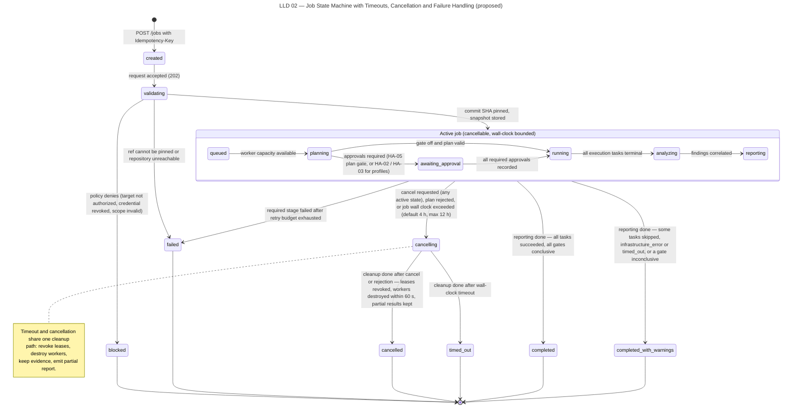
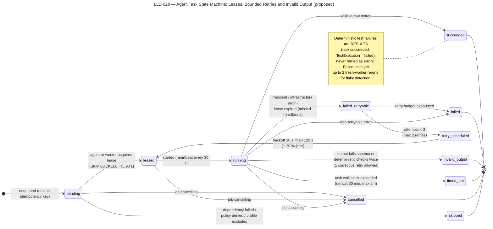

# Low-Level Design

> Autonomous QA Swarm · Documentation v0.1 (Concept) · Status: Proposed — nothing described here is implemented yet.

This document refines the [high-level design](02-high-level-design.md) into the internal mechanisms that make QA jobs reliable and auditable: the Workflow Engine queue and lease protocol, the job and task state machines, cancellation and timeout algorithms, the task contract and worker result schemas, the Policy Engine evaluation order, the Model Gateway request pipeline, the Evidence Store key layout and the error code catalogue. Everything here is **Proposed** and intended for the MVP (**Planned (MVP)**) unless marked **Future**; nothing is **Implemented / Verified**. Entity and column names follow the [data model](../07-data-model/01-data-model-and-erd.md).

## Workflow Engine internals

### Core tables

The Workflow Engine, part of the Orchestrator Agent (AG-01), keeps all workflow state in the Metadata DB so that state changes and queue operations commit in one transaction (AD-02).

| Table | Purpose | Key columns |
|---|---|---|
| `jobs` | One row per QA job | `id` (`job_`), `org_id`, `state`, `profile_hash`, `commit_sha`, `deadline_at`, `cancel_requested_at`, `version` |
| `tasks` | One row per DAG node | `id` (`tsk_`), `job_id`, `stage`, `task_type`, `state`, `depends_on`, `idempotency_key` (unique), `available_at`, `attempt_count`, `retry_class` |
| `task_attempts` | One row per execution attempt | `id`, `task_id`, `attempt_no`, `lease_owner`, `lease_expires_at`, `last_heartbeat_at`, `outcome`, `error_code` |

Every row carries `org_id` with row-level security (SEC-011). The `version` column on `jobs` supports optimistic concurrency and the `412` (stale ETag) response on the API.

### Enqueue

When the validated JobPlan is accepted, the Workflow Engine inserts one `tasks` row per DAG node in state `pending`. The idempotency key is SHA-256 over `job_id`, `stage`, `task_type` and the canonical input hash (canonical JSON with sorted keys of input references). The unique index on `idempotency_key` makes the insert `ON CONFLICT DO NOTHING`, so replaying a plan or a reproduction request never creates duplicate work. A task becomes eligible for leasing when all `depends_on` tasks are `succeeded` (or, for soft dependencies declared in the plan, in any terminal state) and `available_at <= now()`.

### Lease acquisition

Runners (agent runners in the control plane and Execution Service dispatchers in the execution plane) poll for work by task type. Leasing uses row locks that skip rows already locked by other runners, so many runners can poll concurrently without blocking each other.

```text
BEGIN
  SELECT id FROM tasks
   WHERE state IN ('pending', 'retry_scheduled')
     AND task_type = ANY(:runner_types)
     AND available_at <= now()
     AND dependencies_satisfied(id)
   ORDER BY priority DESC, available_at
   LIMIT :batch_size
   FOR UPDATE SKIP LOCKED
  for each selected task:
    attempt_no := attempt_count + 1
    INSERT task_attempts(task_id, attempt_no, lease_owner = :runner_id,
                         lease_expires_at = now() + 90 s, last_heartbeat_at = now())
    UPDATE tasks SET state = 'leased', attempt_count = attempt_no
    INSERT outbox_event('task.leased')
COMMIT
```

The `outbox_event` insert in the same transaction feeds the SSE stream and the Audit Log, so no event can be emitted for a state change that was rolled back.

### Heartbeat

A runner holding a lease sends a heartbeat every 30 s, which extends `lease_expires_at` to `now() + 90 s` only if `lease_owner` still matches. The first heartbeat after work starts moves the task from `leased` to `running`. If the heartbeat update affects zero rows, the runner has lost its lease and must stop work and discard any result; a late result from a lost lease is rejected with `E-QUEUE-002`.

### Reaper

A reaper loop runs every 30 s in the scheduler role:

1. Find attempts whose `lease_expires_at < now()` and whose task is `leased` or `running`; mark the attempt `lease_expired` and the task `failed_retryable` with `error_code = E-QUEUE-001`.
2. Find jobs past `deadline_at` that are not terminal and start the timeout algorithm.
3. Every 5 min, ask the Execution Service to list live workers and destroy any whose task is terminal or unknown (orphan reaping, NFR-008).

### Backoff with jitter

`failed_retryable` tasks are moved to `retry_scheduled` with `available_at` set by retry class:

```text
if retry_class == 'transient':          # infrastructure or transient errors
    if attempt_count > 2: -> failed (budget exhausted)
    base = [30, 120][attempt_count - 1] seconds
    available_at = now() + base * uniform(0.8, 1.2)
if retry_class == 'corrective':         # first invalid LLM output
    if corrective_used: -> invalid_output
    corrective_used = true
    available_at = now()                # re-prompt immediately with validation errors
```

Deterministic test failures are recorded as results inside a `succeeded` task and are never retried as errors. Flaky reruns (up to 2 fresh-worker reruns of a failed test) are separate child tasks of type `test_rerun`, not retries of the parent.

## Job state machine

Figure LLD 02 Job State Machine shows the job states and transitions defined below. States are lower_snake_case in the API and Title Case in the UI.



*Figure LLD 02 — Job State Machine with Timeouts, Cancellation and Failure Handling (proposed).*

### Main path transitions

| From | Event | To | Guard | Side effects |
|---|---|---|---|---|
| `created` | job admitted | `validating` | Idempotency and duplicate checks passed | Audit event; SSE `job.state_changed` |
| `validating` | validation passed | `queued` | Policy allow; snapshot stored with SHA-256 | Deadline set (default 4 h, max 12 h) |
| `validating` | policy denied | `blocked` | Unauthorized target, revoked credential or disallowed profile | No worker started; reason recorded |
| `validating` | intake error | `failed` | Unresolvable ref or fetch failure after retries | Error code recorded |
| `queued` | planner leased | `planning` | Planning capacity free | Planning tasks enqueued |
| `planning` | plan valid, approval required | `awaiting_approval` | Plan gate enabled (HA-05), or profiles need HA-02 or HA-03 not yet recorded | Notification to the approver role for each missing approval |
| `planning` | plan valid, no approval | `running` | DAG acyclic, within budget, policy allow | Stage 3 tasks become eligible |
| `planning` | plan invalid | `failed` | Plan still invalid after corrective retry | `E-PLAN-001` |
| `awaiting_approval` | all required approvals recorded | `running` | Each approver holds the role required by its HA ID | Approval rows; audit events |
| `awaiting_approval` | plan or a required approval rejected | `cancelling` → `cancelled` | Approver holds the required role | Pending tasks `cancelled` |
| `running` | testing stages done | `analyzing` | All stage 3 to 8 tasks terminal | Stage 9 tasks eligible |
| `analyzing` | triage done | `reporting` | All stage 9 tasks terminal | Stage 12 tasks eligible |
| `reporting` | report stored, no warnings | `completed` | No task `skipped`, `timed_out`, or `failed` with error class `infrastructure_error`; no gate inconclusive | Stage 13 cleanup; notification |
| `reporting` | report stored, warnings | `completed_with_warnings` | Any warning condition above | Stage 13 cleanup; notification |

### Failure, cancellation and timeout transitions

| From | Event | To | Guard | Side effects |
|---|---|---|---|---|
| `running`, `analyzing`, `reporting` | critical-path task `failed` | `failed` | Task marked critical in plan (e.g. build) | Dependent tasks `skipped`; cleanup |
| any non-terminal | cancel requested | `cancelling` | Caller authorized | `cancel_requested_at` set; cancellation algorithm starts |
| any non-terminal | deadline passed | `cancelling` | Reaper detected `deadline_at < now()` | Reason `timeout` recorded |
| `cancelling` | cleanup confirmed, reason user | `cancelled` | All tasks terminal; all workers destroyed | Partial report generated |
| `cancelling` | cleanup confirmed, reason timeout | `timed_out` | All tasks terminal; all workers destroyed | Partial report generated |

Patch Proposal (stage 10) and Independent Verification (stage 11) can continue after the job reaches `completed` or `completed_with_warnings`; their progress is tracked by Patch and VerificationRun statuses, and verification produces an addendum report rather than reopening the job.

## Task state machine

Figure LLD 02b Task State Machine shows task states, lease handling, retries and `invalid_output`.



*Figure LLD 02b — Agent Task State Machine: Leases, Bounded Retries and Invalid Output (proposed).*

| From | Event | To | Guard | Side effects |
|---|---|---|---|---|
| `pending` | leased | `leased` | Dependencies satisfied; `available_at` reached | TaskAttempt created; lease 90 s |
| `pending` | upstream failed or excluded | `skipped` | Hard dependency not `succeeded` | Reason recorded; counts toward warnings |
| `leased` | first heartbeat | `running` | Lease owner matches | SSE `task.running` |
| `leased`, `running` | lease expired | `failed_retryable` | No heartbeat for 90 s | `E-QUEUE-001`; worker destroyed |
| `running` | valid result | `succeeded` | Result passes schema and bounds checks | AgentOutput or WorkerRun stored; evidence linked |
| `running` | transient error | `failed_retryable` | Error class retryable | Worker destroyed |
| `running` | invalid LLM output, first time | `failed_retryable` | Corrective retry unused | Validation errors saved for re-prompt |
| `running` | invalid LLM output, second time | `invalid_output` | Corrective retry used | `E-MODEL-003`; raw output hash kept |
| `running` | task timeout | `timed_out` | Wall clock > task limit (default 30 min, max 2 h) | Worker killed and destroyed |
| `running` | non-retryable error | `failed` | Policy refusal, contract error or exhausted budget | Error code recorded |
| `failed_retryable` | budget remains | `retry_scheduled` | Transient ≤ 2 retries or corrective unused | `available_at` set with backoff |
| `failed_retryable` | budget exhausted | `failed` | Retry budget used | Final error code kept |
| `retry_scheduled` | leased | `leased` | `available_at` reached | New TaskAttempt |
| `pending`, `leased`, `running`, `retry_scheduled` | job cancelling | `cancelled` | Job in `cancelling` | Worker stop requested |

Terminal task states are `succeeded`, `failed`, `invalid_output`, `timed_out`, `cancelled` and `skipped`.

**Error class.** Every failed attempt also records an error class: `infrastructure_error` (sandbox, image, worker, network, storage or model-provider failure that is not caused by the code under test), `policy_denied`, `contract_error` or `tool_error`. `infrastructure_error` is therefore not a task state: a task whose retries are exhausted for an infrastructure cause ends in state `failed` with error class `infrastructure_error`. Throughout this documentation, "a task ended `infrastructure_error`" is shorthand for exactly that combination. For test executions, by contrast, `infrastructure_error` is one of the six result statuses.

## Cancellation and timeout algorithms

### Cancellation

1. `POST /jobs/{job_id}/cancel` sets `cancel_requested_at` and moves the job to `cancelling` in one transaction; repeated calls return `202` with the current state.
2. All `pending` and `retry_scheduled` tasks move to `cancelled` immediately.
3. For `leased` and `running` tasks the Execution Service receives a stop request. It sends SIGTERM to the worker process tree, waits up to 10 s, then force-kills and destroys the sandbox.
4. Runners see `cancel_requested_at` on their next heartbeat and abandon agent work; the task becomes `cancelled`.
5. When every task is terminal and the Execution Service confirms no live worker for the job, the job moves to `cancelled` and a partial report is produced from evidence already collected.
6. If confirmation is missing after 60 s, the orphan reaper destroys remaining workers and the event is logged as an infrastructure alert (NFR-008).

### Timeouts

- **Task timeout:** enforced twice, by the worker runtime (hard wall clock in the sandbox) and by the Execution Service (deadline on the attempt). Either firing moves the task to `timed_out`. Timeouts are not retried by default because a repeat is likely to time out again; an operator may mark specific task types as timeout-retryable.
- **Job timeout:** the reaper detects `deadline_at < now()` and runs the cancellation algorithm with reason `timeout`, ending in `timed_out`.
- **Approval wait:** time in `awaiting_approval` counts toward the job deadline, so an unanswered plan approval ends the job `timed_out` rather than holding resources indefinitely.

## Task contract schema

A task contract is the only form in which work reaches the Execution Service. Agents propose contracts; the Workflow Engine completes the deterministic fields; the Policy Engine validates them. The example below is illustrative (sample job QJ-1042).

```json
{
  "schema_version": "1.0",
  "task_id": "tsk_01JB7Q3M2X8V4R6T9W1Y5Z0A2C",
  "job_id": "job_01JB7PZK4N6D8F0H2J4L6M8P0R",
  "org_id": "org_01JB0000000000000000000000",
  "stage": "functional_api_testing",
  "task_type": "api_schema_test",
  "runner": { "tool": "schemathesis", "adapter_version": "1.2.0", "image_digest": "sha256:4f1c0e9a" },
  "inputs": {
    "source_snapshot": "evidence/org_01JB0000000000000000000000/9a/9a3f...e1",
    "openapi_spec": "evidence/org_01JB0000000000000000000000/c2/c27b...4d",
    "target_ref": "ephemeral:payments-api"
  },
  "resource_budget": { "vcpu": 2, "memory_mib": 4096, "pids": 512, "disk_gib": 10, "output_mib": 50 },
  "network_policy": { "dependency_fetch": "proxy_allowlist", "execution": "target_only", "target_ref": "ephemeral:payments-api" },
  "timeout_seconds": 1800,
  "idempotency_key": "sha256:5e8d1b7c",
  "proposed_by": { "agent": "AG-04", "prompt_template": "api-testing/plan@3", "agent_output_id": "aout_01JB7Q2" }
}
```

Hashes are shortened in this example for readability. In `network_policy.execution`, the value `none` is the default; `target_only` allows traffic solely to the bound target inside the sandbox network and is accepted only for task types that need a target.

## Worker result schema

Workers return a bounded, schema-validated result; anything outside the bounds is truncated or rejected, and raw output is stored only as evidence objects.

```json
{
  "schema_version": "1.0",
  "task_id": "tsk_01JB7Q3M2X8V4R6T9W1Y5Z0A2C",
  "attempt_no": 1,
  "worker_run_id": "wrk_01JB7Q4A",
  "exit": { "code": 0, "signal": null, "duration_ms": 412377 },
  "tool": { "name": "schemathesis", "version": "3.x", "image_digest": "sha256:4f1c0e9a" },
  "summary": { "executed": 214, "passed": 209, "failed": 5, "skipped": 0, "errors": 0 },
  "results_ref": "evidence/org_01JB0000000000000000000000/7d/7d02...aa",
  "evidence_refs": ["evidence/org_01JB0000000000000000000000/e4/e4b9...10"],
  "truncated": false,
  "redactions_applied": 2,
  "resource_usage": { "cpu_seconds": 611, "max_rss_mib": 1380, "output_bytes": 8388608 }
}
```

Validation bounds proposed for the MVP: `summary` counters are non-negative integers whose sum equals `executed`; at most 1,000 `evidence_refs` per result; all string fields at most 4 KiB; `output_bytes` at most 50 MiB; every reference must resolve to an object in the job's org prefix. A result that fails validation sets the task to `failed` with `E-EXEC-004`.

## Policy Engine evaluation order

Each proposal or contract is evaluated by OPA/Rego policies in a fixed order; the first denial stops evaluation and returns all reasons collected so far. Default is deny (AD-04).

1. **Schema:** the contract validates against its JSON Schema version.
2. **Identity and scope:** `org_id`, `job_id` and project match; the proposing agent is allowed this `task_type` (per-agent tool permissions, SEC-010).
3. **Source integrity:** input references point to the job's pinned SourceSnapshot and existing evidence objects.
4. **Target authorization:** the target is ephemeral, or a registered TargetEnvironment with a valid, unexpired TargetAuthorization (HA-01).
5. **Activity approvals:** DAST requires HA-02 (and HA-05 for Deep); performance above Smoke or against an external target requires HA-03; Stress, Spike and Soak also require HA-05.
6. **Resource budget:** requested resources are within worker defaults or approved overrides, and within the job's remaining compute and token budget (NFR-015).
7. **Network rules:** execution network is `none` or `target_only`; dependency fetch uses only allow-listed registries (HA-04 for additions); metadata and private ranges are never allowed.
8. **Safety limits:** workload caps, durations and abort rules match the profile; mutation is limited to changed modules and 500 mutants.

Every decision, allow or deny, is written to the Audit Log with the policy bundle version and input hash.

## Model Gateway request pipeline

All LLM calls from agents pass through these steps in order (AD-07):

1. **Template:** the agent names a versioned prompt template (for example `api-testing/plan@3`) and supplies typed variables. Repository content is placed in clearly delimited data sections and marked as untrusted (SEC-014).
2. **Redaction:** secret detectors and the Secrets Broker's list of known credential fingerprints scrub the rendered prompt (SEC-008). Redaction counts are recorded.
3. **Budget check:** estimated tokens are checked against the job's remaining token budget and the provider rate limit; over-budget requests fail with `E-MODEL-002` without calling the provider.
4. **Provider call:** the request is routed to the configured hosted or local provider on the allow-list (SEC-021), with timeout and transient retry.
5. **Schema validation:** the response is parsed and validated against the template's output JSON Schema (SEC-015).
6. **Corrective retry:** on a first validation failure the gateway re-prompts once with the validation errors; a second failure returns `E-MODEL-003` and the task becomes `invalid_output`.
7. **Provenance record:** the gateway stores an AgentOutput with template version, provider, model identifier, prompt hash, response hash, token counts, redaction count and validation outcome. Prompt and response bodies are stored only if the operator enables it, and then as redacted evidence objects.

## Evidence Store key layout

Evidence objects are content-addressed and immutable (AD-05). The proposed key layout is:

```text
evidence/{org_id}/{sha256[0:2]}/{sha256}
```

- `{sha256}` is the hex SHA-256 of the object bytes; the two-character prefix spreads keys across partitions.
- Metadata (media type, size, producer task, tool version, redaction status, retention class) lives in the `evidence_items` table, not in the object key, so one object can be referenced by many EvidenceItem and FindingEvidence rows.
- Writes are idempotent: an existing key is not rewritten. Reads recompute the hash on download for integrity spot checks.
- Retention is applied per EvidenceItem; an object is deleted only when no unexpired EvidenceItem references it (default 90 days, NFR-016). Objects linked to an accepted-risk or released-job decision follow the audit retention class.
- Downloads are served through signed URLs valid for a short period (proposed 5 min) after an authorization check (SEC-019).

## Error code catalogue

Error codes use the form `E-<AREA>-nnn`. They appear in task attempts, problem+json `type` extensions and audit events.

| Code | Meaning | Typical handling |
|---|---|---|
| E-INTAKE-001 | Repository URL rejected (non-HTTPS, private address, not on allow-list) | `422`; no retry |
| E-INTAKE-002 | Ref could not be resolved to a commit SHA | Job `failed` |
| E-INTAKE-003 | Snapshot fetch failed or checksum mismatch | Transient retry, then `failed` |
| E-INTAKE-004 | Credential reference revoked or expired | Job `blocked` |
| E-POLICY-001 | Contract failed schema validation | Task `failed` |
| E-POLICY-002 | Agent not permitted this task type | Task `failed`; audit alert |
| E-POLICY-003 | Target not authorized or authorization expired | Job `blocked` |
| E-POLICY-004 | Required human approval missing | Task waits or job `blocked` |
| E-POLICY-005 | Resource or network request outside allowed limits | Task `failed` |
| E-PLAN-001 | Job plan invalid after corrective retry (cycle, unknown task type, over budget) | Job `failed` |
| E-QUEUE-001 | Lease expired without heartbeat | `failed_retryable` |
| E-QUEUE-002 | Result submitted by a runner that lost its lease | Result discarded |
| E-QUEUE-003 | Duplicate idempotency key; task not enqueued | Existing task reused |
| E-EXEC-001 | Sandbox image pull or start failure | `infrastructure_error`; transient retry |
| E-EXEC-002 | Build failed in sandbox | Critical-path task `failed` |
| E-EXEC-003 | Dependency fetch blocked or failed through proxy | Transient retry, then `failed` |
| E-EXEC-004 | Worker result failed schema or bounds validation | Task `failed` |
| E-EXEC-005 | Ephemeral target failed health check | Transient retry, then dependent tasks `skipped` |
| E-EXEC-006 | Performance run aborted by safety rule | Run marked aborted; result kept |
| E-MODEL-001 | Provider unavailable or rate limited | Transient retry with backoff |
| E-MODEL-002 | Token budget exhausted | Task `failed`; job warning |
| E-MODEL-003 | Output invalid after corrective retry | Task `invalid_output` |
| E-EVID-001 | Evidence write failed or hash mismatch | Transient retry, then `failed` |
| E-API-001 | Job state conflict or active duplicate job | `409` with link |
| E-API-002 | Stale ETag on update | `412` |

The [API contracts](../08-api-specifications/01-api-contracts.md) map these codes to HTTP status codes, and [orchestration and recovery](../06-agent-design/02-orchestration-and-recovery.md) describes how agents react to them.
