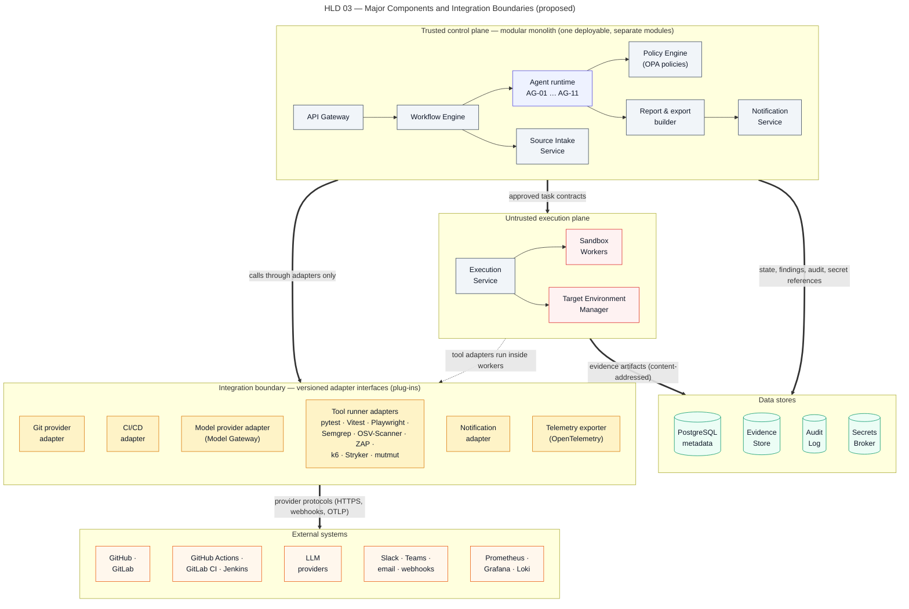

# Component Architecture

> Autonomous QA Swarm · Documentation v0.1 (Concept) · Status: Proposed — nothing described here is implemented yet.

This document catalogues the proposed components of Autonomous QA Swarm, their responsibilities, interfaces, dependencies, trust zones and scaling behavior. It also proposes a module structure for the future codebase, the interface contracts between components, the plugin and adapter model for tools, Git providers and model providers, and how agent prompts and adapters are versioned. It complements the [high-level design](02-high-level-design.md) and the [low-level design](03-low-level-design.md). All content is **Proposed**; MVP items are **Planned (MVP)** and later items **Future**. No component is **Implemented / Verified**; that label will be applied only after code exists and acceptance tests pass.

## Trust zones

Components are assigned to trust zones that match the [security architecture](../10-security-and-threat-model/01-security-architecture-and-threat-model.md):

- **Edge:** the API Gateway and Web UI assets, exposed to authenticated users and CI.
- **Trusted control plane:** deterministic services that hold state and make decisions.
- **Semi-trusted model egress:** the Model Gateway, the only component that sends data to LLM providers.
- **Credential zone:** the Secrets Broker and its backend.
- **Untrusted execution plane:** Execution Service hosts, Sandbox Workers, ephemeral targets and the egress proxy.
- **Data zone:** Metadata DB, Evidence Store and Audit Log.

Agents run as code inside the trusted control plane but their outputs are treated as untrusted proposals until validated.

Figure HLD 03 Components and Integration Boundaries shows the components grouped by trust zone and the adapters to Git, CI, LLM, notification and observability systems.

*Figure HLD 03 — Major Components and Integration Boundaries (proposed).*

## Component catalogue

### Experience and control services

| Component | Responsibility | Interfaces | Depends on | Trust zone | Scaling |
|---|---|---|---|---|---|
| Web UI | React SPA for SCR-01 to SCR-15 | Consumes REST `/api/v1` and SSE | API Gateway, identity provider | Edge | Static assets; CDN or gateway |
| API Gateway | AuthN (OIDC), RBAC, rate limits, idempotency, problem+json, SSE | REST `/api/v1`; SSE `/jobs/{job_id}/events` | Metadata DB, Workflow Engine, Policy Engine | Edge | Stateless replicas |
| Workflow Engine (AG-01) | Job/task state machines, queue, leases, retries, timeouts, cancellation | Internal service API; queue tables | Metadata DB, Policy Engine | Trusted control plane | Scheduler role; one active reaper via advisory lock |
| Policy Engine | Deny-by-default validation of proposals and contracts | Internal decision API (input document, decision with reasons) | OPA with versioned policy bundles | Trusted control plane | Stateless; sidecar or service |
| Source Intake Service | SSRF-safe validation, ref resolution, pinning, snapshot creation | Queue tasks `intake_*`; Git adapter SPI | Secrets Broker, Git adapters, Evidence Store | Trusted control plane | Runner role; network-bound |
| Model Gateway | Templating, redaction, budgets, provider routing, schema validation, provenance | Internal completion API | Model provider adapters, Metadata DB, Evidence Store | Semi-trusted model egress | Stateless; limited by provider rate limits |
| Secrets Broker | Credential custody; short-lived scoped tokens | Internal token-issue API (mTLS proposed) | OpenBao or Vault | Credential zone | Small; high availability via backend |
| Notification Service | Webhooks, email, Slack, Teams | Consumes outbox events; notification adapter SPI | Metadata DB, notification adapters | Trusted control plane | Runner role; retry with backoff |

### Execution and data services

| Component | Responsibility | Interfaces | Depends on | Trust zone | Scaling |
|---|---|---|---|---|---|
| Execution Service | Runs approved contracts in workers; enforces limits; validates results; destroys workers | Leases `exec_*` tasks; worker runtime API; result submission | Policy Engine decision, Evidence Store, worker runtime | Untrusted execution plane (host side hardened) | One per worker host or node pool |
| Sandbox Workers | Execute builds, tests, scanners, mutants, load generators | Task contract in; bounded result out | Tool adapters baked into pinned images | Untrusted execution plane | Horizontal; disposable per task |
| Target Environment Manager | Starts ephemeral targets; binds authorized external targets | Queue tasks `target_*`; target handle in contracts | Secrets Broker (test-user credentials), worker runtime | Untrusted execution plane (control side trusted) | Per job; bounded by worker slots |
| Egress proxy | Allow-listed registry access in dependency-fetch phase | HTTP(S) proxy | Allow-list configuration (HA-04) | Untrusted execution plane boundary | Stateless replicas |
| Metadata DB | All entities, queue, outbox; row-level security | SQL | Storage, backups | Data zone | Vertical; read replica later |
| Evidence Store | Content-addressed immutable evidence | S3 API; signed URLs | Object storage backend | Data zone | Horizontal by backend |
| Audit Log | Append-only, hash-chained AuditEvent records | Append API; read via `GET /audit-events` | Metadata DB (separate schema, insert-only grants) | Data zone | Grows linearly; partitioned by month |
| Observability Stack | Traces, metrics, logs with correlation IDs | OTLP, Prometheus scrape | Operator backends | Trusted operator infrastructure | Operator-managed |

### Agents as a group

| Component | Responsibility | Interfaces | Depends on | Trust zone | Scaling |
|---|---|---|---|---|---|
| Agents AG-02 to AG-11 and the AG-01 planner | Analyze inputs and emit typed proposals, analyses and narratives | Lease agent tasks; read bounded inputs; write AgentOutput; propose task contracts | Model Gateway, Workflow Engine, Evidence Store (read via references) | Trusted control plane process, untrusted output | Agent runner role; concurrency per agent type |

Each agent has a declared permission set listing the task types it may propose and the input types it may read. The [agent catalogue](../06-agent-design/01-agent-catalogue.md) gives per-agent inputs, outputs and permissions. Agents have no network client other than the Model Gateway API, no Secrets Broker client and no repository write path.

## Proposed module structure

The future codebase is proposed as a single repository with one Python package for the control plane, a separate package for the Execution Service host agent, and a frontend application. The table lists modules and their purpose; it is a plan, not existing code.

### Control-plane modules

| Module | Purpose |
|---|---|
| `qaswarm.api` | FastAPI routers for `/api/v1`, authentication, RBAC, idempotency, SSE, problem+json |
| `qaswarm.domain` | Pydantic models for all entities and state enums; no I/O |
| `qaswarm.contracts` | JSON Schemas for task contracts, worker results, agent outputs; schema version registry |
| `qaswarm.workflow` | State machines, enqueue, leasing, heartbeat, reaper, backoff, cancellation |
| `qaswarm.planning` | AG-01 planner and deterministic DAG validator |
| `qaswarm.agents` | One sub-module per agent AG-02 to AG-11 with prompt template references and output handlers |
| `qaswarm.policy` | OPA client, policy input builders, decision recording |
| `qaswarm.intake` | URL validation, DNS pinning, ref resolution, snapshot creation |
| `qaswarm.modelgw` | Model Gateway pipeline and provider adapter interface |
| `qaswarm.secrets` | Secrets Broker client and token scoping |
| `qaswarm.evidence` | Evidence Store client, content addressing, retention jobs, signed URLs |
| `qaswarm.analysis` | Fingerprinting, deduplication, DCS calculation, Risk Priority, conflict precedence |
| `qaswarm.gates` | Quality-gate evaluation QG-01 to QG-08 and verdict logic |
| `qaswarm.reporting` | Report assembly, JSON/HTML/PDF rendering, SARIF and JUnit exports |
| `qaswarm.notify` | Notification Service and channel adapters |
| `qaswarm.audit` | Audit event construction and hash chaining |
| `qaswarm.adapters` | Adapter SPIs and built-in adapters for Git providers and CI systems |
| `qaswarm.telemetry` | OpenTelemetry setup and correlation ID propagation |

### Execution-plane and other modules

| Module | Purpose |
|---|---|
| `qaswarm_exec.host` | Execution Service host agent: leasing `exec_*` tasks, sandbox lifecycle, limit enforcement |
| `qaswarm_exec.runtime` | Worker runtime drivers: rootless Docker/Podman with gVisor (MVP), Firecracker or Kata (Future) |
| `qaswarm_exec.tools` | Tool adapters for runners, scanners, load generators and mutation tools |
| `qaswarm_exec.targets` | Target Environment Manager drivers for ephemeral and registered targets |
| `qaswarm_exec.results` | Bounded output collection, redaction, result validation, evidence upload |
| `policies/` | Rego policy bundles with unit tests, versioned and signed |
| `prompts/` | Versioned prompt templates and their output schemas |
| `images/` | Worker image definitions pinned by digest with SBOMs (SEC-006) |
| `web/` | React + TypeScript + Vite frontend |
| `deploy/` | Docker Compose reference and Kubernetes manifests or Helm chart |

Dependency rules are proposed to be enforced by import-linting in CI: `qaswarm.domain` and `qaswarm.contracts` import nothing else; `qaswarm.agents` may not import `qaswarm.secrets`, `qaswarm.intake` or any execution-plane package; `qaswarm_exec` packages may import only `qaswarm.contracts`.

## Interface contracts between components

### Synchronous interfaces

| Caller | Callee | Style | Purpose |
|---|---|---|---|
| Web UI, CI | API Gateway | REST over HTTPS, OIDC bearer | Commands and queries on `/api/v1` |
| Web UI | API Gateway | SSE | Job and task events with `Last-Event-ID` resume |
| API Gateway | Workflow Engine | In-process call | Create job, cancel, approve plan, record decisions |
| Workflow Engine, API Gateway | Policy Engine | In-process client to OPA (HTTP to sidecar or embedded) | Allow or deny with reasons |
| Agents | Model Gateway | In-process call (extractable to internal HTTP) | Template-based completion with schema-validated output |
| Source Intake, Target Environment Manager | Secrets Broker | Internal HTTPS, mTLS proposed | Short-lived scoped token issue |
| Execution Service | Control-plane result endpoint | Internal HTTPS, mTLS, per-host identity | Submit bounded worker results and heartbeats |
| Components | Evidence Store | S3 API | Content-addressed put and get |

The Execution Service never connects to the Metadata DB directly. It leases and reports through a narrow internal endpoint exposed by the control plane, which keeps database credentials out of the execution plane.

### Asynchronous interfaces

- **Task queue:** every unit of work, including agent tasks, intake, execution and notification delivery, is a `tasks` row leased by the appropriate runner role. This gives retries, timeouts and idempotency uniformly.
- **Outbox events:** state changes write outbox rows in the same transaction. Consumers are the SSE broadcaster, the Audit Log writer, the Notification Service and CI webhook callbacks. Delivery is at-least-once; consumers deduplicate by event ID.
- **Event naming:** events use `entity.action` form, for example `job.state_changed`, `task.leased`, `finding.confirmed`, `patch.review_requested`, `gate.evaluated`. The full list is defined with the [API contracts](../08-api-specifications/01-api-contracts.md).

### Contract rules

- All payloads crossing a component boundary are defined in `qaswarm.contracts` with a `schema_version`.
- Producers may add optional fields within a minor version; removing or changing fields requires a major version, and consumers accept the current and previous major version during a migration window.
- Every message carries `org_id`, `job_id` where applicable, and a correlation ID for tracing (NFR-014).

## Plugin and adapter model

Extensibility is proposed through versioned adapter interfaces (NFR-017). Each adapter declares a manifest with name, version, interface version, capabilities and required permissions; the platform loads only adapters listed in configuration, and in the MVP only adapters shipped with the platform. A public plugin SDK is **Future** (Phase 5).

### Tool adapters

Tool adapters run inside worker images and translate a task contract into a tool invocation and the tool's output into the common result schema.

| Adapter category | MVP examples | Output normalization |
|---|---|---|
| Test runners | pytest, Jest/Vitest, Playwright | JUnit XML parsed into TestExecution records |
| API testing | Schemathesis with Hypothesis | Per-operation results and failing request/response evidence |
| Security scanners | Semgrep CE, Bandit, Gitleaks, OSV-Scanner, Trivy, Checkov | SARIF parsed into candidate findings |
| Load generators | k6 (separate process), Locust | Metrics time series into PerformanceRun and PerformanceMetric |
| Mutation tools | mutmut, Stryker | Per-mutant outcome into MutantResult |

An adapter declares the task types it serves, its network needs (none, or `target_only`), its default resource budget and whether its results are deterministic. The Policy Engine uses these declarations, so an adapter cannot obtain more privilege than its manifest grants and policy allows. OWASP ZAP for DAST and PIT for Java are **Future** adapters.

### Git provider adapters

Git adapters (GitHub and GitLab in the MVP) implement a small interface: validate repository, list refs, resolve a ref to a commit SHA, fetch an archive for a SHA, and fetch a diff between two SHAs. They receive a short-lived token from the Secrets Broker per call and never persist it. Pull-request creation is not part of the MVP interface; it will be added as a separate capability gated by HA-12 (**Future**).

### CI adapters

CI adapters for Jenkins and GitHub Actions map pipeline events to `POST /jobs` calls by the CI Service Account and return status, JUnit XML, SARIF and the verdict. The detailed integration flows are in [integrations](06-integrations.md).

### Model provider adapters

Model adapters implement: list models, complete with structured output, count or estimate tokens, and report rate-limit state. Hosted commercial APIs and local runtimes (Ollama, vLLM) are both adapters behind the same interface. Each adapter declares data-handling attributes (such as whether the provider is configured not to train on submitted data where contractually available) that the Policy Engine checks against the project's allow-list (SEC-021).

### Notification adapters

Webhook, email, Slack and Teams adapters receive rendered event summaries with links. They never receive secrets, raw evidence or full prompts.

## Versioning of agent prompts and tool adapters

### Prompt templates

- Each prompt template is identified as `<agent-area>/<name>@<major>`, for example `api-testing/plan@3`, with a content hash for the exact revision.
- A template is stored with its output JSON Schema, its expected input variables and a small evaluation set of illustrative inputs and expected structural outputs.
- Changing wording within a major version is allowed only if the output schema is unchanged and the evaluation set still passes; changing the output schema requires a new major version.
- Every AgentOutput records template ID, content hash, provider and model identifier, so any finding or report narrative can be traced to the exact prompt revision (NFR-009).
- A job pins template versions when its plan is accepted; templates do not change mid-job, which supports reproducibility (NFR-007).

### Tool adapters and worker images

- Tool adapters follow semantic versioning and declare the adapter interface version they implement.
- Worker images are referenced by digest, signed and tracked with an SBOM (SEC-006); the image digest and tool version are recorded on every WorkerRun.
- Upgrading a tool version is treated as a change that may alter results; the release notes of the platform will list tool versions, and baseline comparisons (for example performance or flaky history) flag runs made with different tool versions.

### Policy bundles

- Rego bundles are versioned and signed; each Policy Engine decision records the bundle version.
- Policy changes go through the same review process as code, with unit tests for allow and deny cases of each rule.

These mechanisms are proposed so that agent behavior can change without silently changing what the platform reports. They do not guarantee identical LLM output across runs; the documented nondeterminism of LLM stages is contained by schema validation, deterministic oracles and the rule that LLM opinion alone can never confirm a finding.
