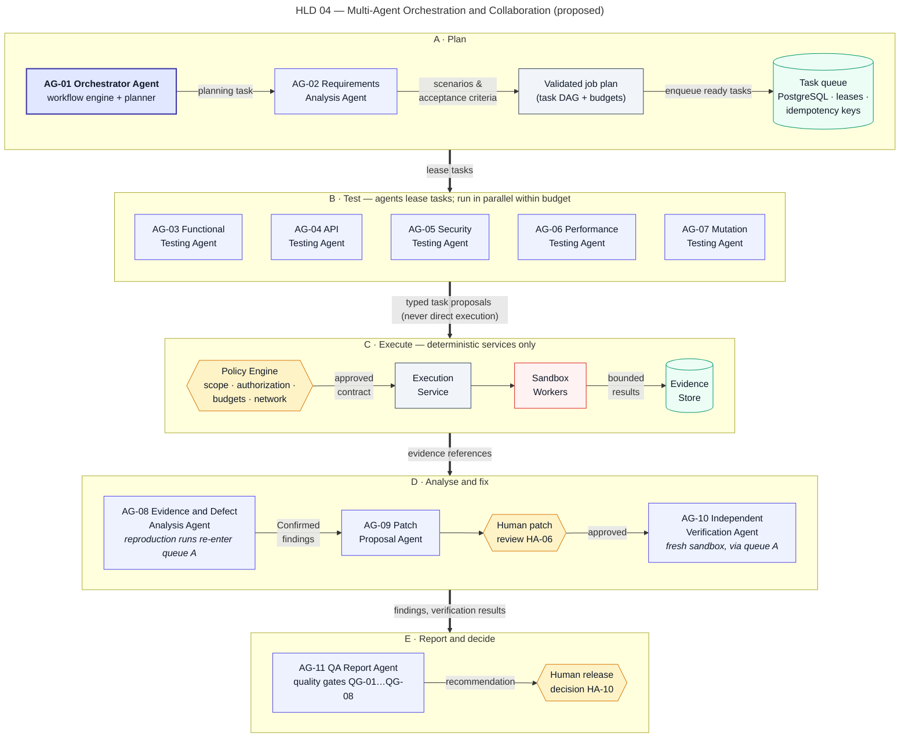
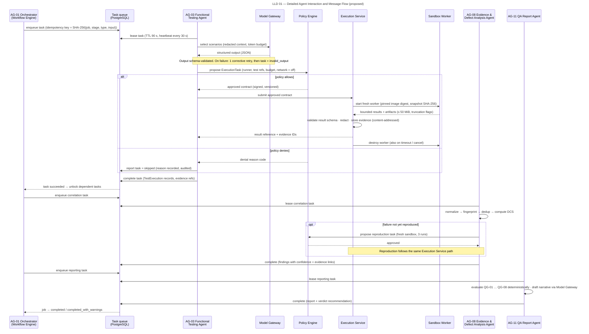

# Orchestration and Recovery

> Autonomous QA Swarm · Documentation v0.1 (Concept) · Status: Proposed — nothing described here is implemented yet.

This document describes how the proposed Orchestrator Agent (AG-01) and its deterministic Workflow Engine will coordinate the other ten agents: how messages are exchanged, how the job plan is built and validated, how work is leased without duplication, how agents hand off, and how the platform is intended to recover from timeouts, invalid outputs, conflicts, restarts and LLM outages. Agent responsibilities and permissions are in the [Agent catalogue](01-agent-catalogue.md); state machine definitions are in the [Low-level design](../05-architecture/03-low-level-design.md). All mechanisms are **Proposed** and planned for Phase 1–2 of the MVP unless stated otherwise.

## Communication model

Agents never call each other directly. All coordination flows through a **task queue stored in PostgreSQL** (the Metadata DB), using `SELECT … FOR UPDATE SKIP LOCKED` so that multiple agent runtimes can poll safely. Temporal is a **Future** option if the PostgreSQL-backed state machine proves insufficient. Every unit of agent work is a Task row; every attempt is a TaskAttempt row; every agent response is an AgentOutput row. A message is therefore a durable database record, not an in-memory call, which makes the system restartable and auditable.

Figure HLD 04 Multi Agent Orchestration shows the Orchestrator dispatching AG-02 to AG-11 through the task queue. Agent proposals go to the Policy Engine; approved contracts go to the Execution Service; results flow to the Evidence and Defect Analysis Agent and then to the QA Report Agent.



*Figure HLD 04 — Multi-Agent Orchestration and Collaboration (proposed).*

### Agent task message

The Workflow Engine writes a typed envelope when it leases a task to an agent runtime. Inputs are references to stored objects (content-addressed by SHA-256), never raw secrets. The example below is illustrative and uses sample data from QJ-1042.

```json
{
  "schema": "aqs.agent_task/v1",
  "message_id": "msg_01JB7Y3K2Q9M4T6V8X0Z1A2B3C",
  "correlation_id": "job_01JB7XZ5Q0ABCDEF/tsk_01JB7Y2R",
  "job_id": "job_01JB7XZ5Q0ABCDEF",
  "task_id": "tsk_01JB7Y2RWS8N1P4Q",
  "attempt": 1,
  "agent_id": "AG-03",
  "stage": "functional_and_api_testing",
  "task_type": "functional.select_and_propose",
  "idempotency_key": "sha256:4f1c…9a7e",
  "lease": { "expires_at": "2026-10-24T09:14:30Z", "ttl_s": 90, "heartbeat_s": 30 },
  "deadline": "2026-10-24T09:43:00Z",
  "policy_version": "pol_2026-10-20.3",
  "inputs": {
    "source_snapshot": { "ref": "sha256:7c9e2a1f4b…", "commit": "7c9e2a1f4b" },
    "scenarios": { "ref": "sha256:2b8d…", "count": 42 },
    "test_inventory": { "ref": "sha256:91aa…", "count": 1286 }
  },
  "budget": { "max_tokens": 60000, "max_proposed_tasks": 20, "max_worker_minutes": 120 },
  "output_schema": "aqs.functional_proposal/v1",
  "untrusted_content_notice": true
}
```

### Agent output envelope

The agent runtime returns an output envelope. The Model Gateway validates `payload` against `output_schema` before the Workflow Engine accepts it, and provenance fields allow any later reader to trace which template, model route and inputs produced it.

```json
{
  "schema": "aqs.agent_output/v1",
  "message_id": "msg_01JB7Y4M8F2H5K7N9Q1S3U5W7Y",
  "in_reply_to": "msg_01JB7Y3K2Q9M4T6V8X0Z1A2B3C",
  "task_id": "tsk_01JB7Y2RWS8N1P4Q",
  "attempt": 1,
  "agent_id": "AG-03",
  "idempotency_key": "sha256:4f1c…9a7e",
  "status": "proposal",
  "provenance": {
    "prompt_template": "functional_select@1.4.0",
    "model_route": "local/open-weight-default",
    "prompt_hash": "sha256:ab12…",
    "response_hash": "sha256:cd34…",
    "input_refs": ["sha256:7c9e2a1f4b…", "sha256:2b8d…", "sha256:91aa…"],
    "tokens": { "input": 41200, "output": 3100 }
  },
  "payload": {
    "execution_proposals": [
      { "runner": "pytest", "image_digest": "sha256:e3f0…", "test_ids": ["tests/api/test_statements.py::test_owner_only"], "limits": { "cpu": 2, "mem_gib": 4, "wall_min": 30 } }
    ],
    "generated_tests": [],
    "rationale": "Selected tests covering changed module app/routers/statements.py."
  }
}
```

### Message flow for one task

Figure LLD 01 Agent Message Flow shows a single functional task end to end: the Orchestrator leases the task to the Functional Testing Agent; the agent's proposal is schema-validated by the Model Gateway and evaluated by the Policy Engine; the Execution Service runs the approved contract in a Sandbox Worker; bounded output is validated and stored in the Evidence Store; the Evidence Agent correlates signals; the Report Agent aggregates.



*Figure LLD 01 — Detailed Agent Interaction and Message Flow (proposed).*

1. Workflow Engine leases the task and writes the agent task message.
2. Agent runtime builds a prompt from the template, with repository content delimited as untrusted data, and calls the Model Gateway.
3. Model Gateway redacts secrets, enforces the token budget, validates the response schema and stores hashes.
4. Policy Engine evaluates every proposal against the task contract: allowed runner, pinned image digest, limits, target authorization, network rules. Deny-by-default.
5. Execution Service creates a fresh worker, runs the approved contract, enforces limits, collects up to 50 MiB of output and destroys the worker.
6. Results are parsed deterministically into TestExecution rows and EvidenceItem objects.
7. A signal task is enqueued for the Evidence Agent; the original task becomes `succeeded`.

## Job plan DAG construction and validation

Planning happens in the `planning` job state. The Orchestrator combines:

- the **template plan** for the selected profiles (a deterministic, versioned DAG that always works without an LLM);
- the Requirements Analysis Agent's scenarios and impact map;
- the LLM-assisted planner's proposed selection and ordering within the fixed task-type catalogue.

The resulting JobPlan is validated deterministically before it is persisted:

| Check | Rule | On failure |
|---|---|---|
| Schema | JobPlan schema version matches | Reject proposal, use template |
| Acyclicity | Topological sort succeeds | Reject proposal, use template |
| Catalogue | Every task type is in the catalogue for the profile | Remove task, record warning |
| Dependencies | Every edge refers to an existing node; required stage order preserved | Reject proposal |
| Budgets | Sum of worker minutes and tokens ≤ job budget | Trim lowest-priority tasks, record warning |
| Policy | Each task contract passes Policy Engine evaluation | Remove task or block job |
| Approvals | Tasks needing HA-02, HA-03 or HA-05 marked as gated | Job enters `awaiting_approval` |

Stage order is fixed by the 13-stage pipeline (see Figure HLD 05 QA Job Lifecycle in the [High-level design](../05-architecture/02-high-level-design.md)). Stages 5 to 8 may run in parallel; stage 9 depends on all completed producing tasks; stages 10 and 11 may happen after the main report. Once approved (or once planning completes without a gate), the plan is frozen: later stages may add only reproduction and verification tasks, which are a bounded, pre-declared task type.

## Task assignment, leases and idempotency

### Leasing

Agent runtimes and the Execution Service poll for `pending` or `retry_scheduled` tasks whose dependencies are `succeeded` (or tolerably `skipped`). A lease is taken atomically with `FOR UPDATE SKIP LOCKED`, moving the task to `leased` with a **90 s TTL**. The holder sends a heartbeat every **30 s**, which extends the lease; the task moves to `running` on first heartbeat. If the lease expires, a sweeper moves the task to `failed_retryable`. A lease token (attempt number plus random nonce) must accompany every write, so a holder whose lease expired cannot overwrite results from a newer attempt.

### Idempotency

Each task has `idempotency_key = SHA-256(job_id, stage, task_type, canonical input hash)`. The key has a unique constraint in the tasks table, so a task with an existing key is never enqueued again. This prevents duplicate work when the planner proposes the same task twice, when a reproduction is requested by two correlation passes, or when the Orchestrator resumes after a restart and replays planning steps. Writes of results are also keyed: a second result for the same key and attempt is discarded and logged.

At job level, `POST /jobs` requires an `Idempotency-Key` header (24 h window), and an active job with the same repository, commit SHA and profile hash returns `409` unless a QA Lead sets `force_new=true`.

## Handoffs between agents

Handoffs are data handoffs through stored records, not conversations:

| From | To | Handoff record | Trigger |
|---|---|---|---|
| AG-02 Requirements Analysis | AG-01 Orchestrator | TestScenario, Requirement, impact map | Planning task `succeeded` |
| AG-03..AG-07 testing agents | AG-08 Evidence Agent | Raw signals, TestExecution, EvidenceItem refs | Producing task `succeeded` |
| AG-08 Evidence Agent | Execution Service | Reproduction task contract | Candidate needs reproduction |
| AG-08 Evidence Agent | AG-09 Patch Proposal Agent | Confirmed Finding | Finding reaches `confirmed` |
| AG-09 Patch Proposal Agent | Human reviewer | Patch in `awaiting_review` | Patch validated |
| Human reviewer | AG-10 Verification Agent | Patch diff only (HA-06 recorded) | Patch `approved_for_verification` |
| All | AG-11 Report Agent | Aggregates and gate inputs | Stage 12 start or addendum |

Context passed in a handoff is minimized: the Verification Agent receives the diff and the original reproduction recipe, never the Patch Proposal Agent's rationale or prompts, preserving independence.

## Parallelism and budgets

- Stages 5 to 8 run concurrently when their dependencies are met, subject to worker pool capacity and the job's budget.
- A configurable per-job concurrency limit on worker tasks prevents one job from starving others on the reference deployment of 8 workers × 2 vCPU (NFR-004).
- Each task carries a token budget and worker-minute budget; the Model Gateway refuses calls beyond the token budget, and the Execution Service refuses contracts beyond worker limits (2 vCPU, 4 GiB RAM, 30 min default, 2 h max per task).
- Job wall-clock limit is 4 h by default (max 12 h); usage is reported per job (NFR-015).
- Performance tasks never run in parallel with other tasks against the same target, to keep measurements valid and load bounded.

## Retries

Retry behavior is fixed by error class and is not configurable per agent:

| Error class | Example | Retries | Backoff | Final state |
|---|---|---|---|---|
| Infrastructure / transient | Worker crash, image pull error, provider `503`, lease expiry | Max 2 | 30 s, 120 s, jitter ±20% | `failed` (task) or `infrastructure_error` (test result) |
| Invalid LLM output | Schema violation, unknown test ID | Max 1 corrective | Immediate, with validation errors in prompt | `invalid_output` |
| Deterministic test failure | Assertion failure | None as error | Not applicable | Recorded as `failed` result |
| Test failure flaky check | Failed test | Up to 2 reruns in fresh workers | Immediate | `flaky` if any rerun passes |
| Policy denial | Unauthorized target | None | Not applicable | Task removed or job `blocked` |

Each retry is a new TaskAttempt with a new lease and, for execution tasks, a new worker; nothing is reused from the failed attempt except stored inputs.

## Timeouts

- **Lease timeout:** 90 s without heartbeat → `failed_retryable`.
- **Task deadline:** per-task wall clock (30 min default, 2 h max) → `timed_out`; not retried automatically because the same input is likely to time out again, unless the cause was classified as infrastructure.
- **Model call timeout:** enforced by the Model Gateway; counts as transient.
- **Job deadline:** at the job wall-clock limit, the job enters `cancelling`, running tasks are stopped and the job ends `timed_out` with partial results.
- **Approval wait:** time spent in `awaiting_approval` counts toward the job limit, so an unattended gate ends as `timed_out` rather than holding resources indefinitely.

## Cancellation semantics

`POST /jobs/{job_id}/cancel` moves the job to `cancelling`. From that moment:

1. No new leases are granted for the job.
2. `pending` and `retry_scheduled` tasks move to `cancelled`.
3. Running agent tasks receive a cancel flag on their next heartbeat and stop; their partial output is discarded.
4. Running execution tasks are signalled; load generators stop first; workers are destroyed within 60 s (NFR-008). The orphan reaper runs every 5 min as a backstop.
5. Evidence already stored is retained and linked; a partial report is produced.
6. The job moves to `cancelled` once all tasks are terminal.

A verification task cancelled mid-run never produces `verified`; the patch is recorded as `verification_failed` with reason "cancelled before completion" and can be re-verified without a new approval if the diff is unchanged.

## Invalid output handling

Agent output passes three layers before use:

1. **Schema validation** in the Model Gateway (structure, enums, lengths).
2. **Deterministic semantic checks** by the Workflow Engine and Policy Engine: referenced test IDs, files, operations, findings and evidence hashes must exist; limits within caps; no forbidden fields (for example status changes).
3. **Policy evaluation** of any resulting task contract.

On first failure, one corrective retry re-prompts with the validation errors. On second failure the task ends `invalid_output`; the output is stored by hash for diagnostics, shown on SCR-05, and never acted on. Dependent tasks are `skipped` unless a deterministic fallback exists (template plan, default suites, raw scanner alerts, report without narrative).

## Conflict reconciliation

When agents disagree, precedence is fixed: (1) deterministic reproduced evidence, (2) deterministic single-run evidence, (3) tool output without reproduction, (4) LLM agent judgement. The Evidence and Defect Analysis Agent schedules a targeted reproduction task (idempotent, so concurrent requests collapse into one). If reproduction resolves the question, the finding moves accordingly through the deterministic DCS calculation. If not, the finding is flagged **Disputed**, stays `triaging` and is routed to human triage. It is never auto-confirmed and never auto-dismissed.

## Failure recovery and resumption

The control plane is designed to be stateless apart from the Metadata DB, Evidence Store and Audit Log. On restart:

1. The Workflow Engine loads all non-terminal jobs and their tasks.
2. Tasks in `leased` or `running` whose lease has expired move to `failed_retryable` and follow the normal retry budget.
3. Worker runs without a live task are destroyed by the orphan reaper.
4. Planning is resumed idempotently: existing tasks are found by idempotency key and not recreated.
5. Event streams resume; clients reconnect with the last event ID and receive missed events.
6. The audit log hash chain is verified before new events are appended.

Committed state is durable per NFR-006 (RPO ≤ 15 min, RTO ≤ 4 h on single-node failure). A restart can delay a job but is not intended to change its results.

## LLM outage degradation

If the Model Gateway cannot reach any configured provider route, the platform degrades rather than stops:

| Component | Behavior during outage |
|---|---|
| Orchestrator planner | Template plan used; warning recorded |
| Requirements Analysis Agent | Task `infrastructure_error` after 2 retries; scenarios absent; QG-04 likely inconclusive |
| Testing agents (AG-03..AG-07) | Deterministic runners still execute template tasks (existing suites, scanners, Smoke workloads, mutation tool) |
| Evidence Agent | Deterministic correlator fingerprints and links; no narrative; findings without reproduction stay Candidate or Probable |
| Patch Proposal Agent | Stage `skipped` |
| Verification Agent | Deterministic verdict; no summary |
| Report Agent | Gates and verdict computed; narrative omitted and labelled |

Agent stages that could not run are marked `skipped` or `infrastructure_error`, and the job ends `completed_with_warnings`. If QG-08 (≤ 5% of tasks ending `infrastructure_error`/`timed_out`) is exceeded, the verdict becomes `INCONCLUSIVE`. Operators may configure a local model route via Ollama or vLLM as a fallback (FR-053). Related failure narratives are in [Use cases and failure scenarios](../04-use-cases/02-use-cases-and-failure-scenarios.md).

## Worked example (illustrative)

The following walk-through uses the sample job QJ-1042 on `northwind/payments-api` to show how the mechanisms above combine. It is illustrative only; no such run has taken place.

1. CI submits `POST /jobs` with an `Idempotency-Key`; a network retry ten seconds later receives the original `202` response. The job pins `release/2.8` to `7c9e2a1f4b`.
2. Planning combines the template plan for Functional Standard, Security Standard and Performance Baseline with 42 scenarios from the Requirements Analysis Agent. The planner proposes a "Deep DAST" task that is not in the Security Standard catalogue; validation removes it and records a warning. HA-03 for the Baseline workload is collected before the performance task becomes leasable.
3. Stages 5, 6 and 8 run in parallel; stage 7 waits for exclusive use of the ephemeral target. One Functional Testing Agent runtime stops heartbeating; after 90 s its lease expires and the task is retried on another runtime. Because the idempotency key is unchanged, the stale attempt's late write is discarded.
4. The API Testing Agent's first output references an operation ID that does not exist in the spec; the corrective retry fixes it.
5. In stage 9, the Functional Testing Agent and API Testing Agent disagree about the statements endpoint. The Evidence Agent's reproduction task reproduces the IDOR 3/3 in fresh workers, and the deterministic DCS of 92 makes FND-0193 Confirmed.
6. The Patch Proposal Agent drafts PCH-0007; a code owner approves it (HA-06); the Verification Agent, given only the diff and reproduction recipe, verifies it as VER-0011 in a fresh sandbox.
7. The QA Report Agent evaluates the gates; the QA Lead records the release decision (HA-10).

## Observability of orchestration

Every message, lease, heartbeat, retry, policy decision and state transition carries the job and task correlation ID and is emitted as OpenTelemetry traces, metrics and logs (NFR-014). Proposed orchestration metrics include queue depth per task type, lease expiries per runtime, corrective retries and `invalid_output` counts per agent and template version, Policy Engine denials by rule, and token and worker-minute consumption per job. A rising `invalid_output` rate for one template version is intended to trigger review of that template rather than silent retries. Operational dashboards and alerts are described in [Observability and operations](../11-quality-gates-and-reporting/03-observability-and-operations.md).
