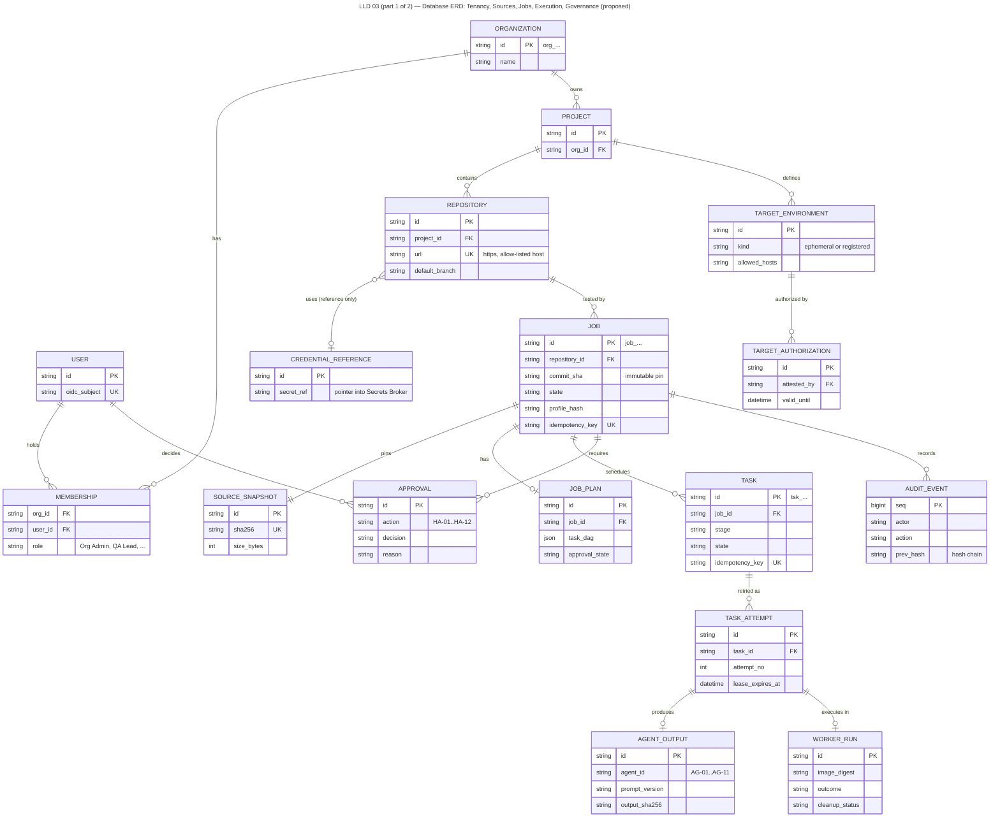
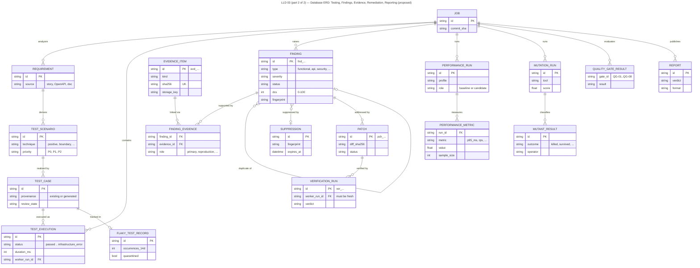

# Data Model and ERD

> Autonomous QA Swarm · Documentation v0.1 (Concept) · Status: Proposed — nothing described here is implemented yet.

This document defines the proposed logical data model for the Autonomous QA Swarm Metadata DB (PostgreSQL 16+) and its relationship to the Evidence Store (S3-compatible, content-addressed) and the Audit Log. It covers conventions, a catalogue of all 34 entities, relationships, enumerations, integrity rules, retention and the migration approach. The model is **Proposed**; the entities needed for Phases 1–3 are **Planned (MVP)**. Nothing is **Implemented / Verified**. Column types are indicative and will be finalized with the first migrations. API resources in [API contracts](../08-api-specifications/01-api-contracts.md) map onto these entities; security controls referenced here are described in [Identity, secrets, audit and data protection](../10-security-and-threat-model/02-identity-secrets-audit-and-data-protection.md).

## Conventions

### Identifiers

Every primary key is a ULID stored as `text` with a type prefix, for example `job_01JB7ZK3M4N5P6Q7R8S9T0V1W2`. ULIDs sort by creation time, which keeps B-tree inserts local and lets cursor pagination use the id alone. Prefixes make ids self-describing in logs and prevent passing a finding id where a job id is expected; a `CHECK` constraint enforces the prefix per table.

| Entity | Prefix | Entity | Prefix |
|---|---|---|---|
| Organization | `org_` | Task | `tsk_` |
| User | `usr_` | TaskAttempt | `att_` |
| Membership | `mbr_` | AgentOutput | `aout_` |
| Project | `prj_` | WorkerRun | `wrk_` |
| Repository | `rep_` | SourceSnapshot | `snp_` |
| CredentialReference | `crd_` | Finding | `fnd_` |
| TargetEnvironment | `tgt_` | EvidenceItem | `evd_` |
| TargetAuthorization | `tauth_` | Patch | `pch_` |
| Job | `job_` | VerificationRun | `ver_` |
| JobPlan | `pln_` | AuditEvent | `aud_` |

Remaining entities use short prefixes of the same style (`req_`, `scn_`, `tc_`, `tex_`, `prun_`, `pmet_`, `mrun_`, `mut_`, `apr_`, `qgr_`, `rpt_`, `flk_`, `sup_`); FindingEvidence is a link table with a composite key. Human-friendly display ids are allocated per organization from a sequence: `QJ-1042` for jobs, `FND-0193` for findings, `PCH-0007` for patches, `VER-0011` for verifications. Display ids are unique per organization and never reused.

### Tenancy and row-level security

Every tenant-owned table carries `org_id text NOT NULL` referencing `organizations`. PostgreSQL row-level security is enabled on all such tables with a policy `org_id = current_setting('app.org_id')`; the API sets this per transaction from the authenticated principal (SEC-011). Service roles used by the Workflow Engine also set `app.org_id` per job. Composite foreign keys include `org_id` where practical, so a row can never reference a parent in another organization. The only table without `org_id` is `users`, because an identity may belong to several organizations through Membership.

### Timestamps and time

All timestamps are `timestamptz` stored in UTC (NFR-020). Every table has `created_at` and, if mutable, `updated_at`. State-bearing entities record `started_at`, `ended_at` and `state_changed_at`. Durations are stored as integer milliseconds.

### Soft versus hard delete

Configuration entities (Project, Repository, TargetEnvironment, CredentialReference, Suppression) use soft delete via `archived_at`; archived rows are hidden from lists but remain referenceable by historical jobs. Execution and evidence records (Job, Task, TestExecution, Finding, EvidenceItem and their children) are never edited after reaching a terminal state and are removed only by retention jobs as hard deletes. AuditEvent is append-only and never updated.

### Optimistic concurrency

Mutable entities carry `version integer NOT NULL`, incremented on every update and exposed as the HTTP ETag. Updates use `WHERE id = $1 AND version = $2`; zero affected rows means a stale write, which the API returns as `412`.

### JSONB usage limits

JSONB is allowed only for bounded, tool-specific metadata that is not queried relationally: tool configuration, parser metadata, agent output payloads after schema validation, and gate inputs. Rules: every JSONB column has a JSON Schema version column next to it; values are capped at 64 KiB (larger content goes to the Evidence Store and is referenced by hash); fields used in filters, joins or gates must be promoted to typed columns. No secrets, raw prompts or source code are ever stored in JSONB.

## Entity relationship diagram

Figure LLD 03 Database ERD shows the core entities and their relationships. Organization scoping is implied for all tenant-owned entities and is omitted from the diagram for readability.

*Figure LLD 03 (part 1 of 2) — Database ERD: Tenancy, Sources, Jobs, Execution, Governance (proposed).*

*Figure LLD 03 (part 2 of 2) — Database ERD: Testing, Findings, Evidence, Remediation, Reporting (proposed).*

## Entity catalogue

Each table below lists purpose, key attributes, relationships, notable constraints or indexes, and retention. Retention defaults follow NFR-016 (evidence 90 days, audit 1 year) and are configurable per organization.

### Identity and tenancy

| Entity | Purpose | Key attributes | Relationships | Constraints and indexes | Retention |
|---|---|---|---|---|---|
| Organization | Tenant boundary | `id`, `name text`, `slug text`, `settings jsonb`, `retention_policy jsonb` | Parent of all tenant data | Unique `slug` | Life of deployment |
| User | Identity from OIDC | `id`, `oidc_issuer text`, `oidc_subject text`, `email citext`, `display_name text`, `last_login_at` | Has Memberships | Unique (`oidc_issuer`, `oidc_subject`) | Pseudonymized on removal; id kept for audit |
| Membership | User role in an org | `id`, `org_id`, `user_id`, `role` enum, `project_ids text[]` nullable | User ↔ Organization | Unique (`org_id`, `user_id`, `role`) | Soft-revoked via `revoked_at` |

`role` is one of the seven RBAC roles: Org Admin, QA Lead, QA Engineer, Developer, Security Reviewer, Viewer, CI Service Account. CI Service Accounts are modeled as Users with `kind = service` and a Membership whose role is CI Service Account.

### Projects, sources and targets

| Entity | Purpose | Key attributes | Relationships | Constraints and indexes | Retention |
|---|---|---|---|---|---|
| Project | Groups repositories, defaults and gate thresholds | `id`, `org_id`, `name`, `gate_config jsonb`, `default_profiles jsonb`, `version` | Has Repositories, Jobs, Suppressions | Unique (`org_id`, `name`) | Soft delete |
| Repository | Registered Git source | `id`, `org_id`, `project_id`, `provider` enum, `url text`, `default_branch`, `last_pinned_sha char(40)`, `validation_status` enum, `credential_ref_id` | Project; CredentialReference; SourceSnapshots | Unique (`org_id`, normalized `url`); HTTPS-only check | Soft delete |
| CredentialReference | Pointer to a secret in the Secrets Broker | `id`, `org_id`, `kind` enum, `broker_path text`, `scopes text[]`, `rotated_at`, `expires_at` | Used by Repository, TargetEnvironment | Never stores secret material; `broker_path` unique | Soft delete; rotation history in audit |
| TargetEnvironment | Ephemeral or registered non-production target | `id`, `org_id`, `project_id`, `kind` enum (`ephemeral`, `registered`), `base_url`, `network_scope jsonb`, `credential_ref_id` nullable | Has TargetAuthorizations | `base_url` required when `registered` | Soft delete |
| TargetAuthorization | HA-01 attestation of permission to test | `id`, `org_id`, `target_id`, `attested_by`, `allowed_activities text[]`, `valid_from`, `valid_until`, `revoked_at` | TargetEnvironment; Approval | Exclusion check against overlapping active rows for same activity | 1 year after expiry |
| SourceSnapshot | Immutable read-only copy of a pinned commit | `id`, `org_id`, `repository_id`, `commit_sha char(40)`, `ref_requested`, `tarball_sha256 char(64)`, `size_bytes bigint` | Repository; Jobs | Unique (`repository_id`, `commit_sha`, `tarball_sha256`) | Tarball 90 days; row kept while any job references it |

`allowed_activities` uses fixed values such as `api_testing`, `dast_passive`, `dast_active`, `performance_smoke`, `performance_above_smoke`. The Policy Engine reads this table when evaluating HA-02 and HA-03 prerequisites; a revoked or expired authorization causes new jobs against that target to end `blocked`.

### Jobs and orchestration

| Entity | Purpose | Key attributes | Relationships | Constraints and indexes | Retention |
|---|---|---|---|---|---|
| Job | One QA run on a pinned commit | `id`, `org_id`, `display_id`, `repository_id`, `snapshot_id`, `commit_sha`, `profiles jsonb`, `profile_hash char(64)`, `state` enum, `current_stage`, `idempotency_key`, `deadline_at`, `version` | Snapshot; JobPlan; Tasks; Findings; Reports | Partial unique (`repository_id`, `commit_sha`, `profile_hash`) where state is non-terminal and not `force_new` | 1 year (metadata) |
| JobPlan | Validated task DAG | `id`, `org_id`, `job_id`, `dag jsonb`, `schema_version`, `approval_required bool`, `approved_at` | Job (1:1 current, history kept); Approval | Unique (`job_id`, `revision`) | With Job |
| Task | Unit of agent or tool work | `id`, `org_id`, `job_id`, `stage`, `task_type`, `agent_id` (AG-01..AG-11), `state` enum, `idempotency_key char(64)`, `depends_on text[]`, `lease_owner`, `lease_expires_at`, `retry_count` | Job; TaskAttempts | Unique (`job_id`, `idempotency_key`); index (`state`, `lease_expires_at`) for queue | With Job |
| TaskAttempt | One try of a task | `id`, `org_id`, `task_id`, `attempt_no`, `outcome` enum, `error_class`, `started_at`, `ended_at` | Task; AgentOutput; WorkerRun | Unique (`task_id`, `attempt_no`) | With Job |
| AgentOutput | Schema-validated output of an LLM-assisted step | `id`, `org_id`, `attempt_id`, `agent_id`, `schema_name`, `schema_version`, `payload jsonb`, `validation_status`, `prompt_sha256`, `response_sha256`, `model_ref`, `tokens_in`, `tokens_out` | TaskAttempt | `validation_status = valid` required before downstream use | 90 days; hashes kept with Job |
| WorkerRun | One disposable sandbox worker lifecycle | `id`, `org_id`, `attempt_id`, `image_digest`, `isolation` enum (`gvisor`, `firecracker`), `limits jsonb`, `exit_code`, `destroyed_at`, `output_bytes` | TaskAttempt; TestExecutions; EvidenceItems | `destroyed_at` monitored for NFR-008 | With Job |

The queue query uses `SELECT … FOR UPDATE SKIP LOCKED` on `tasks` filtered by `state IN ('pending','retry_scheduled')` and dependency completion; a lease of 90 s is written atomically with the state change to `leased`.

### Requirements and tests

| Entity | Purpose | Key attributes | Relationships | Constraints and indexes | Retention |
|---|---|---|---|---|---|
| Requirement | Imported requirement, story or OpenAPI operation | `id`, `org_id`, `project_id`, `source_kind` enum, `source_ref`, `text_sha256`, `priority` | TestScenarios | Unique (`project_id`, `source_kind`, `source_ref`, `text_sha256`) | Life of project |
| TestScenario | Testable scenario derived from requirements or diff | `id`, `org_id`, `job_id`, `requirement_id` nullable, `priority` enum (P0, P1, P2), `test_type`, `derived_by` (agent id), `review_status` | Requirement; TestCases | Index (`job_id`, `priority`) for QG-04 | With Job |
| TestCase | Concrete test, existing or generated | `id`, `org_id`, `project_id`, `framework`, `node_id text`, `provenance` enum (`existing`, `generated`), `review_status`, `content_sha256` | TestScenarios (many-to-many); TestExecutions | Generated cases need `review_status = approved` before CI promotion | Life of project |
| TestExecution | One execution result | `id`, `org_id`, `job_id`, `test_case_id`, `worker_run_id`, `status` enum, `is_flaky bool`, `rerun_of` nullable, `duration_ms`, `purpose` enum (`baseline`, `standard`, `reproduction`, `verification`) | TestCase; WorkerRun; Findings | Partitioned by month on `created_at`; index (`job_id`, `status`) | 90 days detail; aggregates with Job |
| FlakyTestRecord | Flaky Test Register entry | `id`, `org_id`, `project_id`, `test_case_id`, `occurrences_14d`, `quarantined bool`, `acknowledged_by` nullable | TestCase; Approval | Quarantine requires `acknowledged_by` (QA Lead) | Rolling; closed records 1 year |

### Findings and evidence

| Entity | Purpose | Key attributes | Relationships | Constraints and indexes | Retention |
|---|---|---|---|---|---|
| Finding | Correlated defect or vulnerability | `id`, `org_id`, `display_id`, `job_id`, `category`, `title`, `severity` enum, `status` enum, `confidence` enum, `dcs smallint`, `dcs_breakdown jsonb`, `source_class` enum, `cwe`, `fingerprint char(64)`, `duplicate_of` nullable, `disputed bool`, `version` | Job; EvidenceItems; Patches; Suppressions | Index (`org_id`, `fingerprint`); `dcs` between 0 and 100 | 1 year metadata |
| EvidenceItem | Pointer to an immutable object in the Evidence Store | `id`, `org_id`, `job_id`, `kind` enum, `sha256 char(64)`, `size_bytes`, `media_type`, `producer` (tool and version), `worker_run_id`, `deterministic bool`, `redaction_status` | WorkerRun; FindingEvidence | Unique (`org_id`, `sha256`) per object | 90 days object; row kept with metadata |
| FindingEvidence | Link between finding and evidence | `finding_id`, `evidence_id`, `org_id`, `role` enum (`primary`, `reproduction`, `corroboration`, `context`), `test_execution_id` nullable | Finding ↔ EvidenceItem | Primary key (`finding_id`, `evidence_id`) | With Finding |
| Suppression | Scoped, expiring rule or location suppression | `id`, `org_id`, `project_id`, `rule_id`, `location_fingerprint`, `reason text`, `approved_by`, `expires_at` | Project; Approval | `expires_at` ≤ 90 days after creation by default; reason non-empty | 1 year after expiry |

`kind` values for EvidenceItem include `log`, `stack_trace`, `http_exchange`, `screenshot`, `video`, `trace`, `scanner_report`, `metric_series`, `junit_xml`, `sarif`, `diff` and `environment_manifest`. Deterministic kinds are those produced by tools rather than LLM agents; `deterministic` is set by the Execution Service, not by agents.

### Performance and mutation

| Entity | Purpose | Key attributes | Relationships | Constraints and indexes | Retention |
|---|---|---|---|---|---|
| PerformanceRun | One bounded workload execution | `id`, `org_id`, `job_id`, `profile` enum (Smoke, Baseline, Load, Stress, Spike, Soak), `tool`, `target_id`, `caps jsonb`, `abort_reason` nullable, `valid bool`, `baseline_run_id` nullable | Job; TargetEnvironment; PerformanceMetrics | Profile above Smoke requires Approval HA-03 | 1 year metadata |
| PerformanceMetric | Per-endpoint aggregates | `id`, `org_id`, `run_id`, `endpoint`, `samples int`, `p50_ms`, `p90_ms`, `p95_ms`, `p99_ms`, `rps`, `error_rate` | PerformanceRun | `sample_warning` computed (p95 < 400, p99 < 2,000 samples) | With run |
| MutationRun | Mutation testing on changed modules | `id`, `org_id`, `job_id`, `tool`, `modules text[]`, `mutant_cap int`, `killed`, `survived`, `timed_out`, `invalid`, `score numeric(5,2)` | Job; MutantResults | `mutant_cap` ≤ 500 | 1 year metadata |
| MutantResult | Outcome per mutant | `id`, `org_id`, `mutation_run_id`, `file`, `line`, `operator`, `outcome` enum, `equivalent_suspected bool`, `suggestion_ref` nullable | MutationRun | Index (`mutation_run_id`, `outcome`) | 90 days |

`score` is computed as killed / (killed + survived) × 100 over valid, completed mutants, so the sample job QJ-1042 would record 214 mutants, 139 killed, 47 survived, 18 timed out, 10 invalid and a score of 74.7 (illustrative).

### Patches, approvals and verification

| Entity | Purpose | Key attributes | Relationships | Constraints and indexes | Retention |
|---|---|---|---|---|---|
| Patch | Proposed minimal diff for review | `id`, `org_id`, `display_id`, `job_id`, `diff_evidence_id`, `files_changed`, `lines_added`, `lines_removed`, `rationale text`, `status` enum, `version` | Findings (many-to-many); Approvals; VerificationRuns | At least one linked Finding in `confirmed` or later | 1 year |
| Approval | Record of a human gate decision | `id`, `org_id`, `ha_id` (HA-01..HA-12), `subject_type`, `subject_id`, `decision` enum (`approved`, `rejected`), `approver_id`, `role_at_decision`, `reason text`, `expires_at` nullable | Polymorphic subject | `approver_id` must hold the required role; reason required for HA-07, HA-08, HA-09 | 1 year minimum |
| VerificationRun | Independent re-check of pinned commit + patch | `id`, `org_id`, `display_id`, `patch_id`, `worker_run_ids text[]`, `checks jsonb`, `verdict` enum (`verified`, `verification_failed`), `limitations text` | Patch; TestExecutions; WorkerRuns | Fresh-worker rule (see integrity rules) | 1 year |

Patch-to-Finding links are stored in a small join table (`patch_findings`) that is part of the Patch entity rather than a separate domain entity.

### Gates, reports and audit

| Entity | Purpose | Key attributes | Relationships | Constraints and indexes | Retention |
|---|---|---|---|---|---|
| QualityGateResult | Result of one gate evaluation | `id`, `org_id`, `job_id`, `gate_id` (QG-01..QG-08), `result` enum (`passed`, `failed`, `advisory_failed`, `inconclusive`, `not_applicable`, `pending`), `blocking bool`, `measured jsonb`, `threshold jsonb`, `override_approval_id` nullable | Job; Approval (HA-09) | Unique (`job_id`, `gate_id`, `evaluation_no`) | 1 year |
| Report | Generated report and release decision record | `id`, `org_id`, `job_id`, `kind` enum (`main`, `verification_addendum`), `verdict` enum, `formats jsonb` (evidence ids per format), `decision_approval_id` nullable | Job; QualityGateResults; Approval (HA-10) | One `main` report per job | 1 year |
| AuditEvent | Append-only record of every action | `id`, `org_id`, `occurred_at`, `actor_type`, `actor_id`, `action`, `subject_type`, `subject_id`, `details jsonb`, `prev_hash char(64)`, `hash char(64)` | References any entity by id | No UPDATE or DELETE grants; hash chain verified nightly | 1 year default, configurable longer |

## Relationship summary

| Parent | Child | Cardinality | Notes |
|---|---|---|---|
| Organization | Membership, Project and all tenant tables | 1 : N | Enforced by `org_id` and RLS |
| User | Membership | 1 : N | One user, many organizations |
| Project | Repository, TargetEnvironment, Requirement, TestCase, Suppression, FlakyTestRecord | 1 : N | |
| Repository | SourceSnapshot | 1 : N | One snapshot per pinned commit |
| SourceSnapshot | Job | 1 : N | Many jobs may reuse a snapshot |
| TargetEnvironment | TargetAuthorization | 1 : N | History of attestations |
| Job | JobPlan, Task, TestScenario, TestExecution, Finding, PerformanceRun, MutationRun, Patch, QualityGateResult, Report | 1 : N | |
| Task | TaskAttempt | 1 : N | At most 1 + retry budget |
| TaskAttempt | AgentOutput, WorkerRun | 1 : 0..1 | LLM steps have outputs; tool steps have workers |
| WorkerRun | TestExecution, EvidenceItem | 1 : N | Provenance of every result |
| TestScenario | TestCase | N : M | Via scenario-case link |
| Finding | EvidenceItem | N : M | Via FindingEvidence |
| Finding | Finding | N : 1 | `duplicate_of` |
| Patch | Finding | N : M | Via `patch_findings` |
| Patch | VerificationRun | 1 : N | Re-verification allowed |
| PerformanceRun | PerformanceMetric | 1 : N | |
| MutationRun | MutantResult | 1 : N | |

## Key enumerations

| Enumeration | Values |
|---|---|
| Job state | `created`, `validating`, `queued`, `planning`, `awaiting_approval`, `running`, `analyzing`, `reporting`, `cancelling`, `completed`, `completed_with_warnings`, `failed`, `cancelled`, `timed_out`, `blocked` |
| Task state | `pending`, `leased`, `running`, `succeeded`, `failed_retryable`, `retry_scheduled`, `failed`, `invalid_output`, `timed_out`, `cancelled`, `skipped` |
| Test execution status | `passed`, `failed`, `skipped`, `blocked`, `timed_out`, `infrastructure_error` (plus derived `is_flaky`) |
| Finding status | `candidate`, `triaging`, `reproducing`, `confirmed`, `not_reproducible`, `false_positive`, `duplicate`, `accepted_risk`, `fix_proposed`, `fix_verified`, `fix_failed`, `reopened` |
| Patch status | `proposed`, `awaiting_review`, `approved_for_verification`, `verification_running`, `verified`, `verification_failed`, `rejected` |
| Release verdict | `READY`, `READY_WITH_RISKS`, `NOT_READY`, `INCONCLUSIVE` |
| Severity | `critical`, `high`, `medium`, `low`, `informational` |
| Confidence | `confirmed`, `probable`, `candidate`, `rejected` |
| Security source class | `scanner_alert`, `probable_vulnerability`, `confirmed_vulnerability`, `false_positive` |

Enumerations are stored as PostgreSQL enum types for states with stable vocabularies; adding a value requires a migration and a corresponding API version review. Transitions are validated in the service layer against the state machines in [Low-level design](../05-architecture/03-low-level-design.md), and a trigger rejects any update that moves a terminal Job or Task back to a non-terminal state.

## Integrity rules

The following rules are enforced in the service layer and, where noted, by database constraints or deferred constraint triggers so that a bug in one service cannot bypass them.

1. **No evidence, no defect.** A Finding may enter `confirmed` only if it has at least one FindingEvidence link to an EvidenceItem with `deterministic = true` and at least one linked TestExecution with `purpose = reproduction` in a WorkerRun different from the original detection, with reproduction in ≥ 2 of 3 runs, and `dcs ≥ 80`. Enforced by a constraint trigger on status change.
2. **LLM opinion cannot confirm.** AgentOutput rows may be linked only with role `corroboration`; they never satisfy rule 1.
3. **Patch requires a confirmed finding.** A Patch must link to at least one Finding whose status is `confirmed`, `fix_proposed`, `fix_verified` or `fix_failed`. A Patch cannot be created for `candidate`, `probable` or rejected findings.
4. **Patch review before verification.** A VerificationRun may be created only when the Patch is `approved_for_verification` and an Approval with `ha_id = HA-06` and `decision = approved` exists for it from a Developer (code owner) or QA Lead.
5. **Fresh verification worker.** Every WorkerRun used by a VerificationRun must differ from every WorkerRun used by any TaskAttempt of the patch's Job, and must have been created after the HA-06 Approval. VerificationRun has no foreign key to Patch Proposal Agent AgentOutput rows, so reasoning cannot be passed.
6. **Approver role check.** An Approval is valid only if the approver held the required role at decision time; HA-08 for security findings needs two Approvals (QA Lead and Security Reviewer). An HA-09 override cannot be recorded by a CI Service Account.
7. **Suppressions expire.** A Suppression without `expires_at` is rejected; the default is 90 days and an expired suppression stops applying at the next evaluation.
8. **Gate override is explicit.** A QualityGateResult with `result = failed` may carry `override_approval_id` only for an HA-09 Approval with a non-empty reason; the original measured values are never modified.
9. **Terminal immutability.** TestExecution, EvidenceItem, AgentOutput and WorkerRun rows are insert-only. Finding updates create an AuditEvent with before/after status.
10. **Single active duplicate job.** The partial unique index on Job prevents two non-terminal jobs for the same repository, commit and profile hash unless the later job was created with `force_new` by a QA Lead.

## Retention and deletion

Retention is configured per organization with defaults of 90 days for evidence objects and 1 year for audit events (NFR-016). A daily retention job deletes Evidence Store objects whose retention has expired and that are not under legal hold, then clears the corresponding object pointer while keeping the EvidenceItem row with its hash, so findings remain explainable as "evidence expired on date X". Job metadata, findings, approvals and gate results are kept for 1 year by default. Time-partitioned tables (TestExecution, AuditEvent) are dropped by partition rather than row-by-row. Deleting an organization is a hard delete performed after an export window; audit partitions are exported first. User removal pseudonymizes `email` and `display_name` while keeping `id`, so the hash-chained audit trail stays verifiable. Legal hold flags at Job level suspend all deletion for that job.

## Migration approach

Schema changes are planned to use versioned, forward-only migrations (Alembic is the proposed tool, matching the Python stack) reviewed like code. Rules: additive changes first (new nullable column, backfill, then constraint), destructive changes only after one release of deprecation; long backfills run in batches outside the migration transaction; RLS policies and grants are created in the same migration as their table; every migration runs in CI against a seeded database that includes the sample Northwind Fintech data set (illustrative) and is followed by integrity checks of rules 1–10. Enum additions are coordinated with the API deprecation policy in [API contracts](../08-api-specifications/01-api-contracts.md).
