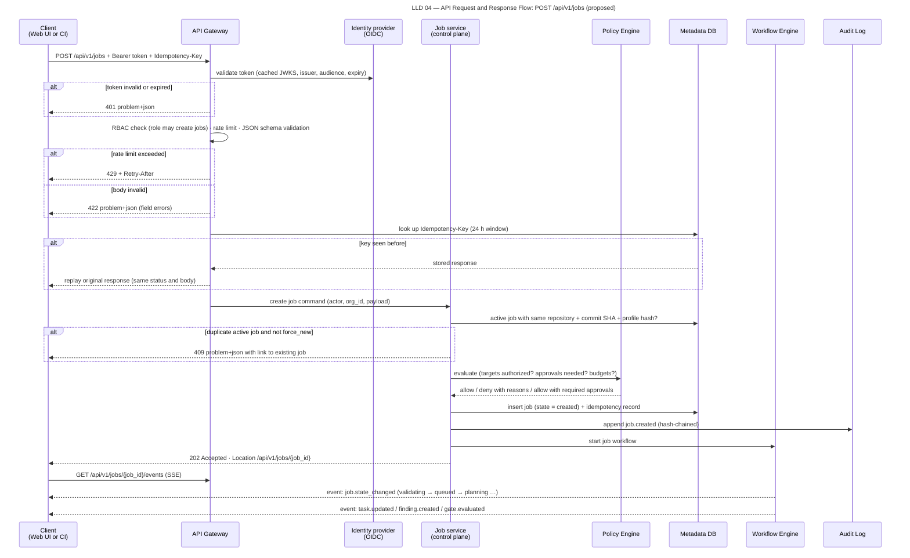

# API Contracts

> Autonomous QA Swarm · Documentation v0.1 (Concept) · Status: Proposed — nothing described here is implemented yet.

This document specifies the proposed REST API of Autonomous QA Swarm: conventions, authentication and authorization assumptions, the error model, the full endpoint reference and detailed contracts for the most important operations. The API is **Proposed**; all endpoints listed are **Planned (MVP)** unless marked **Future**, and none is **Implemented / Verified**. The machine-readable OpenAPI 3.1 document is planned to be generated from the same Pydantic models that validate requests, so this document and the generated specification must be kept in agreement. All examples use the sample Northwind Fintech data set and are illustrative only; ids are example ULIDs. Entities referenced here are defined in [Data model and ERD](../07-data-model/01-data-model-and-erd.md).

## Conventions

### Base URL, media types and identifiers

- Base path: `/api/v1`. All requests and responses use `application/json; charset=utf-8`, except the event stream (`text/event-stream`), error responses (`application/problem+json`) and report downloads in non-JSON formats.
- Resource ids are prefixed ULIDs (`job_…`, `fnd_…`, `pch_…`, `ver_…`). Display ids (`QJ-1042`, `FND-0193`, `PCH-0007`, `VER-0011`) are returned as `display_id` and accepted in search filters, but not as path parameters.
- Field names are `snake_case`. Enumerations use the exact lower_snake_case state names defined in the [low-level design](../05-architecture/03-low-level-design.md); release verdicts are upper case (`READY`, `READY_WITH_RISKS`, `NOT_READY`, `INCONCLUSIVE`).
- Timestamps are RFC 3339 in UTC with a `Z` suffix, for example `2026-10-24T09:15:02Z`. Clients convert to the user's time zone (NFR-020).
- Unknown request fields are rejected with `422` to catch client typos; clients must ignore unknown response fields so that additive changes are non-breaking.

### Cursor pagination

List endpoints use opaque cursors rather than offsets, because job and result tables grow continuously. Parameters: `limit` (default 50, maximum 200) and `cursor`. The response carries `next_cursor`, which is `null` on the last page. Cursors encode the sort key and last id and expire after 24 hours.

```http
GET /api/v1/jobs?project_id=prj_01JB6R0E1T2Y3U4I5O6P7A8S9D&state=completed,completed_with_warnings&limit=2
Authorization: Bearer eyJhbGciOi...
```

```json
{
  "items": [
    { "id": "job_01JB7Y9P2C4D6F8G0H2J4K6M8N", "display_id": "QJ-1041", "state": "completed_with_warnings", "verdict": "READY_WITH_RISKS" },
    { "id": "job_01JB7X3Q5R7S9T1V3W5X7Y9Z1A", "display_id": "QJ-1040", "state": "completed", "verdict": "READY" }
  ],
  "next_cursor": "eyJrIjoiMDFKQjdYM1E1UjdTOVQxVjNXNVg3WTlaMUEifQ",
  "limit": 2
}
```

### Filtering and sorting

Filters are query parameters named after fields. Multiple values are comma-separated and combined with OR within a field and AND across fields (`severity=critical,high&confidence=confirmed`). Ranges use `_from` and `_to` suffixes (`created_from=2026-10-01T00:00:00Z`). Sorting uses `sort=created_at` or `sort=-created_at`; only indexed fields are sortable, and unsupported filters return `400`.

### ETags and conditional updates

Mutable resources (projects, repositories, targets, findings, patches, jobs) return an `ETag` header derived from the row version, for example `ETag: "fnd_01JB8…:v4"`. State-changing calls on an existing resource (triage, patch review, cancel, release decision) require `If-Match`. If the resource has changed since the client read it, the API returns `412 Precondition Failed` with error code `etag_mismatch`, and the client must re-read before retrying. A missing `If-Match` on these endpoints returns `400` with code `if_match_required`.

### Idempotency-Key semantics

`POST /jobs` requires an `Idempotency-Key` header (1–128 printable ASCII characters; a UUID or ULID is recommended). Other POST endpoints accept it optionally. Semantics:

1. The key is scoped to the authenticated principal and endpoint, and stored for 24 hours.
2. A repeated request with the same key and an identical body returns the original status code and body, with header `Idempotent-Replayed: true`.
3. A repeated request with the same key but a different body returns `422` with code `idempotency_key_reused`.
4. A request arriving while the original is still processing returns `409` with code `idempotency_in_progress` and `Retry-After: 2`.

Separately from the key, an active job with the same (repository, commit SHA, profile hash) returns `409` with a link to the existing job unless `force_new=true` is set by a QA Lead (FR-006).

### Rate limits

Rate limits protect the public API (SEC-022). Proposed defaults, configurable by the Org Admin:

| Class | Default limit | Scope |
|---|---|---|
| Read requests | 600 per minute | Per principal |
| Write requests | 60 per minute | Per principal |
| Job creation | 30 per hour | Per project |
| Event stream connections | 10 concurrent | Per principal |
| Evidence download URL issuance | 120 per minute | Per principal |

Every response includes `RateLimit-Limit`, `RateLimit-Remaining` and `RateLimit-Reset` (seconds until reset). When a limit is exceeded the API returns `429` with `Retry-After` in seconds and error code `rate_limited`.

### Versioning and deprecation

The major version is in the path (`/api/v1`). Within v1, changes are additive only: new endpoints, new optional fields, new enum values (clients must tolerate unknown enum values by displaying them as-is). Breaking changes ship in `/api/v2`, with v1 supported for at least 12 months after v2 is released. Deprecated endpoints or fields return `Deprecation` and `Sunset` headers and a `Link` header to migration notes at least 6 months before removal. The OpenAPI document is published at `/api/v1/openapi.json`.

## Authentication and authorization

### Principals

- **Human users** authenticate through the configured OIDC provider (Keycloak by default) using the authorization code flow with PKCE in the Web UI. The API accepts the resulting access token as `Authorization: Bearer <token>`. Tokens are validated for issuer, audience, signature and expiry; the proposed maximum access-token lifetime is 15 minutes, with refresh handled by the UI against the IdP. MFA is enforced at the IdP (SEC-009).
- **CI Service Accounts** use tokens issued by the platform for a specific project, either long-lived (rotated under HA-11) or, preferably, short-lived tokens obtained by exchanging a CI provider OIDC token. Service account tokens are hashed at rest and shown once at creation.
- **Agents and sandbox workers** never call this API and never hold API credentials; they communicate only through internal task contracts (SEC-007).

### Scopes per role

Tokens carry the principal's role for the organization (and optional project restriction). The gateway maps roles to permission scopes and the Policy Engine enforces them per request. Approval-bearing actions additionally check the specific HA requirement.

| Role | Scopes granted | HA actions permitted |
|---|---|---|
| Org Admin | `org:admin`, `projects:write`, `repositories:write`, `targets:write`, `targets:authorize`, `jobs:write`, `evidence:read`, `audit:read`, all read scopes | HA-01, HA-04, HA-11 |
| QA Lead | `projects:write`, `repositories:write`, `jobs:write`, `jobs:approve`, `findings:triage`, `patches:review`, `patches:verify`, `gates:override`, `release:decide`, `evidence:read`, `audit:read`, all read scopes | HA-03, HA-05, HA-06, HA-07 (functional), HA-08, HA-09, HA-10 |
| QA Engineer | `jobs:write`, `findings:triage` (functional triage and duplicate marking only; no HA-07 or HA-08), `findings:comment`, `patches:verify`, `evidence:read`, all read scopes except `audit:read` | None |
| Developer | `jobs:write`, `patches:review` and `patches:verify` (code owner only), `evidence:read`, all read scopes except `audit:read` | HA-06, HA-12 (Future) |
| Security Reviewer | `findings:triage` (security), `targets:authorize`, `evidence:read`, `audit:read`, all read scopes | HA-01, HA-02, HA-07 (security), HA-08 (security) |
| Viewer | Read scopes only, excluding `evidence:read` and `audit:read` | None |
| CI Service Account | `jobs:write`, `jobs:read`, `reports:read`, `gates:read` | None |

## Error model

Errors use RFC 9457 Problem Details (`application/problem+json`). Every problem includes `type`, `title`, `status`, `detail`, `instance`, an `error_code` stable string for programmatic handling, a `trace_id` for correlation with platform telemetry (NFR-014), and, for validation failures, an `errors` array with JSON Pointer locations. Problem `detail` text never contains secrets, tokens or internal host names.

```json
{
  "type": "https://qa-swarm.dev/problems/validation-error",
  "title": "Request validation failed",
  "status": 422,
  "detail": "2 fields failed validation.",
  "instance": "/api/v1/jobs",
  "error_code": "validation_failed",
  "trace_id": "4bf92f3577b34da6a3ce929d0e0e4736",
  "errors": [
    { "pointer": "/profiles/performance", "code": "enum", "message": "Must be one of: none, smoke, baseline, load, stress, spike, soak." },
    { "pointer": "/limits/job_timeout_minutes", "code": "maximum", "message": "Must be at most 720." }
  ]
}
```

| Status | Typical `error_code` values |
|---|---|
| 400 | `bad_request`, `unsupported_filter`, `if_match_required` |
| 401 | `unauthenticated`, `token_expired` |
| 403 | `insufficient_role`, `approval_role_required`, `project_access_denied` |
| 404 | `not_found` (also returned for resources in another organization) |
| 409 | `invalid_state_transition`, `job_duplicate_active`, `idempotency_in_progress` |
| 412 | `etag_mismatch` |
| 422 | `validation_failed`, `repository_url_rejected`, `idempotency_key_reused`, `policy_precondition_failed` |
| 429 | `rate_limited` |
| 500 | `internal_error` |
| 503 | `service_unavailable`, `dependency_unavailable` |

## Endpoint reference

The API exposes exactly the following endpoints, all relative to `/api/v1`. "Min scope" is the scope the gateway checks; approval endpoints additionally verify the HA role.

### Projects, sources, targets and jobs

| Method | Path | Purpose | Min scope |
|---|---|---|---|
| POST | /projects | Create project | `projects:write` |
| GET | /projects | List projects | read |
| POST | /repositories | Register repository (URL validated, SSRF-safe) | `repositories:write` |
| GET | /repositories/{repository_id} | Repository details incl. branches, last pinned SHA | read |
| POST | /repositories/{repository_id}/validate | Re-validate reachability and resolve default branch | `repositories:write` |
| POST | /targets | Register target environment | `targets:write` |
| POST | /targets/{target_id}/authorizations | Record authorization attestation (HA-01) | `targets:authorize` |
| POST | /jobs | Create QA job (`Idempotency-Key` required) | `jobs:write` |
| GET | /jobs | List jobs (cursor pagination, filters) | read |
| GET | /jobs/{job_id} | Job details, state, stage progress | read |
| POST | /jobs/{job_id}/cancel | Request cancellation | `jobs:write` |
| GET | /jobs/{job_id}/events | Server-Sent Events stream of job/task events | read |
| GET | /jobs/{job_id}/plan | Job plan (DAG) | read |
| POST | /jobs/{job_id}/plan/approval | Approve/reject plan (HA-05) | `jobs:approve` |
| GET | /jobs/{job_id}/tasks | Tasks with attempts and status | read |

### Results, findings, patches, gates and audit

| Method | Path | Purpose | Min scope |
|---|---|---|---|
| GET | /jobs/{job_id}/test-executions | Test results | read |
| GET | /jobs/{job_id}/findings | Findings (filters: type, severity, confidence, status) | read |
| GET | /findings/{finding_id} | Finding with evidence references | read |
| POST | /findings/{finding_id}/triage | Change status (false positive, accepted risk, duplicate…) | `findings:triage` |
| GET | /findings/{finding_id}/evidence | Evidence items (signed, short-lived download URLs) | `evidence:read` |
| GET | /jobs/{job_id}/performance-runs | Performance runs and metrics | read |
| GET | /jobs/{job_id}/mutation-runs | Mutation runs and mutant results | read |
| GET | /jobs/{job_id}/patches | Patch proposals | read |
| POST | /patches/{patch_id}/review | Approve for verification / reject (HA-06) | `patches:review` |
| POST | /patches/{patch_id}/verifications | Start independent verification | `patches:verify` |
| GET | /verifications/{verification_id} | Verification result | read |
| GET | /jobs/{job_id}/quality-gates | Quality gate results and verdict | read |
| GET | /jobs/{job_id}/report | Report (`?format=json|html|pdf|junit|sarif`) | read |
| POST | /jobs/{job_id}/release-decision | Record human release decision (HA-10) | `release:decide` |
| GET | /audit-events | Audit trail (filter by job, actor, action) | `audit:read` |

## Request lifecycle

Figure LLD 04 API Request Response Flow shows how a write request travels from the client through the API Gateway (authentication, rate limiting, idempotency check), to the owning service, into the Metadata DB in a single transaction with its audit event, and back as `202 Accepted`, after which progress arrives as SSE events.



*Figure LLD 04 — API Request and Response Flow: POST /api/v1/jobs (proposed).*

Asynchronous operations (job creation, cancellation, verification start) return `202` with a `Location` header for the resource being processed. The gateway writes the idempotency record, the state change and the AuditEvent in the same database transaction, so a crash after commit but before the response is safe to retry with the same key.

## Detailed contracts

### POST /repositories

Registers a repository. The Source Intake Service validates the URL before anything is stored: HTTPS only, host on the provider allow-list, DNS resolved and pinned, and rejection of private, loopback, link-local and cloud metadata addresses (SEC-002). No code is fetched or executed on the control plane.

```http
POST /api/v1/repositories
Authorization: Bearer eyJhbGciOi...
Content-Type: application/json
Idempotency-Key: 01JB8Q2V0Y7K3M5N7P9R1S3T5V

{
  "project_id": "prj_01JB6R0E1T2Y3U4I5O6P7A8S9D",
  "provider": "github",
  "url": "https://github.com/northwind/payments-api",
  "credential_ref_id": "crd_01JB6S1F2G3H4J5K6M7N8P9Q0R"
}
```

```json
{
  "id": "rep_01JB8Q2W6V3K9X4M7N5P2R8T1A",
  "project_id": "prj_01JB6R0E1T2Y3U4I5O6P7A8S9D",
  "provider": "github",
  "url": "https://github.com/northwind/payments-api",
  "default_branch": "main",
  "validation_status": "valid",
  "language_support": "supported",
  "last_pinned_sha": null,
  "credential_ref": { "id": "crd_01JB6S1F2G3H4J5K6M7N8P9Q0R", "display": "github-app:northwind (****a91c)" },
  "created_at": "2026-10-24T08:02:11Z"
}
```

The response is `201 Created` with `Location: /api/v1/repositories/rep_01JB8Q2W6V3K9X4M7N5P2R8T1A`. A URL that resolves to an internal address is rejected with `422`:

```json
{
  "type": "https://qa-swarm.dev/problems/repository-url-rejected",
  "title": "Repository URL rejected",
  "status": 422,
  "detail": "The host resolves to a private or reserved address range. Only public HTTPS Git hosts or hosts allow-listed by an Org Admin are accepted.",
  "instance": "/api/v1/repositories",
  "error_code": "repository_url_rejected",
  "reason": "private_address",
  "trace_id": "0af7651916cd43dd8448eb211c80319c",
  "errors": [ { "pointer": "/url", "code": "ssrf_blocked", "message": "Resolved address is in a blocked range." } ]
}
```

Other `reason` values include `scheme_not_https`, `host_not_allow_listed`, `metadata_address`, `dns_rebinding_suspected` and `credentials_in_url`. The resolved IP itself is not echoed, to avoid turning the endpoint into a network probe.

### POST /jobs

Creates a QA job for a pinned commit. The ref is resolved to an immutable SHA during `validating`; the Policy Engine then checks profiles against target authorizations and approvals. If preconditions fail at policy evaluation, the job is still created but ends `blocked`, so the refusal is visible and audited.

```http
POST /api/v1/jobs
Authorization: Bearer eyJhbGciOi...
Content-Type: application/json
Idempotency-Key: ci-northwind-payments-api-7c9e2a1f4b-std

{
  "repository_id": "rep_01JB8Q2W6V3K9X4M7N5P2R8T1A",
  "ref": "release/2.8",
  "profiles": { "functional": "standard", "security": "standard", "performance": "baseline" },
  "scope": { "paths": ["app/", "tests/"], "test_types": ["unit", "integration", "api"] },
  "target_id": "tgt_01JB6T2G3H4J5K6M7N8P9Q0R1S",
  "limits": { "job_timeout_minutes": 240, "llm_token_budget": 400000 },
  "force_new": false
}
```

```json
{
  "id": "job_01JB9A1B2C3D4E5F6G7H8J9K0M",
  "display_id": "QJ-1042",
  "state": "validating",
  "repository_id": "rep_01JB8Q2W6V3K9X4M7N5P2R8T1A",
  "ref": "release/2.8",
  "commit_sha": null,
  "approvals_required": ["HA-03"],
  "created_at": "2026-10-24T09:00:04Z",
  "links": { "self": "/api/v1/jobs/job_01JB9A1B2C3D4E5F6G7H8J9K0M", "events": "/api/v1/jobs/job_01JB9A1B2C3D4E5F6G7H8J9K0M/events" }
}
```

The response is `202 Accepted` with a `Location` header, because work continues asynchronously. `201 Created` is returned instead when the request sets `"start": false`, which creates the job in `created` state for a later start from the UI. If an equivalent job is already active, the API returns `409`:

```json
{
  "type": "https://qa-swarm.dev/problems/job-duplicate-active",
  "title": "An equivalent job is already active",
  "status": 409,
  "detail": "QJ-1042 is still active for the same repository, commit and profile set.",
  "instance": "/api/v1/jobs",
  "error_code": "job_duplicate_active",
  "existing_job": { "id": "job_01JB9A1B2C3D4E5F6G7H8J9K0M", "display_id": "QJ-1042", "state": "analyzing" },
  "hint": "Use the existing job, or ask a QA Lead to create a new one with force_new=true."
}
```

### GET /jobs/{job_id}

Returns job state, stage progress and summary counts, with an `ETag` header that clients pass as `If-Match` to cancel or record decisions. Pollers should back off to at least 15 s and prefer the event stream.

```json
{
  "id": "job_01JB9A1B2C3D4E5F6G7H8J9K0M",
  "display_id": "QJ-1042",
  "state": "analyzing",
  "current_stage": "evidence_correlation_and_triage",
  "commit_sha": "7c9e2a1f4b",
  "ref": "release/2.8",
  "profiles": { "functional": "standard", "security": "standard", "performance": "baseline" },
  "stages": [
    { "stage": "intake_and_pinning", "status": "succeeded" },
    { "stage": "functional_and_api_testing", "status": "succeeded" },
    { "stage": "evidence_correlation_and_triage", "status": "running" },
    { "stage": "quality_gates_and_reporting", "status": "pending" }
  ],
  "test_summary": { "executed": 1286, "passed": 1241, "failed": 19, "skipped": 14, "blocked": 3, "timed_out": 2, "infrastructure_error": 7, "flaky": 4 },
  "finding_summary": { "confirmed": 3, "probable": 2, "candidate": 1, "rejected": 1 },
  "deadline_at": "2026-10-24T13:00:04Z",
  "version": 37
}
```

The commit SHA is abbreviated in this sample; the API returns the full 40-character SHA. The `stages` array always lists all 13 stages in order; it is shortened here.

### POST /jobs/{job_id}/cancel

Requests cancellation. The job moves to `cancelling`; the Workflow Engine stops leasing new tasks, signals running workers, and every worker is destroyed within 60 s (NFR-008) before the job becomes `cancelled`.

```http
POST /api/v1/jobs/job_01JB9A1B2C3D4E5F6G7H8J9K0M/cancel
Authorization: Bearer eyJhbGciOi...
If-Match: "job_01JB9A1B2C3D4E5F6G7H8J9K0M:v37"
Content-Type: application/json

{ "reason": "Superseded by hotfix commit on release/2.8" }
```

```json
{ "id": "job_01JB9A1B2C3D4E5F6G7H8J9K0M", "state": "cancelling", "requested_by": "usr_01JB5M8N9P0Q1R2S3T4V5W6X7Y", "requested_at": "2026-10-24T10:41:19Z" }
```

The response is `202`. Cancelling a job already in a terminal state returns `409` with `invalid_state_transition`; a repeated cancel on a job already `cancelling` returns `202` with the same body.

### GET /jobs/{job_id}/events

Opens a Server-Sent Events stream. Each event has an `id` (monotonic per job), an `event` type and JSON `data`. Clients reconnect with `Last-Event-ID` to resume; events are retained for replay for 24 hours. A `heartbeat` is sent every 15 s. The target delivery latency is ≤ 2 s from state change (NFR-003). Log lines are not sent on this stream except as redacted tails when `?include=log_tail` is set.

```text
id: 1042-000913
event: task.state_changed
data: {"job_id":"job_01JB9A1B2C3D4E5F6G7H8J9K0M","task_id":"tsk_01JB9F3G4H5J6K7M8N9P0Q1R2S","agent_id":"AG-08","task_type":"reproduction_run","from":"leased","to":"running","at":"2026-10-24T10:12:44Z"}

id: 1042-000914
event: finding.updated
data: {"finding_id":"fnd_01JB9G4H5J6K7M8N9P0Q1R2S3T","display_id":"FND-0193","status":"confirmed","confidence":"confirmed","severity":"critical","dcs":92}

id: 1042-000915
event: heartbeat
data: {"at":"2026-10-24T10:12:59Z"}
```

Other event types: `job.state_changed`, `stage.changed`, `task.retry_scheduled`, `approval.requested`, `quality_gate.evaluated` and `stream.end` (sent after a terminal job state, then the server closes the stream).

### GET /jobs/{job_id}/findings

Lists findings with filters `type`, `severity`, `confidence`, `status`, `source_class` and `disputed`, sorted by risk priority descending by default.

```http
GET /api/v1/jobs/job_01JB9A1B2C3D4E5F6G7H8J9K0M/findings?severity=critical,high&limit=3
```

```json
{
  "items": [
    { "id": "fnd_01JB9G4H5J6K7M8N9P0Q1R2S3T", "display_id": "FND-0193", "type": "security", "severity": "critical", "confidence": "confirmed", "status": "fix_verified", "dcs": 92, "risk_priority": 10.0, "title": "Missing object-level authorization on GET /v1/accounts/{account_id}/statements (IDOR)" },
    { "id": "fnd_01JB9H5J6K7M8N9P0Q1R2S3T4V", "display_id": "FND-0195", "type": "functional", "severity": "high", "confidence": "confirmed", "status": "fix_proposed", "dcs": 88, "risk_priority": 7.0, "title": "Duplicate transfer created when Idempotency-Key is reused with a different payload" },
    { "id": "fnd_01JB9J6K7M8N9P0Q1R2S3T4V5W", "display_id": "FND-0194", "type": "security", "severity": "high", "confidence": "probable", "status": "triaging", "dcs": 64, "risk_priority": 4.2, "title": "Vulnerable dependency PyJWT 2.3.0 (CVE-2022-29217)" }
  ],
  "next_cursor": null,
  "limit": 3
}
```

### GET /findings/{finding_id}

Returns one finding with its DCS breakdown, reproduction record, deduplication links and evidence references. Evidence content is never inlined; `GET /findings/{finding_id}/evidence` issues signed download URLs valid for 5 minutes (SEC-019).

```json
{
  "id": "fnd_01JB9G4H5J6K7M8N9P0Q1R2S3T",
  "display_id": "FND-0193",
  "job_id": "job_01JB9A1B2C3D4E5F6G7H8J9K0M",
  "type": "security",
  "source_class": "confirmed_vulnerability",
  "severity": "critical",
  "cwe": "CWE-639",
  "status": "fix_verified",
  "confidence": "confirmed",
  "dcs": 92,
  "dcs_breakdown": { "reproducibility": 35, "deterministic_oracle": 25, "evidence_completeness": 14, "independent_corroboration": 10, "stability_history": 8 },
  "reproduction": { "runs": 3, "reproduced": 3, "fresh_workers": true },
  "location": { "method": "GET", "route": "/v1/accounts/{account_id}/statements" },
  "fingerprint": "9f2c…41ab",
  "duplicates": [],
  "disputed": false,
  "evidence": [
    { "id": "evd_01JB9K7M8N9P0Q1R2S3T4V5W6X", "kind": "http_exchange", "sha256": "c3a1…77e0", "producer": "schemathesis 3.x (pinned)", "role": "primary" },
    { "id": "evd_01JB9M8N9P0Q1R2S3T4V5W6X7Y", "kind": "http_exchange", "sha256": "d48b…0f19", "producer": "reproduction runner", "role": "reproduction" }
  ],
  "patches": [ { "id": "pch_01JBA0B1C2D3E4F5G6H7J8K9M0", "display_id": "PCH-0007", "status": "verified" } ],
  "version": 6
}
```

### POST /findings/{finding_id}/triage

Changes a finding's status. Allowed actions: `mark_false_positive` (HA-07), `accept_risk` (HA-08, requires `expires_at`), `mark_duplicate` (requires `duplicate_of`), `reopen` and `request_reproduction`. A reason is mandatory for false positive and accepted risk. For security findings, HA-07 requires the Security Reviewer role; for functional findings, QA Lead.

```http
POST /api/v1/findings/fnd_01JB9N9P0Q1R2S3T4V5W6X7Y8Z/triage
Authorization: Bearer eyJhbGciOi...
If-Match: "fnd_01JB9N9P0Q1R2S3T4V5W6X7Y8Z:v3"
Content-Type: application/json

{
  "action": "mark_false_positive",
  "reason": "Value is a fixture password used only by tests/fixtures/users.py against the ephemeral target.",
  "suppression": { "scope": "rule_and_location", "expires_in_days": 90 }
}
```

```json
{ "id": "fnd_01JB9N9P0Q1R2S3T4V5W6X7Y8Z", "display_id": "FND-0198", "status": "false_positive", "confidence": "rejected", "approval_id": "apr_01JB9P0Q1R2S3T4V5W6X7Y8Z9A", "suppression_id": "sup_01JB9Q1R2S3T4V5W6X7Y8Z9A0B", "suppression_expires_at": "2027-01-22T10:30:00Z", "version": 4 }
```

If the caller lacks the role required for HA-07, the API returns `403`:

```json
{
  "type": "https://qa-swarm.dev/problems/approval-role-required",
  "title": "Approval role required",
  "status": 403,
  "detail": "Marking a security finding as false positive requires approval HA-07 by a Security Reviewer.",
  "instance": "/api/v1/findings/fnd_01JB9N9P0Q1R2S3T4V5W6X7Y8Z/triage",
  "error_code": "approval_role_required",
  "required_approval": "HA-07",
  "required_roles": ["Security Reviewer"]
}
```

### POST /patches/{patch_id}/review

Records the HA-06 decision for a patch in `awaiting_review`. The approver must be a Developer who is a code owner of the changed paths, or a QA Lead. Approval moves the patch to `approved_for_verification`; rejection moves it to `rejected`. Neither outcome commits, pushes or merges anything (FR-041). The example below is hypothetical: it shows the response a reviewer would receive when approving PCH-0008; in the sample dataset PCH-0008 is still `awaiting_review`..

```http
POST /api/v1/patches/pch_01JBA1C2D3E4F5G6H7J8K9M0N1/review
Authorization: Bearer eyJhbGciOi...
If-Match: "pch_01JBA1C2D3E4F5G6H7J8K9M0N1:v2"
Content-Type: application/json

{ "decision": "approve_for_verification", "comment": "Rejects reused key with differing payload hash; matches API contract." }
```

```json
{ "id": "pch_01JBA1C2D3E4F5G6H7J8K9M0N1", "display_id": "PCH-0008", "status": "approved_for_verification", "approval": { "id": "apr_01JBA2D3E4F5G6H7J8K9M0N1P2", "ha_id": "HA-06", "approver_id": "usr_01JB5N9P0Q1R2S3T4V5W6X7Y8Z", "role_at_decision": "Developer" }, "version": 3 }
```

Reviewing a patch in any other status returns `409` with `invalid_state_transition`.

### POST /patches/{patch_id}/verifications

Starts independent verification by the Independent Verification Agent in a fresh sandbox. The request selects which check families to run; the platform may add mandatory checks (for example the original reproduction) and records a justification for any family not run.

```http
POST /api/v1/patches/pch_01JBA0B1C2D3E4F5G6H7J8K9M0/verifications
Authorization: Bearer eyJhbGciOi...
Idempotency-Key: 01JBA3E4F5G6H7J8K9M0N1P2Q3
Content-Type: application/json

{ "checks": ["functional", "api", "security"], "skip_justifications": { "performance": "Change is not on a hot path." } }
```

```json
{ "id": "ver_01JBA4F5G6H7J8K9M0N1P2Q3R4", "display_id": "VER-0011", "patch_id": "pch_01JBA0B1C2D3E4F5G6H7J8K9M0", "state": "queued", "fresh_sandbox": true, "links": { "self": "/api/v1/verifications/ver_01JBA4F5G6H7J8K9M0N1P2Q3R4" } }
```

The response is `202`. A patch not in `approved_for_verification` returns `409`. When complete, `GET /verifications/{verification_id}` returns the verdict (`verified` or `verification_failed`), per-check results and stated limitations; for sample VER-0011 the functional re-run shows 1,287 of 1,287 relevant tests passing excluding quarantined flaky tests, the IDOR reproduction no longer reproduces, and performance was not re-run with the justification recorded.

### GET /jobs/{job_id}/quality-gates

Returns each gate result and the computed recommendation. For a job still in progress, gates show `pending` and `verdict` is `null`. The example shows sample job QJ-1041.

```json
{
  "job_id": "job_01JB7Y9P2C4D6F8G0H2J4K6M8N",
  "display_id": "QJ-1041",
  "evaluated_at": "2026-10-22T16:40:12Z",
  "verdict": "READY_WITH_RISKS",
  "verdict_reason": "No blocking gate failed or inconclusive; advisory gate QG-06 failed and 1 accepted risk is open.",
  "gates": [
    { "gate_id": "QG-01", "result": "passed", "blocking": true, "measured": { "open_confirmed_critical": 0 } },
    { "gate_id": "QG-03", "result": "passed", "blocking": true, "measured": { "pass_rate": 0.987, "p0_pass_rate": 1.0 } },
    { "gate_id": "QG-06", "result": "advisory_failed", "blocking": false, "measured": { "mutation_score": 0.55 }, "threshold": { "min": 0.60 } },
    { "gate_id": "QG-08", "result": "passed", "blocking": true, "measured": { "infra_error_ratio": 0.021 } }
  ],
  "accepted_risks": [ { "finding_id": "fnd_01JB7Z0A1B2C3D4E5F6G7H8J9K", "display_id": "FND-0171", "severity": "medium", "expires_at": "2027-01-31T00:00:00Z" } ],
  "release_decision": null
}
```

All eight gates are always returned; the list is shortened here. Measured values in this sample are illustrative.

### POST /jobs/{job_id}/release-decision

Records the human release decision (HA-10) by a QA Lead. The decision may differ from the recommendation. A `reason` is mandatory whenever the verdict is not `READY` or the decision departs from the recommendation; a decision to release when the verdict is `NOT_READY` additionally requires a prior HA-09 override of each failed blocking gate and a reason. The platform recommends; it does not release.

```http
POST /api/v1/jobs/job_01JB7Y9P2C4D6F8G0H2J4K6M8N/release-decision
Authorization: Bearer eyJhbGciOi...
If-Match: "job_01JB7Y9P2C4D6F8G0H2J4K6M8N:v52"
Content-Type: application/json

{ "decision": "release", "recommendation_seen": "READY_WITH_RISKS", "reason": "Mutation score gap tracked; accepted risk expires before next release." }
```

```json
{ "job_id": "job_01JB7Y9P2C4D6F8G0H2J4K6M8N", "decision": "release", "recommendation": "READY_WITH_RISKS", "approval_id": "apr_01JBA5G6H7J8K9M0N1P2Q3R4S5", "decided_by": "usr_01JB5P0Q1R2S3T4V5W6X7Y8Z9A", "decided_at": "2026-10-22T17:05:40Z", "audit_event_id": "aud_01JBA6H7J8K9M0N1P2Q3R4S5T6" }
```

`recommendation_seen` must match the current verdict; if gates were re-evaluated since the client loaded them, the API returns `412` so the human decides on current information.

### GET /audit-events

Returns hash-chained audit events, filterable by `job_id`, `actor_id`, `action` and time range, newest first. Each event includes `prev_hash` and `hash` so clients can verify a contiguous range.

```json
{
  "items": [
    { "id": "aud_01JBA6H7J8K9M0N1P2Q3R4S5T6", "occurred_at": "2026-10-22T17:05:40Z", "actor": { "type": "user", "id": "usr_01JB5P0Q1R2S3T4V5W6X7Y8Z9A", "role": "QA Lead" }, "action": "release_decision.recorded", "subject": { "type": "job", "id": "job_01JB7Y9P2C4D6F8G0H2J4K6M8N" }, "details": { "ha_id": "HA-10", "decision": "release" }, "prev_hash": "7e1d…b902", "hash": "a6f0…3c58" }
  ],
  "next_cursor": "eyJrIjoiMDFKQkE2SDcifQ",
  "limit": 1
}
```

## Outbound webhook payloads

Outbound notifications use a common envelope, signed with HMAC-SHA256 over `timestamp + "." + raw_body` as described in [Integrations](../05-architecture/06-integrations.md). Payloads contain identifiers, states, verdicts and links only, never evidence content, source code, secrets or prompts. Event types: `job.state_changed`, `job.completed`, `approval.requested`, `finding.confirmed`, `quality_gate.evaluated`, `verification.completed`.

```json
{
  "id": "evt_01JBA7J8K9M0N1P2Q3R4S5T6V7",
  "type": "job.completed",
  "api_version": "v1",
  "occurred_at": "2026-10-22T16:40:15Z",
  "organization_id": "org_01JB5A1B2C3D4E5F6G7H8J9K0M",
  "data": {
    "job": { "id": "job_01JB7Y9P2C4D6F8G0H2J4K6M8N", "display_id": "QJ-1041", "state": "completed_with_warnings" },
    "repository": "northwind/payments-api",
    "commit_sha": "3b81d0c9e2",
    "verdict": "READY_WITH_RISKS",
    "open_findings": { "critical": 0, "high": 0, "medium": 2, "low": 1 },
    "links": { "report": "https://qa.example.internal/jobs/QJ-1041/report" }
  }
}
```

Receivers should verify the signature, reject timestamps older than 5 minutes, deduplicate by `id` because deliveries are at-least-once, and fetch details through the API rather than trusting payload fields for decisions.
