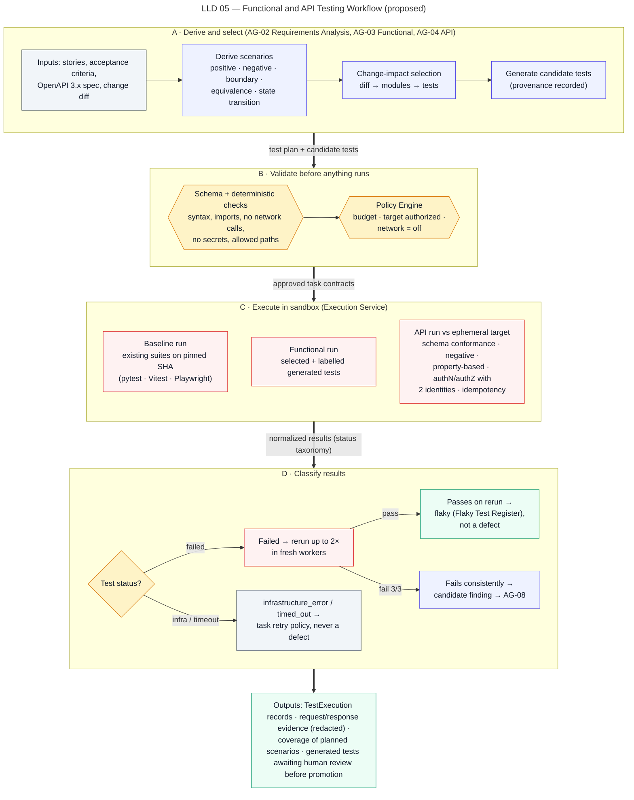

# Functional and API Testing Workflow

> Autonomous QA Swarm · Documentation v0.1 (Concept) · Status: Proposed — nothing described here is implemented yet.

This document describes how Autonomous QA Swarm is proposed to plan, select, run and record functional and API tests against a pinned commit, covering pipeline stages 4 (Baseline Run) and 5 (Functional & API Testing) and the hand-off to stage 9. Agents propose scenarios, selections and candidate tests; the Policy Engine validates them and the Execution Service runs them in disposable sandbox workers. No agent executes code, holds credentials or changes the repository.

## Purpose

The workflow is intended to answer three questions for a given commit, with evidence:

1. Do the existing suites pass on the pinned revision, and which failures are deterministic rather than flaky?
2. Which requirements, stories and API operations affected by the change are exercised, and which are not?
3. Does the API conform to its OpenAPI contract, reject malformed and unauthorized requests, enforce object ownership and handle duplicate requests safely?

The output is `TestExecution` records, candidate findings and coverage data used for quality gates QG-03 (functional pass rate) and QG-04 (plan execution coverage). Passing tests do not prove correctness; the workflow measures what was executed and reports what was not.

## Scope and implementation status

| Capability | Status | Requirement |
|---|---|---|
| Existing-suite execution (pytest, Jest/Vitest, Playwright) | Planned (MVP) | FR-015 |
| Test execution records and status taxonomy | Planned (MVP) | FR-017 |
| Flaky detection and Flaky Test Register | Planned (MVP) | FR-018 |
| Scenario derivation from requirements and OpenAPI | Planned (MVP) | FR-013 |
| Change-impact test selection | Planned (MVP) | FR-014 |
| Generated candidate tests with provenance and review | Planned (MVP) | FR-016 |
| OpenAPI schema conformance | Planned (MVP) | FR-019 |
| Negative, boundary and property-based API tests | Planned (MVP) | FR-020 |
| AuthN/AuthZ and object ownership checks on ephemeral targets | Planned (MVP) | FR-021 |
| API checks against registered external non-production targets | Future | FR-021 |
| JUnit 5 and other non-MVP languages | Future | FR-015 |
| Exporting generated tests as a pull request (HA-12) | Future | FR-041 |

No item in this document has the status **Implemented / Verified**; that label will only be applied once code exists and its acceptance tests pass.

## Actors and agents

| Actor | Role in this workflow |
|---|---|
| Orchestrator Agent (AG-01) | Places functional and API tasks in the job DAG, enforces dependencies, leases, retries and timeouts |
| Requirements Analysis Agent (AG-02) | Converts requirements, stories, OpenAPI specs and the change diff into `TestScenario` records with priorities |
| Functional Testing Agent (AG-03) | Proposes test selection, baseline runs and candidate tests; interprets runner output |
| API Testing Agent (AG-04) | Proposes schema, negative, boundary, property-based, auth and idempotency checks |
| Policy Engine | Validates every proposal against task contracts, scope, target authorization and budgets |
| Execution Service and Sandbox Workers | Run approved task contracts with network off during execution; collect bounded output |
| Target Environment Manager | Starts the ephemeral app under test inside the sandbox network |
| Secrets Broker | Injects scoped, short-lived, non-production test-user credentials when authorized |
| Evidence and Defect Analysis Agent (AG-08) | Correlates results into findings, requests reproductions |
| QA Engineer, QA Lead, Developer | Review generated tests, acknowledge quarantine, triage findings |

Short names (Orchestrator, Evidence Agent) are used after first mention below.

## Preconditions

- The repository is registered and the ref is resolved to an immutable commit SHA with a `SourceSnapshot` (tarball plus SHA-256) produced by the Source Intake Service.
- The job plan (`JobPlan`) is validated; if the plan approval gate is enabled, HA-05 has been recorded.
- Environment Preparation has built the project in a sandbox, with dependencies fetched only through the allow-listed egress proxy.
- At least one supported runner adapter matches the repository (Python with pytest, or JavaScript/TypeScript with Jest/Vitest or Playwright in the MVP).
- For API testing: an OpenAPI document is present in the snapshot or supplied as a job input, and the target is an ephemeral in-sandbox target, or (Future) a registered target with a valid `TargetAuthorization` from HA-01.
- For authorization checks: two non-production test identities are configured as credential references, and the Secrets Broker is permitted to inject them for this target.

## Workflow

Figure LLD 05 Functional and API Testing Workflow shows the sequence from scenario derivation to recorded results.



*Figure LLD 05 — Functional and API Testing Workflow (proposed).*

### Step 1 — Scenario derivation

The Requirements Analysis Agent receives, through the Model Gateway, linked requirements and stories, the OpenAPI document and the change diff summary. Repository content is treated as untrusted data (SEC-014). The agent emits typed `TestScenario` proposals, each with a priority (P0, P1, P2), source reference, acceptance criteria and expected oracle (assertion, schema, status code).

The output is schema-validated (SEC-015). An invalid output receives one corrective retry with the validation errors; a second failure ends the task as `invalid_output`, and the job continues with existing suites only, recorded as a coverage limitation.

### Step 2 — Change-impact test selection

The Functional Testing Agent proposes which tests to run. Selection combines deterministic signals (files changed in the diff, import graph, test-to-module mapping from previous coverage data) with the derived scenarios. The proposal lists selected tests, deselected tests and the reason for each deselection.

Selection rules are conservative:

- All tests mapped to a P0 scenario are always selected.
- If no reliable mapping exists (first job, missing coverage data), the full suite is selected.
- Deselected tests are reported as "not selected", never as passed.
- The Policy Engine rejects a selection that would exceed the task budget (30 min wall clock per task by default, 2 h maximum) and asks for sharding instead.

### Step 3 — Baseline run of existing suites

Before candidate tests run, the existing suites execute on the pinned commit exactly as checked in. This baseline establishes which failures already exist and gives timing data used by the mutation stage. Baseline results are stored as `TestExecution` records with provenance `existing`.

### Step 4 — Generated candidate tests

Where scenarios are not covered by existing tests, the Functional Testing Agent or API Testing Agent may propose candidate tests. Each generated `TestCase` carries provenance: generating agent, model identifier, prompt-template version, prompt and response hashes from the Model Gateway, the scenario it targets and the commit SHA.

Generated tests follow strict rules:

- They are labelled `generated` everywhere: in results tables, reports and exports.
- They run only inside sandbox workers on the pinned snapshot; they are never written into the repository by the platform.
- A failure in a generated test produces a finding only at Candidate level until a deterministic oracle and reproduction confirm it; LLM opinion alone can never lift it to Confirmed.
- Promotion into the project's suite requires human review by a QA Engineer, QA Lead or the code owner, recorded as an `Approval`. Exporting the reviewed test as a pull request is HA-12 and is Future.
- A generated test that fails on the unchanged baseline commit and on the candidate in the same way is flagged as a likely test defect, not a product defect.

### Step 5 — Sandbox execution through runner adapters

The Execution Service turns approved task contracts into `WorkerRun`s. Each worker uses defaults of 2 vCPU, 4 GiB RAM, 512 PIDs, 10 GiB disk and 50 MiB captured output, runs as UID 10001 with a read-only root filesystem and has network off during execution, except for the private sandbox network to the ephemeral target.

Versioned runner adapters (NFR-017) translate native output (pytest JUnit XML, Jest/Vitest reporters, Playwright JSON) into the common status taxonomy and record tool name and version.

### Step 6 — Flaky detection

A failed test is re-run up to 2 times, each in a fresh worker. A pass on either rerun classifies the test as `flaky`: it is not a defect, it is added to the project's Flaky Test Register (`FlakyTestRecord`) and reported separately. Deterministic failures are results, not errors, and are never retried as infrastructure faults.

### Step 7 — API testing

The API Testing Agent proposes a check plan per OpenAPI operation; deterministic runners (Schemathesis-style generation on Hypothesis, or pytest-based clients) execute it.

#### Schema conformance

Every response is validated against the declared schema: status code declared for the operation, content type, required fields, types, formats and enum values. Undeclared status codes and schema violations are deterministic oracles.

#### Negative, boundary and property-based

Generated inputs include missing fields, wrong types, oversized strings, invalid formats, numeric limits, precision edges and stateful sequences from OpenAPI links. Expected behavior is a 4xx with a problem-style body, not a 5xx. Each operation has a bounded example budget; the number of examples run is recorded.

#### Authentication and object-level authorization

Checks use two test identities, A and B, on an authorized target only:

1. Request without a token, expect 401.
2. Request with a malformed or expired token, expect 401.
3. Identity A creates or reads an object it owns, expect 2xx.
4. Identity B requests A's object by identifier, expect 403 or 404 and no A data in the body.
5. Identity B attempts modification of A's object, expect 403 or 404 and unchanged state on a follow-up read by A.

Checks are non-destructive (SEC-018): write attempts target only objects created by the test identities on the ephemeral target.

#### Idempotency and duplicate-request checks

For fintech-style operations that create money movements or other state, checks verify that:

- the same `Idempotency-Key` with the same payload returns the original response and creates one resource;
- the same key with a different payload is rejected (typically 409 or 422) and creates nothing;
- two concurrent requests with the same key produce exactly one resource;
- a retry after a client-side timeout does not duplicate the effect.

The oracle is a follow-up read (count of resources created), not only the status code.

### Step 8 — Hand-off to evidence correlation

Failed and anomalous results become `candidate` findings with linked `EvidenceItem`s. The Evidence Agent fingerprints, deduplicates and schedules reproduction runs in fresh sandboxes before any finding is scored as Confirmed.

## Decision rules

### Status taxonomy

| Status | Meaning | Counts toward |
|---|---|---|
| `passed` | Test assertions held | QG-03 numerator and denominator |
| `failed` | Deterministic assertion or oracle failure after reruns | QG-03 denominator |
| `skipped` | Skipped by test code or markers | Not executed for QG-04 |
| `blocked` | Precondition unmet (dependency task failed, target unavailable) | Not executed for QG-04 |
| `timed_out` | Exceeded per-test or task time limit | Not executed; QG-08 |
| `infrastructure_error` | Worker crash, image pull, resource exhaustion | Not executed; QG-08 |
| `flaky` (derived) | Failed, then passed on a fresh-worker rerun | Reported separately |

### Numeric rules

| Rule | Value |
|---|---|
| Fresh-worker reruns of a failed test | Up to 2 |
| Quarantine trigger | 3 flaky occurrences in 14 days, QA Lead acknowledgement required |
| Infrastructure retries | Max 2 (backoff 30 s, 120 s, ±20% jitter) |
| Invalid LLM output | Max 1 corrective retry, then `invalid_output` |
| Lease TTL / heartbeat | 90 s / 30 s |
| QG-03 functional pass rate | ≥ 98% of executed in-scope tests, 100% of P0 scenarios |
| QG-04 plan execution coverage | ≥ 95% of P0 and ≥ 85% of P1 scenarios executed |
| QG-08 infrastructure health | ≤ 5% of tasks `infrastructure_error` or `timed_out` |
| Confirmed finding | DCS ≥ 80 and reproduced (≥ 2 of 3 fresh runs) |

Quarantined tests are excluded from the QG-03 denominator only after the quarantine is acknowledged; until then a flaky test still appears in the Flaky Test Register and the report.

## Outputs and evidence

The workflow is proposed to produce:

- `TestScenario` and `TestCase` records with provenance (`existing` or `generated`).
- `TestExecution` records: status, duration, runner and version, worker run ID, commit SHA, attempt number.
- `FlakyTestRecord` entries.
- Endpoint coverage matrix for the API Test Results screen (SCR-07).
- Evidence items stored content-addressed (SHA-256) in the Evidence Store: runner reports, logs, assertion diffs, Playwright traces and screenshots, and redacted request/response pairs.

Redaction happens inside the worker before output leaves it (SEC-008). Authorization headers, cookies, tokens and configured sensitive fields are replaced; a redaction manifest records which fields were redacted but never their values.

```json
{
  "evidence_type": "http_exchange",
  "sample": true,
  "job": "QJ-1042",
  "commit": "7c9e2a1f4b",
  "identity": "test-identity-B",
  "request": {
    "method": "GET",
    "route_template": "/v1/accounts/{account_id}/statements",
    "path": "/v1/accounts/acc_A-owned/statements",
    "headers": {"Authorization": "[REDACTED:bearer]"}
  },
  "response": {
    "status": 200,
    "body_excerpt": {"account_id": "acc_A-owned", "items": "[3 statements, PII fields redacted]"}
  },
  "expected": "403 or 404, no data belonging to identity A",
  "redaction_manifest": ["request.headers.Authorization", "response.body.items[*].iban"]
}
```

## Failure handling

| Failure | Handling |
|---|---|
| Runner not detected or unsupported language | Task `skipped` with reason; scenarios counted as not executed for QG-04 |
| Build fails in Environment Preparation | Dependent tasks `blocked`; job continues with static stages if possible |
| Worker crash or image pull failure | `infrastructure_error`, up to 2 retries with backoff |
| Lease expires (no heartbeat) | `failed_retryable`, then `retry_scheduled` |
| Ephemeral target fails health check | API tasks `blocked`; reported, not counted as API failures |
| OpenAPI document invalid | Schema conformance `skipped`; validation errors attached as evidence |
| Test identity credential missing or revoked | Authorization tests recorded as `blocked`; if detected during validation the job ends `blocked`, otherwise the job continues and finishes `completed_with_warnings` |
| Output exceeds 50 MiB | Output truncated, truncation recorded in evidence |
| Agent proposes out-of-scope target or path | Policy Engine denies; audit event written |

Failures never silently turn into passes; anything not executed affects QG-04 and QG-08.

## Human gates

- **HA-01** — a target used for API testing beyond the ephemeral sandbox must be registered and its authorization attested by an Org Admin or Security Reviewer.
- **HA-05** — a QA Lead approves the job plan when the plan approval gate is enabled.
- **HA-07** — a QA Lead marks a functional finding as false positive, with a reason.
- **HA-08** — a QA Lead accepts risk on a Confirmed functional finding, with an expiry.
- **HA-11** — an Org Admin registers or rotates the test-identity credentials.
- **HA-12** (Future) — a code owner exports reviewed generated tests as a pull request.
- Quarantine acknowledgement and review before promotion of generated tests are human steps recorded as `Approval` records.

## Example walk-through (sample data)

The following uses the illustrative Northwind Fintech (sample org) dataset.

Job QJ-1042 targets `northwind/payments-api` at ref `release/2.8`, pinned to commit `7c9e2a1f4b`, with profile Functional Standard. The Requirements Analysis Agent derives scenarios from the OpenAPI document and the release stories, including a P0 scenario "a customer can read only their own account statements" and a P0 scenario "a transfer request is processed at most once per Idempotency-Key".

Change-impact selection finds that `app/routers/statements.py` and the transfer service changed, so all tests mapped to those modules plus all P0-mapped tests are selected. The baseline run and subsequent execution record 1,286 executed tests in this sample: 1,241 passed, 19 failed, 14 skipped, 3 blocked, 2 timed_out and 7 infrastructure_error.

Four tests failed once and passed on a fresh-worker rerun, including `test_statement_pagination_cursor`. They are classified `flaky` and added to the Flaky Test Register. None has reached 3 occurrences in 14 days, so none is quarantined.

API testing produces three notable results in the sample:

- With identity B, `GET /v1/accounts/{account_id}/statements` for an account owned by identity A returns 200 with A's statements. Reproduced 3 of 3 times in fresh sandboxes, this becomes FND-0193, Critical, Confirmed, CWE-639, DCS 92.
- Reusing an `Idempotency-Key` on the transfer endpoint with a different payload creates a second transfer; the follow-up read shows two resources. This becomes FND-0195, High, Confirmed, DCS 88.
- A boundary case with amount 0.005 is accepted, rounded to 0.00, and the transfer succeeds. This becomes FND-0196, Medium, Confirmed, DCS 84.

Quality gates for QJ-1042 remain "Pending" while the job is in the Evidence Correlation & Triage stage.

## Limitations

- Passing tests show only that the executed checks held on this commit in this sandbox; they do not prove absence of defects.
- Change-impact selection depends on mapping quality; low-confidence mappings fall back to fuller runs, which costs time.
- Generated tests can encode wrong expectations. They are labelled, sandboxed and reviewed for that reason.
- Property-based generation is bounded by an example budget and may miss rare input combinations.
- Authorization checks cover only the two configured identities and the operations in the OpenAPI document; undocumented endpoints are not tested.
- Flaky classification by rerun can hide intermittent product defects such as race conditions; the register keeps them visible.
- External targets, non-MVP languages and UI coverage beyond Playwright suites in the repository are out of MVP scope.

## Related requirements and security controls

- Functional: FR-013, FR-014, FR-015, FR-016, FR-017, FR-018, FR-019, FR-020, FR-021, FR-032, FR-035, FR-041.
- Security: SEC-003, SEC-004, SEC-007, SEC-008, SEC-014, SEC-015, SEC-016, SEC-018.
- Quality gates: QG-03, QG-04, QG-08.

See also the [Agent catalogue](../06-agent-design/01-agent-catalogue.md), [Sandboxed execution](../10-security-and-threat-model/03-sandboxed-execution.md), [Evidence and defect analysis](../11-quality-gates-and-reporting/01-evidence-and-defect-analysis.md), [Quality gates and release readiness](../11-quality-gates-and-reporting/02-quality-gates-and-release-readiness.md) and [API contracts](../08-api-specifications/01-api-contracts.md).
