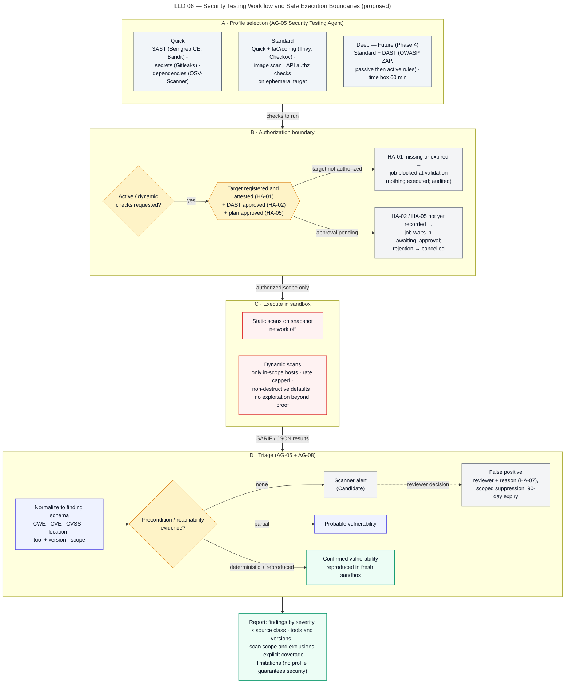

# Security Testing Workflow

> Autonomous QA Swarm · Documentation v0.1 (Concept) · Status: Proposed — nothing described here is implemented yet.

This document describes how Autonomous QA Swarm is proposed to run security testing in pipeline stage 6 (Security Testing) and how scanner output is triaged before it can be reported as a vulnerability. The Security Testing Agent selects and orchestrates deterministic scanners and proposes triage decisions; the Policy Engine authorizes every scan; the Execution Service runs scanners in sandbox workers. Security testing is always authorized, bounded and non-destructive by default. No profile claims comprehensive security coverage.

## Purpose

The workflow is intended to:

- run a repeatable set of static and (when authorized) dynamic checks against a pinned commit;
- convert scanner output into findings whose confidence reflects evidence, not tool volume;
- separate **Scanner alert**, **Probable vulnerability**, **Confirmed vulnerability** and **False positive**;
- feed quality gates QG-01 and QG-02, plus an explicit coverage-limitation statement.

It is not a penetration test and never exploits beyond proof of reachability (SEC-018).

## Scope and implementation status

| Capability | Status | Requirement |
|---|---|---|
| SAST (Semgrep CE, language linters) | Planned (MVP) | FR-022 |
| Dependency scanning (OSV-Scanner) | Planned (MVP) | FR-023 |
| Secret detection with redaction (Gitleaks) | Planned (MVP) | FR-024 |
| IaC/config and container image scanning (Trivy, Checkov) | Planned (MVP) | FR-025 |
| API negative/authz checks against ephemeral target | Planned (MVP) | FR-021 |
| DAST (OWASP ZAP) against ephemeral targets | Future | FR-026 |
| DAST against registered external non-production targets | Future | FR-026 |
| Triage workflow, suppressions, false positives | Planned (MVP) | FR-037 |

The **Deep** profile depends on DAST and is therefore Future; the MVP is planned to offer Quick and Standard. No item has the status **Implemented / Verified**.

## Actors and agents

| Actor | Role in this workflow |
|---|---|
| Orchestrator Agent (AG-01) | Schedules security tasks in the DAG within profile and budget |
| Security Testing Agent (AG-05) | Selects tools per language, proposes scan tasks, triages scanner output, proposes reachability checks |
| API Testing Agent (AG-04) | Runs API negative and authorization checks in the Standard and Deep profiles |
| Evidence and Defect Analysis Agent (AG-08) | Fingerprints, deduplicates, computes the Defect Confidence Score (DCS), schedules reproductions |
| Policy Engine | Enforces target authorization, scope, exclusions, time box and network rules |
| Execution Service and Sandbox Workers | Run scanners with pinned image digests; network off for static scans |
| Target Environment Manager | Starts ephemeral targets or binds a registered non-production target |
| Security Reviewer | Attests targets (HA-01), approves DAST (HA-02), marks false positives (HA-07), co-approves accepted risk (HA-08) |
| Org Admin | Registers targets and attests authorization (HA-01) |
| QA Lead | Approves the job plan (HA-05) and accepts risk (HA-08, with a Security Reviewer for security findings) |

## Preconditions

- Pinned commit and `SourceSnapshot` exist; Environment Preparation has completed for checks that need a built artifact or container image.
- Scanner worker images are pinned by digest, signed and SBOM-tracked (SEC-006); scanner rule packs are versioned and recorded.
- For Standard: an ephemeral target can be started by the Target Environment Manager.
- For Deep: the target has a `TargetAuthorization` attested via HA-01; HA-02 is recorded for active checks; HA-05 plan approval is recorded (the gate is on by default for Deep).
- Any outbound allow-list entries needed for scanner databases (for example vulnerability feeds) are approved via HA-04 and are reachable only during the dependency-fetch phase.

## Security profiles

The profiles below are exactly the proposed defaults. Each profile includes everything in the one before it.

| Check | Tool (proposed) | Quick | Standard | Deep |
|---|---|---|---|---|
| SAST | Semgrep CE + language linters (e.g. Bandit) | Yes | Yes | Yes |
| Secret detection | Gitleaks | Yes | Yes | Yes |
| Dependency scanning | OSV-Scanner | Yes | Yes | Yes |
| IaC/configuration scan | Trivy config / Checkov | No | Yes | Yes |
| Container image scan | Trivy | No | Yes | Yes |
| API negative/authz checks (ephemeral target) | API Testing Agent | No | Yes | Yes |
| DAST passive then active | OWASP ZAP baseline + API scan | No | No | Yes |

| Profile | Approvals | Time bound | Status |
|---|---|---|---|
| Quick | None beyond job creation | Task defaults (30 min per task) | Planned (MVP) |
| Standard | None for ephemeral target | Task defaults | Planned (MVP) |
| Deep | HA-01, HA-02, HA-05 | DAST bounded to 60 min | Future |

## Tool selection by language

The Security Testing Agent proposes tools from detected languages and manifests; the Policy Engine accepts only tools in the project's allowed tool set.

| Language or artifact | SAST | Dependencies | Notes |
|---|---|---|---|
| Python | Semgrep CE Python rules + Bandit | OSV-Scanner on lockfiles and requirements | MVP language |
| JavaScript/TypeScript | Semgrep CE JS/TS rules | OSV-Scanner on npm/yarn/pnpm lockfiles | MVP language |
| Java | Semgrep CE Java rules | OSV-Scanner on Maven/Gradle | Future (Phase 4) |
| Dockerfiles, Kubernetes, Terraform | Trivy config / Checkov | Not applicable | Standard and Deep |
| Built container image | Trivy | Image OS and language packages | Standard and Deep |
| All files and history in snapshot | Gitleaks | Not applicable | All profiles |

Semgrep registry rules fall under the Semgrep Rules License; operators are expected to check the terms before adoption.

## Workflow

Figure LLD 06 Security Testing Workflow shows the profile checks, the authorization gate, the static scans, optional DAST and the triage and promotion rules.



*Figure LLD 06 — Security Testing Workflow and Safe Execution Boundaries (proposed).*

### Step 1 — Profile resolution and authorization gate

The Orchestrator expands the selected profile into scan tasks. The Policy Engine then evaluates each task:

- static tasks need only the pinned snapshot and are allowed with network off;
- tasks needing a target require an ephemeral target or a registered target with a valid authorization (HA-01);
- active DAST additionally requires HA-02 and, for Deep, HA-05;
- a missing or expired target authorization (HA-01) is detected during `validating`, and the job moves to `blocked` before any execution, as in the sample job QJ-1037;
- a missing DAST approval (HA-02) holds the job in `awaiting_approval` after planning; no DAST task is leased until it is granted, and a rejection ends the job `cancelled`.

### Step 2 — Static scans in the sandbox

SAST, secret detection, dependency scanning, IaC scanning and image scanning run in sandbox workers on the read-only snapshot with network off. Vulnerability databases are fetched in the dependency-fetch phase through the allow-listed proxy and their version or snapshot date is recorded. Output is SARIF or tool JSON, capped at 50 MiB per task.

Secret detection output is redacted inside the worker: only the rule, file, line and a short hash of the matched value leave the sandbox (SEC-008). The secret value itself is never written to the Evidence Store, the Model Gateway or the report.

### Step 3 — DAST, passive then active (Deep only, Future)

DAST runs in two phases against an authorized ephemeral or registered non-production target:

1. **Passive phase** — ZAP baseline spider and passive rules observe traffic without attack payloads.
2. **Active phase** — only after the passive phase completes and HA-02 is valid, ZAP active rules and the API scan run against operations in the OpenAPI document.

Controls on DAST:

- **Scope** — only hosts and path prefixes listed in the `TargetAuthorization`; requests outside scope are dropped by the egress proxy.
- **Exclusions** — paths such as logout, account deletion, payment execution against real processors or admin bulk actions are excluded by default; projects can add exclusions.
- **Time box** — 60 min total; on expiry the scan stops and results are recorded as partial.
- **Rate** — request rate is capped by the target policy; a target health check failing repeatedly stops the scan.
- **Non-destructive** — rules known to modify or delete data are disabled unless the target is ephemeral.

### Step 4 — Normalization and triage

All scanner output is normalized into `Finding` records with status `candidate` and source class **Scanner alert**. The Evidence Agent fingerprints each finding (category, normalized location, rule or CWE id) and merges exact matches as `duplicate`.

The Security Testing Agent then proposes, per alert, the evidence needed to move it forward. Typical checks are:

- **Reachability** — is the vulnerable function or sink called from code that is reachable from an entry point (route handler, CLI, job)?
- **Precondition** — does the vulnerable configuration actually apply (for example, the vulnerable library option is enabled)?
- **Exposure** — is the code changed or externally reachable, internal, or test-only?
- **Reproduction** — for API and DAST findings, does a request reproduce the behavior in a fresh sandbox?

Each check is a deterministic task (call-graph query, configuration read, request replay) proposed by the agent and run by the Execution Service. The agent's opinion is recorded but can count at most toward the independent-corroboration component of DCS.

### Step 5 — Promotion

Promotion rules follow the finding lifecycle and DCS levels:

| Source class | Display confidence | Rule |
|---|---|---|
| Scanner alert | Candidate | Default for all scanner output; DCS < 50 |
| Probable vulnerability | Probable | DCS 50–79 with reachability or precondition evidence |
| Confirmed vulnerability | Confirmed | DCS ≥ 80 and reproduced in a fresh sandbox (≥ 2 of 3 runs) |
| False positive | Rejected | HA-07 by a Security Reviewer, with reason |

A finding that lacks reproducible evidence cannot be Confirmed ("No evidence, no defect"). If agents disagree, for example a scanner reports an injection sink and the API checks find no effect, the finding is flagged **Disputed**, stays in `triaging` and is routed to a human.

### Step 6 — False-positive workflow and suppressions

A Security Reviewer marks a finding false positive (HA-07) through `POST /findings/{finding_id}/triage` with a mandatory reason. Optionally a `Suppression` is created:

- scoped to rule id plus location fingerprint, never to a whole rule globally by default;
- expiring after 90 days by default; expiry re-opens matching alerts as `candidate` on the next job;
- audited, with the reviewer, reason and expiry in the hash-chained Audit Log.

Accepted risk on a Confirmed security finding is different from a false positive: it requires HA-08 by a QA Lead and a Security Reviewer, with an expiry.

### Step 7 — Security regression after patch

When a Confirmed security finding receives an approved patch, the Independent Verification Agent re-runs the original reproduction and the scanner rule that raised the finding, plus the relevant profile checks, on the pinned commit plus patch in a fresh sandbox. The finding moves to `fix_verified` only if the reproduction no longer succeeds and no new High or Critical alert appears in the changed files. Later jobs keep the original reproduction as a regression check.

## Decision rules

| Rule | Value |
|---|---|
| DCS Confirmed | ≥ 80 and reproduced |
| DCS Probable | 50–79 |
| DCS Candidate | < 50 |
| Reproduction | Fresh sandbox, ≥ 2 of 3 runs |
| Suppression expiry | 90 days default |
| DAST time box | 60 min |
| QG-01 | 0 open Confirmed Critical findings |
| QG-02 | 0 open Confirmed High security findings without accepted risk |
| Forced verdict | Open Confirmed Critical, or Confirmed High security without accepted risk, forces `NOT_READY` |

### CWE, CVE and CVSS mapping

- Every security finding carries a CWE id where the rule or scanner provides one; the Security Testing Agent may propose a CWE for unmapped rules, labelled as proposed until a reviewer confirms it.
- Dependency findings carry CVE and OSV/GHSA identifiers, affected and fixed versions.
- Severity uses the CVSS v3.1 or v4 base score where available and maps to platform severity (Critical, High, Medium, Low, Informational) using the standard CVSS qualitative bands.
- Without CVSS, severity is the scanner's severity mapped to the platform scale, and the mapping source is recorded.
- Risk Priority = Severity weight × Confidence factor × Exposure, as defined in [Quality gates and release readiness](../11-quality-gates-and-reporting/02-quality-gates-and-release-readiness.md). It orders the triage queue; it never overrides QG-01 or QG-02.

### Finding schema fields

```json
{
  "id": "fnd_01J...", "display_id": "FND-0194", "sample": true,
  "job_id": "job_01J...", "commit_sha": "7c9e2a1f4b",
  "category": "security.dependency",
  "title": "Vulnerable dependency PyJWT 2.3.0 (CVE-2022-29217)",
  "source_class": "probable_vulnerability",
  "status": "triaging", "confidence": "probable", "dcs": 64,
  "severity": "high", "cvss": {"version": "3.1", "base_score": "from advisory"},
  "cwe": "CWE-327", "cve": "CVE-2022-29217",
  "location": {"file": "requirements.lock", "package": "PyJWT", "version": "2.3.0"},
  "fingerprint": "sha256:...",
  "tool": {"name": "OSV-Scanner", "version": "recorded per run", "rule_db": "snapshot date"},
  "exposure": "changed_or_external",
  "reachability": {"status": "unconfirmed", "evidence": []},
  "evidence_ids": ["evd_01J..."],
  "suppression": null, "disputed": false
}
```

The CWE and advisory values above are illustrative; real values come from the advisory database at scan time.

## Outputs and evidence

- `Finding` records with source class, confidence, DCS breakdown and fingerprint.
- Raw scanner output (SARIF/JSON) as content-addressed `EvidenceItem`s, with tool name, version, rule pack version and database snapshot date.
- Reachability and precondition evidence: call paths, configuration excerpts, replayed requests with redacted headers.
- DAST session evidence: scope, exclusions, request counts, passive and active phase durations, stop reason.
- SARIF export for code-scanning integrations (FR-045).
- A coverage-limitation statement for the Security Testing Center (SCR-08) and the report.

### Coverage-limitation statement

Every security report is proposed to include a generated statement such as: "This job ran the Standard security profile: SAST (Semgrep CE, Bandit), secret detection (Gitleaks), dependency scanning (OSV-Scanner), IaC/config and image scanning (Trivy, Checkov) and API negative/authorization checks against an ephemeral target. DAST was not run. Business-logic flaws, authentication flows outside the OpenAPI document, runtime configuration of production, and vulnerabilities not covered by the listed rules are outside the scope of these checks. Absence of findings is not evidence of absence of vulnerabilities."

## Failure handling

| Failure | Handling |
|---|---|
| Missing or expired target authorization | Task denied; job `blocked` if the profile requires the target |
| HA-02 revoked during DAST | Active phase stops immediately; partial results recorded |
| Scanner crash or image pull failure | `infrastructure_error`, max 2 retries |
| Vulnerability database fetch fails | Dependency scan `blocked`; reported, not treated as clean |
| Scanner output exceeds 50 MiB | Truncated with marker; triage notes incompleteness |
| DAST time box reached | Scan stopped, results marked partial |
| Target health check failing | DAST stopped; target availability recorded |
| Reachability check inconclusive | Finding stays Probable or Candidate; never silently dropped |
| Secret found in non-test code | Redacted evidence; finding raised; secret value never stored |

## Human gates

- **HA-01** — target registration and authorization attestation (Org Admin or Security Reviewer).
- **HA-02** — DAST or other active checks against a target (Security Reviewer).
- **HA-04** — outbound allow-list additions for scanner feeds (Org Admin).
- **HA-05** — plan approval, default on for Deep (QA Lead).
- **HA-07** — false positive or rule suppression (Security Reviewer).
- **HA-08** — accepted risk on a Confirmed security finding (QA Lead + Security Reviewer).
- **HA-09** — overriding QG-01 or QG-02 (QA Lead, reason mandatory, audited).

## Example walk-through (sample data)

Sample job QJ-1042 on `northwind/payments-api` (commit `7c9e2a1f4b`) runs the Security Standard profile against an ephemeral target. All values below are illustrative.

- **FND-0193** — the API authorization check finds identity B can read identity A's statements on `GET /v1/accounts/{account_id}/statements`. Reproduced 3/3; CWE-639; DCS 92; Critical; **Confirmed vulnerability**. It triggers QG-01 and forces `NOT_READY` until a verified fix is part of the evaluated commit; accepting risk does not satisfy QG-01 for a Critical finding.
- **FND-0194** — OSV-Scanner reports PyJWT 2.3.0 with CVE-2022-29217. The reachability check cannot confirm that the vulnerable algorithm path is used, so it remains **Probable vulnerability**, High, DCS 64. It does not trigger QG-02, which counts only Confirmed findings, but it appears as a residual risk.
- **FND-0197** — Semgrep flags possible SQL string concatenation at `reports/export.py:118`. No reachable caller with user input is shown yet; it stays a **Scanner alert**, Candidate, Medium, DCS 38.
- **FND-0198** — Gitleaks flags a hard-coded password in `tests/fixtures/users.py`. A Security Reviewer marks it **False positive** under HA-07 with reason "test fixture, non-production value", and creates a suppression scoped to that rule and location fingerprint, expiring in 90 days.

## Limitations

- Static analysis has known false-positive and false-negative rates that vary by rule and language.
- Reachability analysis is approximate, especially for dynamic dispatch, reflection and framework routing.
- Dependency scanning depends on advisory database completeness and lockfile accuracy.
- DAST is Future, time-boxed and excludes destructive paths; it will miss deep business-logic flaws.
- No profile claims comprehensive security coverage; residual risk is always reported.

## Related requirements and security controls

- Functional: FR-021, FR-022, FR-023, FR-024, FR-025, FR-026, FR-033, FR-034, FR-035, FR-036, FR-037, FR-045.
- Security: SEC-003, SEC-004, SEC-005, SEC-006, SEC-008, SEC-014, SEC-015, SEC-016, SEC-018.
- Quality gates: QG-01, QG-02, QG-07.

See also [Security architecture and threat model](../10-security-and-threat-model/01-security-architecture-and-threat-model.md), [Safe-use policies](../10-security-and-threat-model/04-safe-use-policies.md), [Sandboxed execution](../10-security-and-threat-model/03-sandboxed-execution.md) and [Evidence and defect analysis](../11-quality-gates-and-reporting/01-evidence-and-defect-analysis.md).
