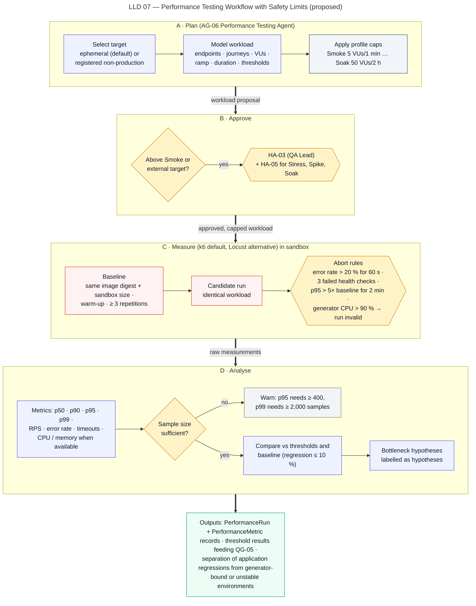

# Performance Testing Workflow

> Autonomous QA Swarm · Documentation v0.1 (Concept) · Status: Proposed — nothing described here is implemented yet.

This document describes how Autonomous QA Swarm is proposed to plan, approve, run and analyze bounded performance tests in pipeline stage 7 (Performance Testing). The Performance Testing Agent proposes workloads and interprets metrics; the Policy Engine enforces workload caps, approvals and target authorization; the Execution Service runs load generators (k6 by default, Locust as an alternative) in sandbox workers. Load testing is always authorized, bounded and stopped automatically when abort rules fire.

## Purpose

The workflow is intended to answer, with measured evidence:

- whether key endpoints meet the project's latency and error-rate thresholds on the pinned commit;
- whether the candidate commit has regressed against a comparable baseline;
- whether an observed slowdown is likely to come from the application, from the test environment, or from the load generator itself.

Results feed quality gate QG-05 (p95 ≤ project threshold, error rate ≤ 1%, p95 regression ≤ 10% vs. baseline) and the Performance Testing Lab screen (SCR-09). Results are only as representative as the sandbox or non-production environment they ran in; the workflow never presents them as production capacity figures.

## Scope and implementation status

| Capability | Status | Requirement |
|---|---|---|
| Smoke and Baseline profiles on ephemeral targets | Planned (MVP) | FR-027 |
| Baseline vs candidate comparison | Planned (MVP) | FR-029 |
| Load profile | Future | FR-028 |
| Stress, Spike and Soak profiles | Future | FR-028 |
| Runs against registered external non-production targets | Future | FR-028 |
| Safety limits and automatic abort | Planned (MVP) | SEC-017 |

No item has the status **Implemented / Verified**.

## Actors and agents

| Actor | Role in this workflow |
|---|---|
| Orchestrator Agent (AG-01) | Schedules performance tasks after functional smoke checks succeed |
| Performance Testing Agent (AG-06) | Proposes workload model, thresholds and profile; analyzes metrics; proposes bottleneck hypotheses |
| Requirements Analysis Agent (AG-02) | Supplies scenarios and any stated latency requirements |
| Policy Engine | Checks profile caps, approvals, target authorization, network rules, time limits |
| Execution Service and Sandbox Workers | Run the generator and, for ephemeral targets, the app under test; collect metrics |
| Target Environment Manager | Starts ephemeral targets or binds a registered non-production target |
| Evidence and Defect Analysis Agent (AG-08) | Turns threshold breaches into findings and requests reproduction runs |
| QA Lead | Approves profiles above Smoke and any external target run (HA-03), plan approval (HA-05) |
| Performance Test Engineer, Developer | Define thresholds, review analysis, triage findings |

## Preconditions

- Pinned commit, built image and passing functional smoke checks for the endpoints under test; performance tasks are `blocked` if the app does not start.
- Thresholds are configured per endpoint in the project (for example p95 in milliseconds) or explicitly marked as "baseline-only comparison".
- Test data is synthetic and non-production; test-user credentials, if needed, are injected by the Secrets Broker as scoped, short-lived values.
- Approvals for the chosen profile are recorded (table below).
- For external targets: a registered `TargetEnvironment` with a valid `TargetAuthorization` (HA-01) that names the allowed hosts, rate ceiling and time window.

## Performance profiles

| Profile | Default workload cap | Duration cap | Approval | Status |
|---|---|---|---|---|
| Smoke | 5 VUs | 1 min | None for ephemeral target | Planned (MVP) |
| Baseline | 20 VUs | 5 min | HA-03 | Planned (MVP) |
| Load | ≤ 100 VUs or ≤ 200 req/s | 15 min | HA-03 | Future |
| Stress | ramp to ≤ 500 VUs | 20 min | HA-03 + HA-05 | Future |
| Spike | burst to ≤ 300 VUs for ≤ 60 s | 5 min | HA-03 + HA-05 | Future |
| Soak | ≤ 50 VUs | 2 h | HA-03 + HA-05 | Future |

Any profile against an external (non-ephemeral) target requires HA-03, even Smoke. Caps are ceilings: a project may lower them but cannot raise them without a policy change by an Org Admin.

## Target selection

| Target type | When used | Controls |
|---|---|---|
| Ephemeral in-sandbox target | Default; MVP | Started by the Target Environment Manager from the pinned image; same sandbox network as the generator; destroyed at the end |
| Registered non-production target | Future; when realistic data or infrastructure is needed | HA-01 authorization, HA-03 approval, allowed hosts and rate ceiling enforced at the egress proxy |

Production targets are never valid. The Policy Engine rejects any target not registered as non-production, and rejects workloads that exceed the target's authorized rate ceiling.

## Workflow

Figure LLD 07 Performance Testing Workflow shows planning, approval, baseline, the run with abort rules, analysis and comparison.



*Figure LLD 07 — Performance Testing Workflow with Safety Limits (proposed).*

### Step 1 — Workload modelling

The Performance Testing Agent proposes a workload model as a typed proposal:

- **Endpoints and mix** — selected from changed routes (change-impact analysis), P0 scenarios and stated performance requirements, with a request mix (for example 70% reads, 30% writes).
- **Arrival model** — closed (fixed VUs with think time) for Smoke and Baseline; open (target request rate) for Load in the Future.
- **Ramp and duration** — within the profile caps, including a warm-up period that is excluded from measurement.
- **Data** — synthetic accounts and payloads generated in the sandbox; idempotency keys unique per request unless the scenario tests duplicates.
- **Thresholds** — per-endpoint p95 and error-rate thresholds from the project configuration.

The Policy Engine validates the proposal: VUs, rate and duration within caps, endpoints within the target's scope, write operations only against ephemeral targets or explicitly authorized test tenants.

### Step 2 — Approval

If the profile is above Smoke or the target is external, the job waits in `awaiting_approval` after planning until HA-03 is recorded, and no load task is leased before then. Stress, Spike and Soak also need HA-05. The approval screen shows profile, caps, target, abort rules, estimated duration and request volume. Approval is bound to the job plan hash; a changed plan needs re-approval.

### Step 3 — Baseline establishment

A candidate run is only compared with a baseline that is comparable. The comparability rules are:

| Rule | Requirement |
|---|---|
| Image | Same worker image and base runtime image digests; only the application layer built from the commit differs; a re-run of the same commit must use the same target image digest |
| Sandbox size | Same worker size for generator and target (default 2 vCPU, 4 GiB RAM) |
| Generator | Same tool and version, same script version, same workload model |
| Warm-up | Same warm-up duration, excluded from metrics |
| Repetitions | At least 3 repetitions for a baseline; the median of repetitions is used |
| Data | Same synthetic dataset size and seed |
| Age | Baseline produced on the same platform version and worker image digest |

If no comparable baseline exists, the platform is proposed to run the baseline commit (for example the merge base or the last release tag) in the same job, 3 times, before the candidate. If that is impossible within budget, the regression part of QG-05 is `inconclusive` and only absolute thresholds are evaluated.

### Step 4 — Candidate run with abort rules

The generator runs in its own sandbox worker; the target runs in a separate worker so that generator load does not distort target measurements. Automatic abort rules are evaluated continuously by a deterministic monitor:

| Abort rule | Effect |
|---|---|
| Error rate > 20% for 60 s | Run stopped; result recorded as aborted with reason |
| Target health check failing 3× consecutively | Run stopped; target instability recorded |
| p95 > 5× baseline for 2 min | Run stopped; severe regression evidence retained |
| Generator CPU > 90% | Run marked invalid (generator-bound); not used for gates |

Duration caps and the per-task wall clock (30 min default, 2 h maximum, needed for Soak) are enforced independently of these rules. Cancellation of the job stops the generator first, then destroys both workers.

### Step 5 — Metric collection

Metrics are collected per endpoint and for the whole run:

- latency percentiles p50, p90, p95 and p99;
- throughput (requests per second, RPS);
- error rate (non-2xx/3xx responses and transport errors) and timeouts, reported separately;
- request count (sample size) per endpoint;
- target CPU and memory when the worker exposes them;
- generator CPU and memory, always, to detect generator-bound runs.

Raw k6 summary output and time-series data are stored as `EvidenceItem`s; aggregated values are stored as `PerformanceMetric` rows linked to the `PerformanceRun`.

### Step 6 — Threshold evaluation and comparison

Evaluation is deterministic:

1. Check sample size per endpoint; attach warnings where below minimums.
2. Compare candidate p95 with the absolute project threshold.
3. Compare error rate with 1%.
4. Compute p95 regression = (candidate p95 − baseline median p95) / baseline median p95.
5. Classify each endpoint as within threshold, breach, or inconclusive.

### Step 7 — Separating causes

Before a breach becomes a finding, the workflow tries to rule out non-application causes:

| Signal | Interpretation | Treatment |
|---|---|---|
| Generator CPU > 90% | Generator-bound | Run invalid; re-run with more generator resources or lower load |
| Health check flapping, worker throttling, noisy-neighbor indicators | Environment instability | Run marked unstable; gate `inconclusive` unless a rerun is clean |
| High variance between baseline repetitions (spread larger than the regression being measured) | Baseline not stable enough | Regression result `inconclusive` |
| Stable environment, comparable baseline, breach repeated in reruns | Probable application regression | Finding raised |

### Step 8 — Findings and hypotheses

A reproduced breach becomes a performance finding. The Performance Testing Agent may add bottleneck hypotheses (for example "the new ownership query may lack an index"), always labelled **Hypothesis** and never used as evidence for DCS beyond the independent-corroboration component. Hypotheses can suggest a targeted follow-up run, which the Evidence Agent may schedule.

## Decision rules

| Rule | Value |
|---|---|
| QG-05 absolute | p95 ≤ project threshold |
| QG-05 errors | Error rate ≤ 1% |
| QG-05 regression | p95 regression ≤ 10% vs. baseline |
| QG-05 blocking | Yes, when a performance profile ran |
| Baseline repetitions | ≥ 3 |
| p95 minimum samples | ≥ 400 per endpoint |
| p99 minimum samples | ≥ 2,000 per endpoint |
| Confirmed performance finding | DCS ≥ 80 and breach reproduced (≥ 2 of 3 runs) |

Below 400 samples, p95 is shown with a warning and cannot fail QG-05 on its own; the gate becomes `inconclusive` for that endpoint. Below 2,000 samples, p99 is shown as indicative only.

## Outputs and evidence

- `PerformanceRun` records: profile, workload model hash, target, approvals, start/stop, stop reason (completed, aborted, invalid).
- `PerformanceMetric` rows per endpoint and percentile.
- Evidence: generator script version, tool version, raw summary, time series, generator and target resource metrics, environment metadata (image digests, worker sizes).
- Baseline vs candidate comparison table and sample-size warnings for SCR-09.
- Performance findings with DCS, linked to evidence; hypotheses kept separate.

```json
{
  "sample": true,
  "job": "QJ-1042",
  "profile": "Baseline",
  "endpoint": "POST /v1/transfers",
  "samples": 6240,
  "baseline_p95_ms": 261,
  "candidate_p95_ms": 412,
  "threshold_p95_ms": 300,
  "regression_pct": 57.9,
  "error_rate_pct": "recorded per run",
  "generator_cpu_max_pct": "recorded per run",
  "verdict": "breach",
  "warnings": []
}
```

## Failure handling

| Failure | Handling |
|---|---|
| Target fails to start | Tasks `blocked`; QG-05 `inconclusive` |
| Missing HA-03 / HA-05 | Task waits; on job timeout it ends `skipped` with reason |
| Abort rule fires | Run stopped; evidence retained; reason shown |
| Generator-bound | Run invalid; one rerun with adjusted generator resources if budget allows |
| Environment instability | Run unstable; rerun once; persistent instability → `inconclusive` |
| No comparable baseline | Regression check `inconclusive`; absolute thresholds still evaluated |
| Worker crash | `infrastructure_error`, max 2 retries |
| Authorization revoked mid-run | Generator stopped immediately; audit event |

## Human gates

- **HA-01** — registering an external non-production target and attesting authorization.
- **HA-03** — any profile above Smoke, or any profile on an external target (QA Lead).
- **HA-05** — plan approval for Stress, Spike and Soak (QA Lead).
- **HA-08** — accepting risk on a Confirmed performance finding, with expiry.
- **HA-09** — overriding a failed QG-05, reason mandatory and audited.

## Example walk-through (sample data)

Sample job QJ-1042 on `northwind/payments-api` uses Performance Baseline against an ephemeral target. HA-03 is recorded by the sample QA Lead.

The baseline commit is run 3 times with the same worker and base image digests, the same 2 vCPU / 4 GiB workers and a 30-second warm-up excluded from metrics. The median baseline p95 for `POST /v1/transfers` is 261 ms. The candidate run at 20 VUs for 5 minutes collects 6,240 requests for that endpoint, above the 400-sample minimum for p95 and above the 2,000 minimum for p99.

Candidate p95 is 412 ms: above the 300 ms threshold and +58% against baseline, beyond the 10% regression limit. Generator CPU stays below 90% and health checks pass, so the run is valid and stable. The breach is reproduced, but the evidence collected so far gives DCS in the Probable range; it becomes FND-0199, Medium, Probable. The agent adds the labelled hypothesis that new validation logic in the transfer path adds a database round trip. QG-05 evaluation waits until triage completes; gates for QJ-1042 show "Pending".

## Limitations

- Sandbox and ephemeral environments differ from production in hardware, data volume, network and caching; absolute numbers are indicative.
- MVP profiles (Smoke, Baseline) do not explore capacity limits; Load, Stress, Spike and Soak are Future.
- Short runs can miss memory leaks, GC pauses and slow resource exhaustion.
- Hypotheses are not root-cause analysis; they guide follow-up work only.
- CPU and memory of the target are available only when the worker exposes them.

## Related requirements and security controls

- Functional: FR-027, FR-028, FR-029, FR-032, FR-033, FR-035, FR-050.
- Security: SEC-003, SEC-004, SEC-005, SEC-007, SEC-016, SEC-017, SEC-018.
- Non-functional: NFR-007, NFR-015.
- Quality gates: QG-05, QG-08.

See also [Safe-use policies](../10-security-and-threat-model/04-safe-use-policies.md), [Sandboxed execution](../10-security-and-threat-model/03-sandboxed-execution.md) and [Quality gates and release readiness](../11-quality-gates-and-reporting/02-quality-gates-and-release-readiness.md).
