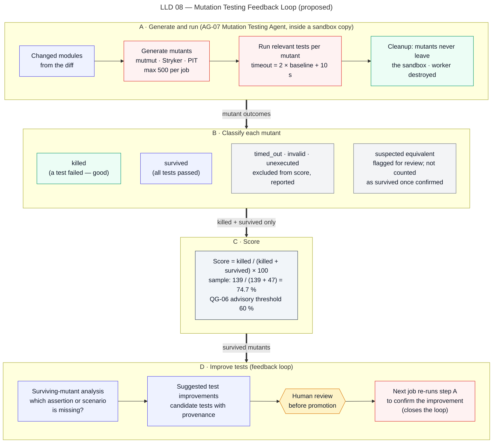

# Mutation Testing Workflow

> Autonomous QA Swarm · Documentation v0.1 (Concept) · Status: Proposed — nothing described here is implemented yet.

This document describes how Autonomous QA Swarm is proposed to run mutation testing on the modules changed in a pinned commit (pipeline stage 8, Mutation Testing), compute a valid mutation score and feed surviving mutants back into reviewed test improvements. The Mutation Testing Agent wraps deterministic mutation tools and uses an LLM only to explain surviving mutants and suggest assertions. Mutants are created, executed and discarded inside sandbox copies of the source; no mutated code ever leaves the sandbox.

## Purpose

Line and branch coverage show which code ran during tests; they do not show whether tests would notice if that code were wrong. Mutation testing introduces small, deliberate faults (mutants) into changed code and checks whether the existing tests fail. The workflow is intended to:

- measure test-suite fault-detection strength for the changed modules, reported as a mutation score;
- point reviewers at specific weak spots (surviving mutants) with concrete suggested assertions;
- close the loop through reviewed tests and a re-run, without changing the repository automatically.

The score feeds quality gate QG-06 (≥ 60% on changed modules), which is **advisory** by default: it can move a verdict to READY_WITH_RISKS but does not block on its own.

## Scope and implementation status

| Capability | Status | Requirement |
|---|---|---|
| Mutation on changed Python modules (mutmut) | Planned (MVP) | FR-030 |
| Mutation on changed JS/TS modules (Stryker) | Planned (MVP) | FR-030 |
| Valid score calculation with exclusions | Planned (MVP) | FR-030 |
| Surviving-mutant analysis and suggested assertions | Planned (MVP) | FR-031 |
| Java (PIT) and C# (Stryker.NET) | Future | FR-030 |
| Exporting reviewed tests as a pull request (HA-12) | Future | FR-041 |

No item has the status **Implemented / Verified**.

## Actors and agents

| Actor | Role in this workflow |
|---|---|
| Orchestrator Agent (AG-01) | Schedules mutation after a successful baseline run; enforces budgets |
| Mutation Testing Agent (AG-07) | Selects tool and scope, proposes mutation tasks, classifies results, explains survivors |
| Functional Testing Agent (AG-03) | Supplies baseline timings and test-to-module mapping; drafts candidate tests from accepted suggestions |
| Policy Engine | Enforces mutant cap, per-mutant timeout, scope to changed modules, network off |
| Execution Service and Sandbox Workers | Create sandbox copies, apply mutants, run tests, destroy workers |
| Evidence and Defect Analysis Agent (AG-08) | Records mutation evidence; mutation results are test-quality signals, not product defects |
| QA Engineer, Developer (code owner), QA Lead | Mark equivalent mutants, review suggested assertions and candidate tests |

## Preconditions

- The Baseline Run (stage 4) completed and the tests mapped to the changed modules passed on the unmutated pinned commit. Mutation on a red suite is meaningless; if mapped tests fail, mutation tasks end `blocked`.
- Change-impact analysis has produced the list of changed modules and the tests that cover them.
- Baseline test duration per module is known (used for the per-mutant timeout).
- The language and test runner are supported by an adapter.
- The job budget allows the estimated number of mutants within the 500-mutant cap.

## Tools per language

| Language | Tool (proposed) | Test runner | Status |
|---|---|---|---|
| Python | mutmut (BSD-3) | pytest | Planned (MVP) |
| JavaScript/TypeScript | Stryker (Apache-2.0) | Jest/Vitest | Planned (MVP) |
| Java | PIT (Apache-2.0) | JUnit 5 | Future |
| C#, Scala | Stryker (Apache-2.0) | Native runners | Future |

Tool versions and operator sets are recorded on every `MutationRun`, so a score can be reproduced with the same commit, configuration and tool versions (NFR-007).

## Workflow

Figure LLD 08 Mutation Testing Feedback Loop shows the loop from changed modules to mutants, execution, classification, scoring, surviving-mutant suggestions, reviewed tests and re-run.



*Figure LLD 08 — Mutation Testing Feedback Loop (proposed).*

### Step 1 — Scope to changed modules

The Mutation Testing Agent proposes the scope: files and, where the tool supports it, functions or line ranges touched by the diff. Generated code, migrations, vendored code and test files are excluded by default. The Policy Engine rejects scopes outside the changed set unless the job scope explicitly widens it.

### Step 2 — Mutant generation in sandbox copies

The Execution Service starts sandbox workers from the pinned snapshot. Inside each worker the tool creates a working copy and generates mutants (for example, replacing `<` with `<=`, negating conditions, changing constants, removing calls). If the estimate exceeds 500 mutants, the agent proposes a sample: a stratified selection by operator type and file, recorded so the report states that the score is sampled.

### Step 3 — Execution with per-mutant timeouts

Each mutant runs the subset of tests mapped to its module. The per-mutant timeout is:

```text
per_mutant_timeout = 2 × baseline_test_time + 10 s
```

Workers run with network off, the default resource limits (2 vCPU, 4 GiB RAM, 512 PIDs) and the 30-minute task wall clock; large mutant sets are sharded across tasks. Each shard is an idempotent task, so a lease expiry or worker crash re-runs only that shard.

### Step 4 — Classification

| Classification | Meaning | In score |
|---|---|---|
| Killed | At least one test failed with the mutant applied | Numerator and denominator |
| Survived | All mapped tests passed with the mutant applied | Denominator |
| Timed out | Exceeded per-mutant timeout | Excluded, reported |
| Invalid | Mutant did not compile, import or load | Excluded, reported |
| Unexecuted | Not run (budget, cap, shard failure, cancellation) | Excluded, reported |

A timed-out mutant often indicates an infinite loop introduced by the mutation, which tests might arguably have caught; the platform still excludes it from the score and reports the count, so the score is not inflated by tool behavior.

### Step 5 — Score calculation

```text
mutation_score = killed / (killed + survived) × 100
```

The score is computed only over valid, completed mutants. Mutants marked equivalent by a human reviewer are removed from "survived" and reported separately.

**Worked example (sample):** 214 mutants are generated in changed modules. 139 are killed, 47 survive, 18 time out and 10 are invalid.

```text
valid completed = 139 + 47 = 186
score = 139 / 186 × 100 = 74.7%
excluded and reported: 18 timed out, 10 invalid
```

74.7% is above the QG-06 advisory threshold of 60%.

### Step 6 — Equivalent mutant handling

Some mutants do not change observable behavior (for example, changing a loop bound that is never reached). The Mutation Testing Agent may flag a survivor as *suspected equivalent*, with reasoning. Suspicion alone changes nothing in the score. Only when a QA Engineer, QA Lead or the code owner marks it equivalent, with a reason recorded as an audited triage decision (not an HA approval), is it removed from the survived count. Equivalence decisions are keyed to the mutant's fingerprint (file, symbol, operator, original and mutated token) and are re-evaluated if the surrounding code changes.

### Step 7 — Surviving-mutant analysis

For each survivor the agent receives the mutant diff, the mapped tests and their source, and produces:

- a plain-language explanation of what behavior the tests fail to check;
- one or more suggested assertions (for example, "assert that a transfer of 0.005 is rejected rather than rounded");
- a priority based on whether the mutated code sits in a P0 scenario or a security-relevant path.

The output is schema-validated. Suggestions are advice only; they are shown on the Mutation Testing Dashboard (SCR-10) and never treated as evidence of a defect.

### Step 8 — Reviewed tests and re-run loop

1. A reviewer accepts, edits or rejects each suggestion.
2. For accepted suggestions, the Functional Testing Agent drafts candidate tests with provenance (`generated`, linked to the mutant ID and suggestion).
3. A reviewer approves the candidate tests for sandbox execution.
4. The Orchestrator schedules a targeted re-run: the new tests on the unmutated commit (they must pass, or they reveal a real defect or a wrong expectation) and then against the previously surviving mutants.
5. The new score and the list of newly killed mutants are recorded as a new `MutationRun` linked to the first.

The loop is bounded by the job budget; at most one re-run cycle is planned per job by default. Promotion of the tests into the repository is a human action outside the platform; export as a pull request (HA-12) is Future.

A candidate test that fails on the unmutated commit is routed to the Evidence Agent: it may reveal a genuine defect (as with the sample rounding case) or an incorrect expectation. Either way it is triaged, not silently dropped.

### Step 9 — Cleanup guarantees

- Mutated source exists only in the worker's ephemeral disk; it is never written to the Evidence Store, the repository or any export.
- Evidence contains mutant descriptors (file, line, operator, original and mutated tokens) and test outcomes, not mutated files.
- Workers are destroyed within 60 s of the task reaching a terminal state (NFR-008); the orphan reaper runs every 5 minutes.
- On cancellation, running shards stop, partial results are kept as `unexecuted` for the remainder, and workers are destroyed.

## Decision rules

| Rule | Value |
|---|---|
| Scope | Changed modules only (default) |
| Maximum mutants per job | 500 |
| Per-mutant timeout | 2 × baseline test time + 10 s |
| Score | killed / (killed + survived) × 100 over valid, completed mutants |
| Excluded from score | Timed out, invalid, unexecuted, human-marked equivalent |
| QG-06 | ≥ 60% on changed modules, advisory |
| Infrastructure retries per shard | Max 2 |
| Re-run cycles per job | 1 by default |

If excluded mutants exceed half of all generated mutants, the score is shown with a warning that it rests on a small or unrepresentative subset, and QG-06 is reported as `inconclusive`.

## Outputs and evidence

- `MutationRun` records: tool and version, scope, operator set, cap and sampling, totals per classification, score, warnings.
- `MutantResult` records: mutant fingerprint, location, operator, classification, killing test (if any), duration.
- Surviving-mutant explanations and suggested assertions, labelled as agent output with provenance.
- Equivalence decisions with reviewer and reason.
- Links between suggestions, candidate tests and the re-run `MutationRun`.

```json
{
  "sample": true,
  "mutant_fingerprint": "sha256:...",
  "file": "app/services/transfers.py",
  "symbol": "normalize_amount",
  "operator": "replace ROUND_HALF_EVEN with ROUND_DOWN",
  "classification": "survived",
  "tests_run": 12,
  "explanation": "No test checks amounts below the minor-unit precision.",
  "suggested_assertion": "A transfer with amount 0.005 is rejected with 422.",
  "suggestion_review": "pending human review"
}
```

## Failure handling

| Failure | Handling |
|---|---|
| Mapped tests fail on unmutated commit | Mutation tasks `blocked`; reason reported |
| Unsupported language | Task `skipped`; QG-06 not evaluated for that module |
| Estimate above 500 mutants | Stratified sample; score labelled sampled |
| Shard worker crash | `infrastructure_error`, max 2 retries; remaining mutants `unexecuted` if retries fail |
| Tool error on a mutant | Mutant `invalid` |
| Job budget or wall clock exhausted | Remaining mutants `unexecuted`; partial score with warning |
| LLM explanation invalid | One corrective retry; then survivor listed without explanation |

## Human gates

- Equivalent-mutant marking, suggestion acceptance and candidate-test approval are human review steps recorded as `Approval` records (QA Engineer, QA Lead or code owner).
- **HA-05** — plan approval when the gate is enabled.
- **HA-09** — overriding QG-06 is possible but rarely needed since QG-06 is advisory.
- **HA-12** (Future) — exporting reviewed tests as a pull request.

## Example walk-through (sample data)

In sample job QJ-1042 on `northwind/payments-api`, the changed modules include the transfer service and the statements router. Baseline tests for those modules pass. mutmut generates 214 mutants, under the 500 cap, so no sampling is needed.

Results: 139 killed, 47 survived, 18 timed out, 10 invalid; score 74.7% (139/186), above the 60% advisory threshold. One survivor in the amount-normalization code changes the rounding mode without any test failing. The agent explains that no test exercises sub-cent amounts and suggests the assertion "a transfer with amount 0.005 is rejected". A reviewer accepts it; the candidate test fails on the unmutated commit, which corroborates the separately reported boundary finding FND-0196 ("Amount 0.005 rounds to 0.00 and transfer succeeds"). The candidate test stays labelled `generated` and is kept for patch verification rather than counted as a mutation kill until the fix is in place.

## Limitations

- Mutation score measures fault detection for the chosen operators only; it is not a measure of correctness.
- Changed-module scope ignores weaknesses in unchanged code that the change depends on.
- Sampling above 500 mutants trades precision for cost.
- Equivalent mutants need human judgment; unmarked equivalents lower the score.
- Timeouts are excluded, which may understate test strength for loop-related mutants.
- Mutation testing is compute-heavy; budget limits may leave mutants unexecuted.

## Related requirements and security controls

- Functional: FR-014, FR-016, FR-030, FR-031, FR-032, FR-041.
- Security: SEC-001, SEC-003, SEC-004, SEC-015.
- Non-functional: NFR-007, NFR-008, NFR-015.
- Quality gates: QG-06.

See also [Functional and API testing](01-functional-and-api-testing.md), [Sandboxed execution](../10-security-and-threat-model/03-sandboxed-execution.md) and [Quality gates and release readiness](../11-quality-gates-and-reporting/02-quality-gates-and-release-readiness.md).
