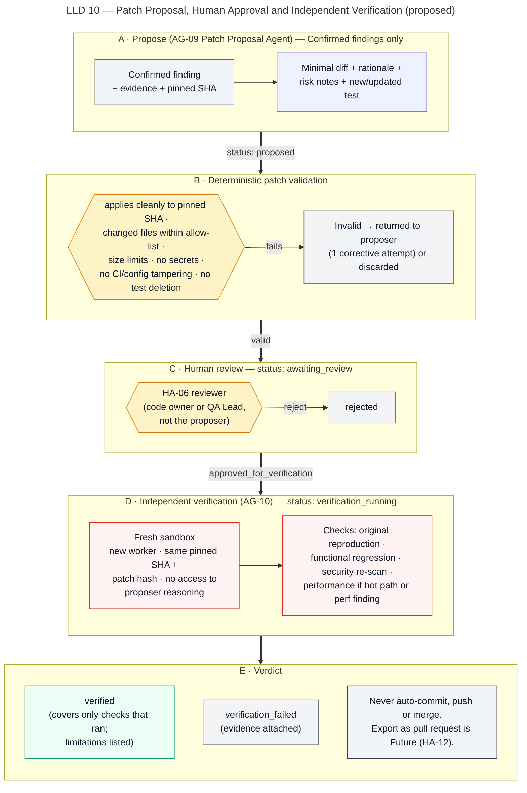

# Patch Proposal and Independent Verification

> Autonomous QA Swarm · Documentation v0.1 (Concept) · Status: Proposed — nothing described here is implemented yet.

This document describes how Autonomous QA Swarm is proposed to turn Confirmed findings into minimal patch proposals for human review (pipeline stage 10, Patch Proposal, with the Human Patch Review gate) and how approved patches are independently re-checked in a fresh sandbox (stage 11, Independent Verification). The Patch Proposal Agent only proposes; deterministic validation filters proposals; a human decides whether a patch is worth verifying; the Independent Verification Agent re-runs checks without access to the proposer's reasoning. The platform never commits, pushes or merges (FR-041).

## Purpose

The workflow is intended to shorten the path from a reproduced defect to a reviewed fix, while keeping three properties:

- **Minimality** — a patch addresses one Confirmed finding with the smallest reasonable diff.
- **Human control** — no patch is verified, exported or applied without a named human approving it.
- **Independent evidence** — "verified" means that a separate deterministic process, in a fresh sandbox, re-ran named checks on the pinned commit plus the exact approved patch, and those checks passed.

Verification results feed quality gate QG-07 (100% of patches included in the release candidate are `verified`).

## Scope and implementation status

| Capability | Status | Requirement |
|---|---|---|
| Patch proposal with diff, rationale and evidence links | Planned (MVP) | FR-038 |
| Deterministic patch validation | Planned (MVP) | FR-038 |
| Human patch review and approval for verification (HA-06) | Planned (MVP) | FR-039 |
| Independent verification in fresh sandbox | Planned (MVP) | FR-040 |
| No automatic commit, push or merge | Planned (MVP) | FR-041 |
| Export of verified patch as pull request (HA-12) | Future | FR-041 |

No item has the status **Implemented / Verified**.

## Actors and agents

| Actor | Role in this workflow |
|---|---|
| Patch Proposal Agent (AG-09) | Proposes a minimal diff, rationale, risk notes and an optional regression test for one Confirmed finding |
| Evidence and Defect Analysis Agent (AG-08) | Supplies the Confirmed finding, reproduction steps and evidence references |
| Policy Engine | Runs deterministic patch validation rules |
| Developer (code owner) or QA Lead | Reviews and approves or rejects the patch (HA-06) |
| Independent Verification Agent (AG-10) | Selects and runs verification checks in a fresh sandbox; summarizes results |
| Execution Service and Sandbox Workers | Apply the patch to the pinned snapshot inside the sandbox and run checks |
| QA Report Agent (AG-11) | Adds a verification addendum to the job report; evaluates QG-07 |

## Preconditions

- The finding is in state `confirmed` (DCS ≥ 80 and reproduced). Probable, Candidate, Disputed, false-positive and duplicate findings are not eligible.
- The finding is not under accepted risk (HA-08); accepting risk and patching are alternative paths.
- The finding has a deterministic reproduction recorded as evidence (test, request sequence, scanner rule plus precondition check, or measured threshold breach).
- The pinned commit SHA and `SourceSnapshot` checksum are available.
- The project's changed-file allow-list, size limits and in-scope paths are configured (defaults below).

## Eligibility

| Finding state | Eligible | Reason |
|---|---|---|
| Confirmed | Yes | Reproducible evidence exists for verification to test against |
| Probable / Candidate | No | Without a reproduction there is no oracle to show the fix worked |
| Disputed (status `triaging`) | No | Needs human triage first |
| False positive / duplicate | No | Nothing to fix, or the canonical finding is patched instead |
| Accepted risk | No | A human chose not to fix in this release; can be reopened |

Users may also request a proposal for an eligible finding manually; the Orchestrator may schedule one automatically for Confirmed Critical and High findings when enabled in project settings.

## Workflow

Figure LLD 10 Patch Approval Verification shows the path from proposal through validation and human review to fresh-sandbox verification and verdict.



*Figure LLD 10 — Patch Proposal, Human Approval and Independent Verification (proposed).*

### Step 1 — Patch proposal

**Inputs** to the Patch Proposal Agent, passed through the Model Gateway with redaction and token budgets:

- the finding (title, category, CWE where relevant, severity, DCS breakdown);
- reproduction steps and redacted evidence excerpts (assertion diff, request/response pair, stack frames);
- the relevant source files from the pinned snapshot, bounded by size, treated as untrusted data (SEC-014);
- project conventions (language, framework, test runner) and the changed-file allow-list.

**Outputs**, as a typed, schema-validated proposal:

- a unified diff against the pinned SHA;
- a rationale linking each hunk to the finding;
- risk notes (behavioral side effects, compatibility concerns, areas the reviewer should check);
- an optional regression test that reproduces the original finding and should pass after the patch;
- a list of evidence IDs used.

The agent never receives credentials, never runs code and has no tool that writes to a repository. An output that fails schema validation gets one corrective retry, then the task ends `invalid_output`.

### Step 2 — Deterministic patch validation

The Policy Engine applies rules that do not depend on any model:

| Rule | Default |
|---|---|
| Applies cleanly | `git apply --check` against the pinned SHA snapshot succeeds with no fuzz |
| Changed-file allow-list | Only files in the finding's location module and test directories |
| Size limit | ≤ 10 files and ≤ 300 changed lines (project-configurable) |
| No secrets | Secret detection (Gitleaks rules) finds nothing in added lines |
| No CI or config tampering | No changes to CI definitions, build scripts, dependency manifests, lockfiles, Dockerfiles or platform config unless the finding is explicitly about them and the scope allows it |
| No test deletion | No deleted test files, removed test functions or added skip markers |
| No weakening of checks | No removal of assertions, auth decorators or validation calls flagged by diff analysis |
| Single finding | Patch references exactly one Confirmed finding |

A proposal that fails any rule is rejected before human review, with the failed rules recorded. The agent may receive one corrective attempt with the rule violations; a second failure leaves the finding without a proposal, reported as such. Dependency upgrades for findings like a vulnerable library are allowed only when the finding is a dependency finding and the scope includes the manifest and lockfile.

The patch is stored as a `Patch` record with a SHA-256 patch hash; every later step refers to that hash.

### Step 3 — Statuses

Patch statuses are exactly:

| Status (API) | UI label | Entered when |
|---|---|---|
| `proposed` | Proposed | Proposal stored after validation passes |
| `awaiting_review` | Awaiting review | Reviewer assigned and notified |
| `approved_for_verification` | Approved for verification | HA-06 recorded |
| `verification_running` | Verification running | VerificationRun started |
| `verified` | Verified | All selected checks passed |
| `verification_failed` | Verification failed | Any selected check failed or could not run |
| `rejected` | Rejected | Reviewer rejected from `awaiting_review` |

The finding moves to `fix_proposed` when the patch is proposed, then to `fix_verified` or `fix_failed` from the verification verdict.

### Step 4 — Human review (HA-06)

A Developer who owns the code, or a QA Lead, reviews the patch on the Patch Review screen (SCR-12). Reviewers see:

- the patch summary, finding link, severity and DCS breakdown;
- the full diff with syntax highlighting and the files touched;
- the rationale and risk notes, labelled as agent output;
- linked evidence (reproduction, logs, request/response pairs);
- validation results for every rule in Step 2;
- the proposed regression test, if any, labelled `generated`;
- a "no auto-commit" notice stating that approval only allows verification in a sandbox.

The reviewer calls `POST /patches/{patch_id}/review` to approve for verification or reject, with a comment. Rejection reasons are kept and may be passed to a new proposal attempt. Approval is bound to the patch hash; any change to the diff creates a new `Patch` and requires a new review.

### Step 5 — Independent verification (AG-10)

Approval triggers `POST /patches/{patch_id}/verifications`, creating a `VerificationRun`. Independence rules:

- **No proposer reasoning** — the Verification Agent receives the finding, its original evidence, the pinned SHA and the patch hash and diff; it receives no prompts, responses, rationale or risk notes from the Patch Proposal Agent.
- **Different worker** — a fresh sandbox worker, never one used for proposal-related tasks or original reproduction.
- **Same inputs** — the same pinned SHA, the same `SourceSnapshot` checksum and the exact patch hash approved under HA-06; a mismatch aborts the run.
- **Deterministic selection** — check selection is rule-based; the LLM only writes the summary.

### Step 6 — Check selection

| Check | When selected |
|---|---|
| Original reproduction | Always: the test, request sequence or rule that confirmed the finding |
| Proposed regression test | When included and approved |
| Functional regression | Always: tests mapped to changed modules plus all P0-mapped tests |
| API checks | When the finding is API-related or the patch touches route handlers |
| Security re-scan | Always for security findings; SAST and secret detection on changed files for all patches |
| Performance | When the finding is a performance finding, or the patch touches endpoints or modules marked as hot paths |

When performance is not selected, the run records the justification (for example "change not on hot path"). Quarantined flaky tests are run but excluded from the pass decision, as in QG-03.

### Step 7 — Verdict rules

- **verified** — the original reproduction no longer reproduces, every selected functional and API check passes (excluding quarantined flaky tests), the security re-scan shows no new High or Critical alert in changed files, and selected performance checks meet QG-05 thresholds.
- **verification_failed** — any of the above fails, or a selected check ends `blocked`, `timed_out` or `infrastructure_error` after the standard 2 retries. An unrun check is never treated as a pass.

The verdict is recorded in the `VerificationRun` (display ID such as VER-0011) and added to the job report as an addendum, because stages 10–11 may complete after the main report.

## Decision rules

| Rule | Value |
|---|---|
| Eligibility | `confirmed` findings only (DCS ≥ 80 and reproduced) |
| Patch size default | ≤ 10 files, ≤ 300 changed lines |
| Corrective attempts after validation failure | 1 |
| Reproduction for original check | Must not reproduce in the fresh sandbox |
| Infrastructure retries per verification task | Max 2 |
| QG-07 | 100% of patches in the release candidate are `verified` |

## Outputs and evidence

- `Patch` records: diff, patch hash, finding link, validation results, status history.
- `Approval` records for HA-06 with reviewer, decision, comment and timestamp; matching `AuditEvent`s.
- `VerificationRun` records: worker run IDs, pinned SHA, snapshot checksum, patch hash, selected checks with justification, per-check results, verdict, limitations.
- Evidence items for every check, content-addressed.
- Verification addendum in the report and on the Independent Verification screen (SCR-13), including original versus patched comparison.

```json
{
  "sample": true,
  "verification": "VER-0011",
  "patch": "PCH-0007",
  "finding": "FND-0193",
  "commit": "7c9e2a1f4b",
  "patch_hash": "sha256:...",
  "fresh_worker": true,
  "checks": [
    {"type": "original_reproduction", "result": "not_reproduced"},
    {"type": "functional_regression", "result": "passed", "detail": "1,287/1,287 relevant, quarantined flaky excluded"},
    {"type": "security_rescan", "result": "passed", "detail": "IDOR check no longer reproducible"},
    {"type": "performance", "result": "not_selected", "justification": "change not on hot path"}
  ],
  "verdict": "verified",
  "limitations": ["Performance not re-run", "Verified only for the checks listed"]
}
```

## Failure handling

| Failure | Handling |
|---|---|
| Patch does not apply to pinned SHA | Rejected in validation; no review requested |
| Validation rule violated | One corrective attempt; then no proposal, reported |
| Reviewer does not respond | Patch stays `awaiting_review`; job report lists it as unverified |
| Patch hash mismatch at verification | Run aborted; `verification_failed`; audit event |
| Check `infrastructure_error` | Max 2 retries; still failing → `verification_failed` |
| Original reproduction still reproduces | `verification_failed`; finding `fix_failed` |
| New High or Critical alert in changed files | `verification_failed`; new finding created |
| Job cancelled during verification | Verification cancelled; workers destroyed; patch returns to `approved_for_verification` |

## Human gates

- **HA-06** — approving a patch for verification (Developer as code owner, or QA Lead).
- **HA-08** — accepting risk instead of patching (QA Lead, plus Security Reviewer for security findings).
- **HA-09** — overriding QG-07 when an unverified patch is included (QA Lead, reason mandatory).
- **HA-10** — the release decision, which considers verification results.
- **HA-12** (Future) — exporting a verified patch as a pull request (Developer as code owner).

The platform never commits, pushes or merges; even after HA-12 exists, merging remains a human action in the Git provider.

## Example walk-through (sample data)

Sample finding FND-0193 (Critical, Confirmed, CWE-639, DCS 92, reproduced 3/3) on sample job QJ-1042 reports that identity B can read identity A's statements via `GET /v1/accounts/{account_id}/statements`.

The Patch Proposal Agent proposes PCH-0007: an ownership check in `app/routers/statements.py` plus a new regression test, 2 files, +14/−3 lines. Validation passes: it applies cleanly to commit `7c9e2a1f4b`, stays within the allow-list and size limits, contains no secrets and deletes no tests. A sample code owner approves it under HA-06.

VER-0011 runs in a fresh worker on the same SHA and patch hash. The original IDOR reproduction no longer succeeds, the functional regression passes 1,287/1,287 relevant tests (excluding quarantined flaky tests), and the security re-scan raises nothing new. Performance is not re-run, with the justification "change not on hot path", which is stated as a limitation. PCH-0007 becomes `verified` and FND-0193 `fix_verified`.

Sample patch PCH-0008 for FND-0195 (duplicate transfer on reused Idempotency-Key) is `awaiting_review`. Until it is reviewed and verified, it cannot be counted as a verified patch for QG-07.

## Limitations

- "Verified" covers only the checks that ran; it does not mean the patch is correct in every respect or free of side effects.
- Check selection relies on test-to-module mapping; weak mapping can miss regressions elsewhere.
- Hot-path detection is configuration-based and may omit a performance check that would have mattered.
- Patch quality depends on the model; validation removes unsafe proposals but cannot judge design quality, which is why HA-06 exists.
- The platform does not apply patches to any branch; integrating a fix remains a human workflow.

## Related requirements and security controls

- Functional: FR-033, FR-035, FR-038, FR-039, FR-040, FR-041, FR-044.
- Security: SEC-001, SEC-003, SEC-007, SEC-008, SEC-010, SEC-013, SEC-014, SEC-015.
- Quality gates: QG-07.

See also [Agent catalogue](../06-agent-design/01-agent-catalogue.md), [Orchestration and recovery](../06-agent-design/02-orchestration-and-recovery.md), [API contracts](../08-api-specifications/01-api-contracts.md) and [Quality gates and release readiness](../11-quality-gates-and-reporting/02-quality-gates-and-release-readiness.md).
