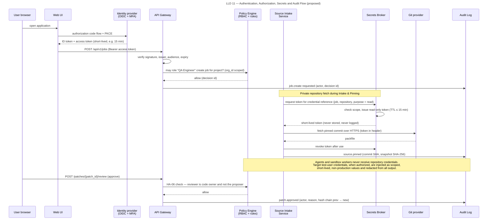

# Identity, Secrets, Audit and Data Protection

> Autonomous QA Swarm · Documentation v0.1 (Concept) · Status: Proposed — nothing described here is implemented yet.

This document specifies how Autonomous QA Swarm is proposed to identify people and machines, decide what they may do, hold credentials, record every consequential action and protect the data it collects. It implements the controls referenced by the threat model in [Security architecture and threat model](01-security-architecture-and-threat-model.md), in particular TM-01, TM-02, TM-03, TM-09, TM-10, TM-11, TM-13, TM-14 and TM-18. All mechanisms are **Proposed** or **Planned (MVP)** unless marked **Future**; none is **Implemented / Verified**. Numeric defaults introduced here (token lifetimes, URL validity, retention periods other than those in NFR-016) are proposed starting values that operators can tune.

Figure LLD 11 AuthN AuthZ Secrets Audit shows the end-to-end sequence: a user signs in through the OIDC identity provider, the API Gateway validates the token, the RBAC and Policy Engine checks authorize the request, the Secrets Broker issues a short-lived scoped token to the service that needs it, and an audit event is written for each decision.



*Figure LLD 11 — Authentication, Authorization, Secrets and Audit Flow (proposed).*

## Authentication

### Human users

Human authentication is planned to be delegated entirely to an external OpenID Connect identity provider (SEC-009). Keycloak (Apache-2.0) is the proposed reference IdP for self-hosted deployments; any standards-compliant OIDC provider can be configured instead. The platform will not store passwords.

- **Flow.** The Web UI uses the authorization code flow with PKCE. The API Gateway validates bearer tokens on every call: signature against the IdP's published keys, issuer, audience, expiry and not-before.
- **MFA.** Multi-factor authentication is enforced by the IdP, not the platform. The platform is proposed to read the `amr` or `acr` claim and refuse sessions without MFA for the Org Admin and Security Reviewer roles, and for any request that records HA-01, HA-02, HA-04, HA-08, HA-09 or HA-11.
- **Role mapping.** IdP group claims map to `Membership` roles per organization. A group-to-role mapping change is itself an audited administrative action.
- **Deprovisioning.** A user disabled at the IdP loses access when the current access token expires; the gateway also checks a revocation list populated from IdP logout and admin events.

### Session and token lifetimes

| Item | Proposed default | Rationale |
|---|---|---|
| Access token lifetime | 15 min | Limits replay window for a stolen token (TM-01) |
| Refresh token idle timeout | 30 min | Abandoned browser sessions expire quickly |
| Absolute session lifetime | 12 h | Forces daily re-authentication |
| Step-up re-authentication for approvals | Authentication within last 15 min | Approvals made by the person at the keyboard |
| SSE stream token | Same as access token; stream closed on expiry | Long-lived streams cannot outlive authorization |
| Concurrent sessions per user | 5 | Limits impact of leaked refresh tokens |

### CI service accounts

CI systems (for example GitHub Actions or Jenkins, as described in [Integrations](../05-architecture/06-integrations.md)) authenticate as the **CI Service Account** role using the OIDC client credentials flow or, where the IdP supports it, workload identity federation from the CI provider's own OIDC tokens. Static API keys are discouraged; where an operator must issue one, it is planned to be scoped as follows.

- Bound to one or more named projects, never organization-wide.
- Permissions limited to creating jobs, reading job status, events, quality gates and reports.
- Maximum validity 90 days, with a rotation reminder at 75 days.
- Cannot record any HA-xx approval and cannot change settings, targets, credentials or allow-lists.
- Usage logged with the CI run identifier supplied in a request header, so audit events link back to the pipeline run.

## Authorization

### Model

Authorization is role-based with least privilege (SEC-010), evaluated at the API Gateway for coarse endpoint access and again in each service for object-level checks (the requested project, finding or patch must belong to the caller's organization and to a project the caller is a member of). Decisions that depend on context, such as whether an approver is the same person who proposed the change, are evaluated by the Policy Engine. Every denial returns `403` with a problem+json body and is audited.

Agents are not users and have no RBAC role. Their permissions are a separate per-agent tool allow-list (also SEC-010) configured in Settings & Integrations (SCR-15): each agent may only emit the proposal types listed for it, and the Policy Engine rejects anything else.

### Role and permission matrix

The seven roles are Org Admin, QA Lead, QA Engineer, Developer, Security Reviewer, Viewer and CI Service Account. The matrix is split into two tables for width; rows are identical. "Own" means limited to the user's own items; "P" means only in projects where the user holds the role.

| Permission | Org Admin | QA Lead | QA Engineer | Developer |
|---|---|---|---|---|
| View jobs, findings, reports | Yes | P | P | P |
| Create projects and register repositories | Yes | P | No | No |
| Create and cancel QA jobs | Yes | P | P | P |
| Use `force_new=true` on duplicate job | No | P | No | No |
| Approve job plan (HA-05) | No | P | No | No |
| Triage functional findings, mark duplicate | No | P | P | No |
| Mark functional false positive (HA-07) | No | P | No | No |
| Mark security false positive or suppress rule (HA-07) | No | No | No | No |
| Accept risk on Confirmed finding (HA-08) | No | P | No | No |
| Approve patch for verification (HA-06) | No | P | No | Code owner |
| Start independent verification | No | P | P | Code owner |
| Override failed quality gate (HA-09) | No | P | No | No |
| Record release decision (HA-10) | No | P | No | No |
| Register target and attest authorization (HA-01) | Yes | No | No | No |
| Approve DAST or active checks (HA-02) | No | No | No | No |
| Approve performance above Smoke (HA-03) | No | P | No | No |
| Add sandbox allow-list entries (HA-04) | Yes | No | No | No |
| Register or rotate credentials (HA-11) | Yes | No | No | No |
| Edit execution limits, agent permissions, model gateway | Yes | No | No | No |
| Download evidence | Yes | P | P | P |
| Read audit events | Yes | P | No | No |

| Permission | Security Reviewer | Viewer | CI Service Account |
|---|---|---|---|
| View jobs, findings, reports | P | P | P |
| Create projects and register repositories | No | No | No |
| Create and cancel QA jobs | No | No | P (own) |
| Use `force_new=true` on duplicate job | No | No | No |
| Approve job plan (HA-05) | No | No | No |
| Triage functional findings, mark duplicate | No | No | No |
| Mark functional false positive (HA-07) | No | No | No |
| Mark security false positive or suppress rule (HA-07) | P | No | No |
| Accept risk on Confirmed finding (HA-08) | P (co-approver) | No | No |
| Approve patch for verification (HA-06) | No | No | No |
| Start independent verification | No | No | No |
| Override failed quality gate (HA-09) | No | No | No |
| Record release decision (HA-10) | No | No | No |
| Register target and attest authorization (HA-01) | P | No | No |
| Approve DAST or active checks (HA-02) | P | No | No |
| Approve performance above Smoke (HA-03) | No | No | No |
| Add sandbox allow-list entries (HA-04) | No | No | No |
| Register or rotate credentials (HA-11) | No | No | No |
| Edit execution limits, agent permissions, model gateway | No | No | No |
| Download evidence | P | No | No |
| Read audit events | P | No | No |

Org Admin deliberately holds administrative rights but not quality decisions: administering the platform and deciding release readiness are separate duties. The HA-10 approver is the QA Lead role; an organization with a dedicated release manager maps that person (for example through an identity-provider group) to the QA Lead role, so no eighth role is introduced. Viewers see summaries and findings but cannot download raw evidence, because evidence can contain sensitive request and response data.

### Approval permissions and separation of duties

Each human approval is an `Approval` entity with approver identity, role at the time, timestamp, reason, scope and optional expiry, written together with an `AuditEvent` in one transaction.

| ID | Approver role | Separation-of-duties rule | Reason required | Expiry |
|---|---|---|---|---|
| HA-01 | Org Admin or Security Reviewer | Attester cannot be the job creator for the first job on that target | Yes (scope statement) | Authorization window, max 90 days |
| HA-02 | Security Reviewer | Not the job creator | Yes | Per job |
| HA-03 | QA Lead | Not the job creator for external targets | Yes for external targets | Per job |
| HA-04 | Org Admin | Not the requester of the entry | Yes | Reviewed every 90 days |
| HA-05 | QA Lead | Not the job creator | Optional | Per plan version |
| HA-06 | Developer (code owner) or QA Lead | Cannot approve a patch for a finding they triaged as confirmed in the same job unless a second approver signs | Optional | Per patch revision |
| HA-07 | Security Reviewer (security) / QA Lead (functional) | Not the person who raised or last triaged the finding | Yes | Suppressions default 90 days |
| HA-08 | QA Lead + Security Reviewer for security findings | Two distinct people for security findings | Yes | Mandatory, max 180 days |
| HA-09 | QA Lead | Cannot be the same person who records HA-10 for that job | Yes | Per job |
| HA-10 | QA Lead | Recorded after gate results exist | Yes when the verdict is not READY or the decision departs from the recommendation | Per job |
| HA-11 | Org Admin | Rotation event notifies a second Org Admin | Yes | Per credential policy |
| HA-12 (Future) | Developer (code owner) | Not the reviewer who approved HA-06 when policy requires two-person review | Optional | Per export |

Agents can never satisfy an approval. The Patch Proposal Agent proposes, a human approves (HA-06), and the Independent Verification Agent verifies; the proposer, the approver and the verifier are always different actors. Overrides and acceptances (HA-07, HA-08, HA-09) are planned to appear in the report's residual-risk section with approver, reason and expiry, so they cannot be hidden in the trail (TM-14).

## Secrets management

### Secrets Broker

All credentials are held only in the Secrets Broker (SEC-007). OpenBao (MPL-2.0) is the proposed default; HashiCorp Vault can be used but is BUSL-1.1, not OSI open source. The Metadata DB stores only a `CredentialReference`: an identifier, a type, a masked hint (for example the last four characters) and the broker path. Raw tokens are never stored in the Metadata DB, never returned by the API and never shown in the UI after entry.

### Who receives what

| Consumer | What it may obtain | Scope | Proposed lifetime |
|---|---|---|---|
| Source Intake Service | Git read token for one repository | Read-only, one repository | 15 min |
| Target Environment Manager | Target test-user credentials | One registered non-production target, test identities only | Task duration, max 2 h |
| Sandbox worker (only when authorized) | Target test-user credential injected by Target Environment Manager | Non-production test identity, single target | Task duration |
| Model Gateway | LLM provider API key, held in gateway memory only | One provider account | Rotated per credential policy |
| Notification Service | Webhook or chat tokens | One channel | Rotated per credential policy |
| Agents, LLM prompts | Nothing | None | None |

The rule is that agents, prompts and model providers never see a credential, and workers see only scoped, short-lived, non-production test identities for an authorized target. A worker that runs a dependency fetch never receives a registry credential; private registries are planned to be reached through the egress proxy, which holds the credential itself.

### Rotation and revocation

- Registering or rotating a repository or target credential requires HA-11 by an Org Admin.
- Dynamic tokens expire on their own; static upstream credentials (for example a provider app private key) are planned to have a configurable rotation interval with a default warning at 90 days.
- Revoking a credential reference immediately stops pending tasks that depend on it: they end `skipped` with the revocation recorded as the reason, and the running job finishes `completed_with_warnings`. A job submitted after revocation that needs the credential ends `blocked` during validation, before any execution (`blocked` is reserved for jobs in which nothing has run, as in the sample job QJ-1037, which was blocked because its target was not authorized).
- Every token issuance is logged by the broker's own audit device and mirrored as an `AuditEvent` (credential reference, consumer service, task ID, TTL) without the token value.

### Redaction

Redaction (SEC-008) is the backstop for secrets that slip through anyway, such as credentials hard-coded in the repository or echoed by a test. The proposed redaction pipeline runs on every log line, evidence item, prompt and report before storage or egress.

1. Exact-match replacement of every secret value the platform knows about for the job (target test credentials, tokens issued for the job).
2. Pattern detection using Gitleaks-compatible rules and high-entropy heuristics.
3. Replacement with a typed marker such as `[REDACTED:aws-access-key:3f9a]`, where the suffix is a short keyed hash so identical secrets can be correlated without being revealed.

Secret-detection findings (FR-024) report location and rule, never the secret value. Redaction is pattern-based and cannot be complete; this residual risk is recorded under TM-09.

## Audit logging

### What is logged

Every action that changes state or reveals sensitive data produces an `AuditEvent` (SEC-013, FR-054).

| Category | Examples |
|---|---|
| Authentication | Login, logout, failed token validation, MFA-missing refusal |
| Authorization | Every `403`, every Policy Engine denial with rule ID |
| Human approvals | HA-01 to HA-12 with reason, scope and expiry |
| Job lifecycle | Create, plan, approve, cancel, terminal state, `force_new` use |
| Agent activity | Each proposal (hash), validation result, `invalid_output`, denial |
| Execution | Worker start and destroy, limits applied, network phase changes, orphan reaping |
| Model calls | Provider, model identifier, prompt hash, response hash, token counts |
| Secrets | Token issuance (no value), credential registration, rotation, revocation |
| Data access | Evidence URL issuance, report export, audit export |
| Configuration | Settings, allow-list, agent permission and policy bundle changes |

### Event format and hash chain

Each event is canonicalized (sorted keys, UTF-8, UTC timestamps) and chained: the event hash is SHA-256 over the previous event's hash concatenated with the canonical event body. An illustrative event:

```json
{
  "id": "aud_01JB8Z4K2Q7M3N5P6R8S9T0V1W",
  "org_id": "org_01JB8Y...",
  "occurred_at": "2026-10-24T09:41:07Z",
  "actor": {"type": "user", "id": "usr_01JB...", "role": "QA Lead"},
  "action": "patch.review.approved",
  "approval_id": "HA-06",
  "resource": {"type": "patch", "display_id": "PCH-0007"},
  "job_display_id": "QJ-1042",
  "reason": "Ownership check matches FND-0193 evidence",
  "request_id": "req_7f3c...",
  "prev_hash": "9b1e...c4",
  "hash": "e07a...51"
}
```

### Tamper detection and export

- The Audit Log is append-only: no service role has update or delete grants, and the table is planned to reject such statements by trigger.
- A verification job is proposed to recompute the chain hourly and raise a Critical operational alert on any break.
- Checkpoints (latest hash, event count, timestamp) are planned to be exported periodically to storage outside the platform's write path, for example a write-once bucket, so that truncating the tail of the log is detectable.
- `GET /audit-events` supports filters by job, actor and action, and export in JSON Lines with the chain fields included so that an external auditor can verify integrity independently.
- Audit retention defaults to 1 year (NFR-016). Retention expiry removes whole chain segments and records a signed tombstone checkpoint, so the remaining chain still verifies.

The hash chain detects tampering; it does not prevent an operator with database superuser rights from rewriting history and recomputing hashes. External checkpoints exist to make that attack detectable.

## Data protection

### Classification

| Class | Definition | Examples | Handling |
|---|---|---|---|
| Restricted | Compromise grants access to other systems | Credentials, signing keys, provider API keys | Secrets Broker only; never logged, prompted or exported |
| Confidential | Customer intellectual property or vulnerability detail | Source snapshots, evidence, findings, patches, prompts, reports | Encrypted at rest, RBAC plus signed URLs, retention-managed |
| Internal | Operational and governance records | Audit events, approvals, settings, metrics | Encrypted at rest, role-restricted |
| Public | Intended for publication | Project documentation, released SBOMs | No restriction |

Security findings with Confirmed vulnerabilities are proposed to be treated as the most sensitive Confidential data, visible only to project members with QA Lead, Security Reviewer or Developer roles until fixed.

### Encryption

- **In transit.** TLS 1.2 or later on all external and internal service connections (SEC-012), including connections to PostgreSQL, the Evidence Store and the Secrets Broker. Mutual TLS between control-plane services is proposed for Kubernetes deployments.
- **At rest.** PostgreSQL volumes, Evidence Store buckets and backups are encrypted. Evidence objects are proposed to use envelope encryption with a data key per project, wrapped by a key held in the Secrets Broker transit engine, so a project's evidence can be crypto-shredded on deletion.

### Evidence access

Evidence is downloaded via `GET /findings/{finding_id}/evidence`, which returns signed, short-lived URLs (SEC-019) only after the RBAC check. Proposed defaults: URL validity 5 minutes, bound to object key and requesting user, single object per URL, issuance audited. Evidence content is never included in notifications; messages carry links that require sign-in.

### Retention and deletion

| Data | Proposed default retention | Notes |
|---|---|---|
| Evidence items and source snapshots | 90 days (NFR-016) | Snapshots kept so verification addenda remain possible |
| Findings, reports, gate results | Life of project | Evidence links show "expired" after evidence deletion |
| Full prompt and response text | Not stored by default; 30 days if enabled | Hashes always kept in audit |
| Worker scratch disks | Destroyed with worker | NFR-008 cleanup |
| Audit events | 1 year (NFR-016) | Chain-preserving expiry |

Deleting a project removes its metadata, deletes its evidence objects and destroys its data key. Accepted risks and release decisions may be configured to be retained longer as governance records.

### Minimizing data sent to models

The Model Gateway applies minimization before any prompt leaves the control plane:

- Send the smallest excerpt needed: the changed hunk and enclosing function, not whole files or the whole repository.
- Run redaction on every prompt; refuse to send a prompt in which a known secret value was detected after redaction.
- Strip personal data patterns (email addresses, phone numbers, names in fixtures) from logs and responses where feasible; test fixtures should already be synthetic, per [Safe-use policies](04-safe-use-policies.md).
- Record prompt and response hashes, model identifier and token counts; enforce per-job token budgets (NFR-015).

### Model provider data controls

SEC-021 governs provider selection. An Org Admin configures a provider allow-list; each project can be restricted to local models (Ollama or vLLM) so that source never leaves the operator's infrastructure. For hosted providers, operators are expected to select contractual terms that exclude training on submitted data where available and to review provider retention terms. The platform records which provider and model handled each call so the exposure of a given job can be reconstructed.

## Tenant isolation

The MVP is planned as a single-organization, self-hosted deployment. Even so, every tenant-owned table carries `org_id`, and PostgreSQL row-level security (SEC-011) is planned to be enabled from Phase 1 so that isolation is exercised and tested before it matters. Each service connects with a database role that sets the organization context per request, and RLS policies reject rows from other organizations even if application code omits a filter.

Multi-tenant SaaS operation is **Future** (Phase 4) and is proposed to add:

- **Per-tenant keys.** Separate key hierarchies in the Secrets Broker per organization, enabling tenant-level crypto-shredding and key rotation.
- **Isolated worker pools.** Dedicated worker hosts or node pools per tenant, combined with microVM isolation, so that a sandbox escape on one tenant's worker does not reach another tenant's code.
- **Per-tenant model gateway configuration.** Separate provider keys, allow-lists and budgets, with no shared prompt caches.
- **Namespaced storage.** Evidence buckets or prefixes per tenant with bucket policies, not only application-level checks.
- **Isolation testing.** Automated cross-tenant access tests in the platform's own CI covering API, database and evidence paths (TM-03).

Until those controls exist, operators should not host mutually distrusting organizations on one deployment.
