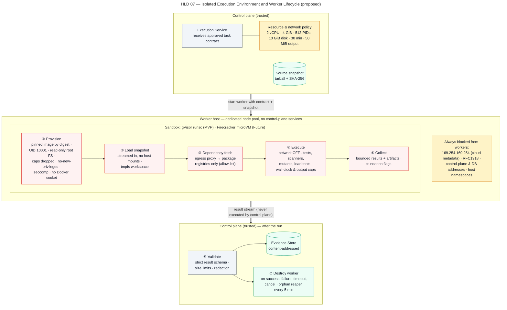

# Sandboxed Execution

> Autonomous QA Swarm · Documentation v0.1 (Concept) · Status: Proposed — nothing described here is implemented yet.

This document describes how Autonomous QA Swarm is proposed to execute untrusted code: the worker lifecycle, isolation layers, resource limits, network policy, image supply chain, output handling and cleanup. It is the detailed design behind SEC-001, SEC-003, SEC-004, SEC-005 and SEC-006, and it addresses threats TM-21 to TM-24 and TM-27 from [Security architecture and threat model](01-security-architecture-and-threat-model.md). All controls are **Proposed** or **Planned (MVP)** unless marked **Future**; none has the status **Implemented / Verified**. Sandboxing reduces risk; it does not make running hostile code safe, and the residual risk is stated at the end.

## Why sandboxing is required

A QA platform has to run the code it tests, and that code is untrusted by definition. The platform cannot distinguish a careless build script from a malicious one, so it treats every execution as potentially hostile. The main sources of untrusted execution are:

- **Build scripts.** `Makefile` targets, `package.json` scripts, `setup.py`, `conftest.py` and plugin hooks run arbitrary commands with the privileges of the build.
- **Dependency hooks.** Package managers can execute install-time scripts (`preinstall`, `postinstall`, source distributions built on install). A compromised transitive dependency is a well-known supply-chain attack path (TM-21).
- **Tests.** Existing suites and generated tests are code; a test can read the filesystem, open sockets or fork processes.
- **Mutants.** The Mutation Testing Agent deliberately changes code; a mutant can turn a bounded loop into an infinite one or a cleanup into a deletion.
- **The application under test.** The Target Environment Manager starts the app as an ephemeral in-sandbox target; it processes attacker-shaped inputs from API, security and performance tests.
- **Tool output parsers.** Scanner and test reports are produced inside the sandbox and must be treated as untrusted when collected.

The design rule that follows is SEC-001: the control plane never executes repository code, not even to resolve dependencies or list tests. Everything that interprets or runs repository content happens in a disposable Sandbox Worker.

## Worker lifecycle

Each task contract approved by the Policy Engine is turned by the Execution Service into exactly one `WorkerRun`. The lifecycle has eight phases, shown in Figure HLD 07 Isolated Worker Architecture.

*Figure HLD 07 — Isolated Execution Environment and Worker Lifecycle (proposed).*

### Phase 1: Provision

The Execution Service selects a worker host from the pool and creates a sandbox from the task's pinned image digest, with the resource limits from the task contract (bounded by the profile and organization maximums). The sandbox gets a fresh ephemeral volume, a non-root UID 10001 and no network interfaces other than the one used in the fetch phase. A warm pool is planned to keep provisioning within the NFR-002 job start target of 60 seconds; warm sandboxes are never reused after any task has run in them.

### Phase 2: Snapshot transfer without host mounts

The source snapshot produced by the Source Intake Service is a tarball with a SHA-256 checksum. It is streamed into the sandbox over the runtime's copy interface, not bind-mounted from the host, and its checksum is verified inside the sandbox by a platform-provided entrypoint before extraction. Extraction enforces limits on total size, file count and path depth, rejects absolute paths and `..` components, and does not follow symlinks outside the workspace. No host directory is ever mounted, so there is nothing on the host for the code to write to.

### Phase 3: Dependency fetch through an allow-listed proxy

If the task needs dependencies, a dedicated fetch step runs with network enabled, but the only reachable endpoint is the egress proxy. The proxy permits only allow-listed package registries (for example PyPI and npm in the MVP); new entries require HA-04. Where the ecosystem supports it, install-time scripts are disabled during this phase (for example `npm ci --ignore-scripts` and wheel-only installs where wheels exist), so that code fetched from the network does not run while the network is available. Lockfiles are honored; dependency resolution outside the lockfile is flagged in the task result. Each downloaded artifact's name, version and hash is recorded in the evidence bundle.

### Phase 4: Network off

When the fetch step ends, the Execution Service removes the sandbox's network interface. From this point the sandbox has only a loopback interface, or, for tasks with an in-sandbox target, an isolated per-job network that contains only the target and the test runner (see below). This transition is recorded in the audit trail with a timestamp.

### Phase 5: Execute

The task's command runs: build hooks deferred from Phase 3, the test suite, scanner, mutation run or load generator. The platform-provided entrypoint enforces the wall-clock limit, captures stdout and stderr to size-capped files, and writes a structured result manifest. Heartbeats to the Execution Service are emitted by the host-side supervisor, not by code inside the sandbox, so a hung process cannot fake liveness; the task lease (90 s TTL, 30 s heartbeat) reflects real supervisor state.

### Phase 6: Bounded result collection

After the command exits or is killed, the host-side supervisor pulls the results directory out of the sandbox. Collection is bounded at 50 MiB per task; anything beyond the cap is truncated and the result carries a truncation flag. The sandbox cannot push data; collection is initiated from outside. Collected files are hashed and written to the Evidence Store, content-addressed by SHA-256.

### Phase 7: Schema validation

The result manifest and structured outputs (JUnit XML, SARIF, k6 summaries, mutation reports) are parsed by deterministic parsers with size and depth limits and validated against versioned schemas (SEC-015). A result that fails validation is recorded as `infrastructure_error` for the attempt and can be retried within the retry budget; it is never partially trusted. Free-text output is stored as evidence and treated as untrusted data when later shown to agents.

### Phase 8: Destroy

The sandbox, its ephemeral volume and its network are deleted, and the `WorkerRun` is marked destroyed with a timestamp. Destruction is required within 60 seconds of the task reaching a terminal state (NFR-008), whether the task succeeded, failed, timed out or was cancelled.

## Isolation layers

The isolation layers are cumulative; each addresses a different escape or abuse path.

| Layer | Setting | Threat mitigated |
|---|---|---|
| User-space kernel | gVisor `runsc` runtime in MVP | Host kernel exploitation via syscalls (TM-22) |
| Rootless runtime | Docker or Podman rootless on the worker host | Escalation from container root to host root |
| Non-root user | UID 10001, no setuid binaries in images | Privileged operations inside the sandbox |
| Capabilities | All Linux capabilities dropped | Raw sockets, mounts, module loading, ptrace |
| Privilege escalation | `no-new-privileges` | setuid or file-capability escalation |
| Syscall filter | Default seccomp profile plus AppArmor profile | Reduced syscall and filesystem attack surface |
| Filesystem | Read-only root FS; writable ephemeral workspace and `/tmp` only | Persisting tools, tampering with image contents |
| Host interfaces | No Docker socket, no host mounts, no host PID, IPC or network namespaces | Direct control of the host or other containers |
| Network | No network during execution; fetch phase via proxy only | Exfiltration, lateral movement (TM-23) |
| Credentials | No platform credentials in the sandbox | Credential theft (TM-09, TM-10) |
| Dedicated hosts | Worker hosts separate from control-plane hosts (recommended for all shared or production use; the single-host evaluation topology omits this layer) | Escape reaching control-plane memory or data |
| Disposability | One task per sandbox, destroyed after use | Persistence across tasks and cross-job contamination |

## Resource limits

Defaults below are the proposed platform defaults. Projects can lower them freely; raising them above the organization maximum is not possible, and raising the wall clock beyond 30 minutes requires a profile that allows it.

| Resource | Default per task | Maximum | Behavior on breach |
|---|---|---|---|
| CPU | 2 vCPU | Organization setting | Throttled (cgroup quota) |
| Memory | 4 GiB | Organization setting | Process killed; attempt `infrastructure_error` if the runner died, `failed` if a test hit it |
| Processes | 512 PIDs | Organization setting | Fork fails inside sandbox |
| Ephemeral disk | 10 GiB | Organization setting | Writes fail; task ends `failed` with disk-full marker |
| Wall clock | 30 min | 2 h | Sandbox killed; task `timed_out` |
| Captured output | 50 MiB | 50 MiB | Truncated; truncation flag set |
| Job wall clock | 4 h | 12 h | Job `timed_out`; all workers destroyed |

Mutation runs add a per-mutant timeout of 2 × baseline test time + 10 s, and a cap of 500 mutants per job, so that a mutant that loops forever counts as a timed-out mutant rather than consuming the task budget. Performance generators additionally monitor generator CPU and mark a run invalid above 90%, as described in [Performance testing](../09-testing-workflows/03-performance-testing.md).

## Network policy

### Phases

| Phase | Network | Reachable destinations |
|---|---|---|
| Provision and snapshot transfer | None | None |
| Dependency fetch | Proxy-only | Egress proxy, which forwards only to allow-listed registries |
| Execute (no target) | None | Loopback only |
| Execute (in-sandbox target) | Isolated per-job network | Test runner and ephemeral target containers of the same job |
| Execute (registered external target) | Target-only egress | The authorized target's addresses from TargetAuthorization, through a target egress gateway |
| Collection and destroy | None | None |

### Blocked ranges

Regardless of phase, worker egress is planned to be denied at the host firewall (not only inside the sandbox) to the following destinations (SEC-005):

- Cloud metadata endpoints: `169.254.169.254`, the IPv6 equivalent `fd00:ec2::254`, and other provider metadata addresses.
- The whole link-local ranges `169.254.0.0/16` and `fe80::/10`.
- RFC1918 private ranges `10.0.0.0/8`, `172.16.0.0/12`, `192.168.0.0/16`, and IPv6 unique local `fc00::/7`, except the isolated per-job network.
- Loopback of the host, carrier-grade NAT `100.64.0.0/10`, and the control-plane service and pod CIDRs.
- The worker host's own addresses and the container runtime's management endpoints.

A registered external non-production target on a private address is the one exception, and it is permitted only for that job, only to the attested addresses, and only through the target egress gateway after HA-01 (and HA-02 for active security checks). DNS for the fetch phase is resolved by the proxy, not by the sandbox, which prevents DNS rebinding from turning an allow-listed name into an internal address.

### In-sandbox target network

For the common case, the app under test runs as an ephemeral target started by the Target Environment Manager on an isolated network created for the job. It holds the target container(s), any declared backing services such as a throwaway PostgreSQL, and the test runner or load generator. The network has no route out. API, security and performance traffic in the MVP stays within it, which is why Smoke runs against ephemeral targets need no approval. Target test-user credentials, when required, are synthetic values generated for the job.

## Image supply chain

Worker images contain the language runtimes, test runners, scanners, mutation tools and load generators. A compromised image would run inside every sandbox and could falsify results (TM-27), so images are treated as part of the platform's own supply chain (SEC-006, SEC-020).

| Control | Proposed practice |
|---|---|
| Pinning | Task contracts reference images by digest (`sha256:…`), never by mutable tag |
| Signing | Platform-built images are signed at build time; the Execution Service verifies the signature before pull and refuses unsigned images |
| SBOM | An SBOM is generated for each image and stored with the release; the image digest is recorded in every evidence item |
| Scanning | Images are scanned (Trivy) at build and on a schedule; a Critical vulnerability in a runtime component triggers a rebuild |
| Minimal content | No shell utilities beyond those the tool needs, no package manager in final layers where feasible, no setuid binaries |
| Rebuild cadence | Proposed weekly rebuild for base-layer security updates, plus on-demand rebuilds for urgent fixes |
| Tool versions | Tool and rule-pack versions are pinned and recorded, supporting NFR-007 reproducibility |
| Custom images | Operator-supplied images must be registered by an Org Admin, pinned by digest and signed with an operator key configured in settings |

Rebuilding images changes tool versions; reports are planned to show the image digest so that a result difference caused by a tool upgrade is distinguishable from a code change.

## Handling outputs

Everything that comes out of a sandbox is untrusted data.

- **Size caps.** 50 MiB per task, with individual file caps for structured reports so one huge log cannot crowd out the result manifest.
- **Truncation flags.** Truncated outputs are marked in the result and shown in the UI; findings that depend on truncated evidence lose evidence-completeness points in the DCS.
- **Never executed.** The control plane never executes, imports or evaluates anything from sandbox output: no running collected scripts, no deserializing pickled objects, no rendering collected HTML. Screenshots are re-encoded before display.
- **Parsed defensively.** XML parsing with external entities disabled, JSON with depth limits, archive extraction with size and path limits.
- **Delimited for agents.** When the Evidence and Defect Analysis Agent reads output, it receives structured fields extracted by deterministic parsers plus excerpts clearly delimited as data (SEC-014).
- **Redacted.** Logs and evidence pass through the redaction pipeline before storage, as described in [Identity, secrets, audit and data protection](02-identity-secrets-audit-and-data-protection.md).

## Cleanup and orphan reaper

NFR-008 requires 100% of workers to be destroyed within 60 seconds of a terminal task state, and an orphan reaper every 5 minutes. The proposed design has two independent mechanisms.

- **Normal path.** The Execution Service destroys the sandbox in Phase 8 and records the destroy timestamp on the `WorkerRun`. On job cancellation (FR-011) the job enters `cancelling`, all running tasks receive a kill, and the job reaches `cancelled` only after every worker is confirmed destroyed.
- **Orphan reaper.** Every 5 minutes, a reaper on each worker host lists sandboxes carrying platform labels and compares them with `WorkerRun` records. Any sandbox whose task is terminal, whose lease has expired, whose job is terminal, or that has no matching record is destroyed, along with its volumes and networks. Each reap is audited and counted as an operational metric; a non-zero reap rate is an alert condition described in [Observability and operations](../11-quality-gates-and-reporting/03-observability-and-operations.md).
- **Host failure.** If a worker host is lost, its leases expire, tasks move to `failed_retryable`, and on recovery the host's reaper destroys everything before the host rejoins the pool.

## MVP gVisor versus Future microVM isolation

| Aspect | MVP: rootless containers + gVisor | Future: Firecracker microVMs or Kata Containers |
|---|---|---|
| Status | **Planned (MVP)** | **Future** (Phase 4) |
| Kernel boundary | User-space kernel intercepts syscalls; host kernel still shared | Separate guest kernel per sandbox behind a hardware-virtualization boundary |
| Startup cost | Low; suits warm pools on a single host | Higher, mitigated with snapshots and warm pools |
| Compatibility | Some syscalls and filesystems unsupported; some tools run slower | Near-native Linux compatibility inside the guest |
| Host requirements | Standard Linux host, Docker Compose or Kubernetes | KVM-capable hosts (bare metal or nested virtualization) |
| Suitable for | Single organization testing its own or broadly trusted repositories | Hostile-code tenancy and multi-tenant SaaS |
| Main residual risk | gVisor or host kernel bug enabling escape | Hypervisor or VMM bug enabling escape; smaller attack surface |

Containers are not a perfect boundary. gVisor substantially reduces the host kernel attack surface but does not eliminate it, and container runtimes have a history of escape vulnerabilities. The MVP threat model therefore assumes a sandbox escape is possible though unlikely (TM-22, residual Medium) and limits what an escaped process could reach: worker hosts hold no platform credentials, cannot reach the control plane except through the supervisor's outbound channel, and run no other tenant's work in the MVP. Operators who intend to test code from parties they do not trust should wait for microVM isolation or run the worker pool on dedicated, disposable virtual machines.

## Operator hardening checklist

Operators deploying the MVP are expected to apply the following in addition to the platform's defaults.

1. Run worker hosts on machines or VMs separate from the control plane and data stores; never co-locate the Secrets Broker with workers.
2. Keep worker host kernels, container runtime and gVisor patched; subscribe to their security advisories.
3. Enforce the blocked egress ranges at the host or cloud firewall level, not only in container network settings; verify `169.254.169.254` is unreachable from a test sandbox.
4. Disable instance metadata credentials on worker VMs, or require token-based metadata access with a hop limit of 1.
5. Restrict the egress proxy allow-list to the registries actually needed; review HA-04 entries every 90 days.
6. Verify image signature enforcement is on and that no task contract can reference a mutable tag.
7. Confirm no worker host has the Docker socket exposed over TCP and that rootless mode is in use.
8. Monitor orphan reaper counts, worker destroy latency (NFR-008) and sandbox kill reasons; alert on anomalies.
9. Use disposable worker hosts that are rebuilt from a known image on a regular schedule, so any undetected compromise does not persist.
10. Do not mount shared network storage on worker hosts.
11. After every upgrade, run a probe task in a sandbox that attempts to reach the metadata endpoint, control-plane addresses and host filesystem paths, and record that all attempts fail.
