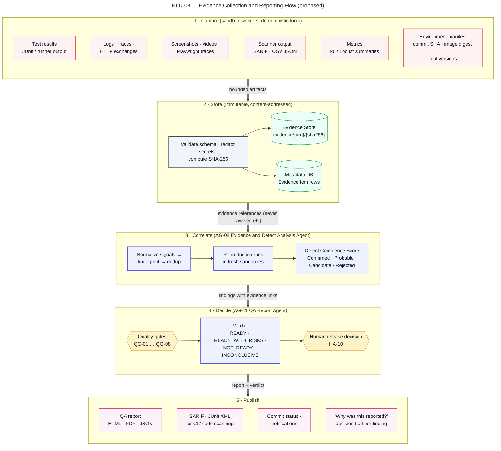
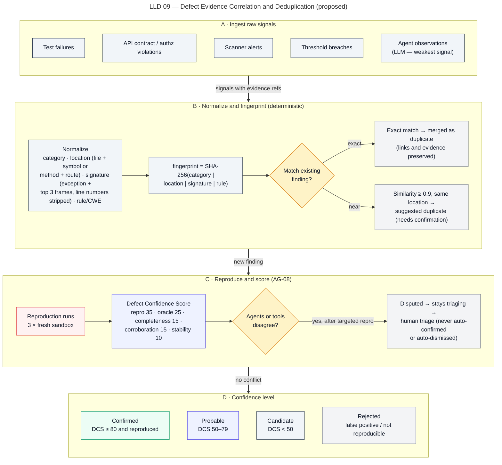

# Evidence and Defect Analysis

> Autonomous QA Swarm · Documentation v0.1 (Concept) · Status: Proposed — nothing described here is implemented yet.

This document specifies how Autonomous QA Swarm is proposed to capture, store and reason about evidence, and how the Evidence and Defect Analysis Agent (AG-08) is planned to turn raw signals from sandbox workers into deduplicated, scored and explainable findings. It applies the second core principle of the platform, **"No evidence, no defect."**: no finding may be shown as Confirmed unless deterministic tooling captured reproducible evidence for it. All mechanisms below carry the status **Planned (MVP)** unless marked **Future**; no item has the status **Implemented / Verified**, which will only be applied after code exists and acceptance tests pass. The relevant requirements are FR-032 to FR-037, NFR-007, NFR-009 and NFR-010.

## Scope and position in the pipeline

Evidence handling spans the whole job but is concentrated in stage 9, **Evidence Correlation & Triage**, which includes reproduction runs. Every earlier execution stage (Baseline Run, Functional & API Testing, Security Testing, Performance Testing, Mutation Testing) produces evidence items through the Execution Service; stage 9 correlates them into Finding records; stage 12, **Quality Gates & Reporting**, consumes the findings; and stage 13, **Cleanup & Retention**, applies retention rules. Figure HLD 08 Evidence and Reporting Flow shows the end-to-end path.



*Figure HLD 08 — Evidence Collection and Reporting Flow (proposed).*

The flow is proposed as follows:

1. Sandbox Workers produce bounded output (maximum 50 MiB captured output per task by default).
2. The Execution Service validates the output against the task contract schema (SEC-015), applies redaction (SEC-008), computes SHA-256 digests and writes objects to the Evidence Store.
3. The Execution Service records an EvidenceItem row per object in the Metadata DB, linked to the WorkerRun, TaskAttempt and Task.
4. The Evidence Agent reads normalized signals (never raw worker access), proposes correlations, and requests reproduction tasks; each request passes through the Policy Engine like any other agent proposal.
5. The deterministic correlator inside AG-08 computes fingerprints and the Defect Confidence Score; the LLM part of AG-08 only writes summaries and corroboration notes.
6. Findings, FindingEvidence links and scores feed quality-gate evaluation and the QA Report Agent (AG-11). See [Quality gates and release readiness](02-quality-gates-and-release-readiness.md).

Agent output is never trusted automatically. The Evidence Agent can propose that two signals are related, but the merge, the score and the status transition are decided by deterministic rules and, where the rules require it, by a human.

## Evidence types

The platform is proposed to recognize the following evidence types. Each is stored as one or more immutable objects and described by an EvidenceItem record with a declared media type.

| Evidence type | Typical producer | Format | Notes |
|---|---|---|---|
| Test results | pytest, Jest/Vitest, Playwright, JUnit runners | JUnit XML, runner JSON | Per-test status from the result taxonomy, duration, assertion diff |
| Logs | Application under test, runners, scanners | Structured JSON lines or text | Redacted before hashing; truncated at task output cap with a truncation marker |
| Traces | OpenTelemetry SDK in the in-sandbox target | OTLP JSON | Span tree for the failing request where instrumentation exists |
| HTTP exchanges | API Testing Agent runners, Schemathesis, ZAP | HAR-like JSON | Request and response with headers; credentials and tokens redacted |
| Screenshots and videos | Playwright | PNG, WebM | Captured on failure by default; videos only when the profile enables them |
| Playwright traces | Playwright | Trace archive (zip) | Includes DOM snapshots and network log; redaction applied to network bodies |
| Scanner output | Semgrep CE, Bandit, Gitleaks, OSV-Scanner, Trivy, Checkov, ZAP | SARIF 2.1.0 or native JSON | Native output is preserved alongside a normalized SARIF copy |
| Metrics | k6, Locust, worker resource sampler | JSON time series, summary JSON | Includes sample counts per endpoint for p95/p99 validity |
| Environment manifest | Execution Service | JSON | Worker image, limits, network phase, target build, seed values |
| Tool versions | Execution Service | Part of manifest | Exact versions and rule-pack versions of every tool invoked |
| Commit SHA | Source Intake Service | Part of manifest | Pinned immutable commit and SourceSnapshot SHA-256 |
| Image digest | Execution Service | Part of manifest | Worker image referenced by digest, never by mutable tag (SEC-006) |

### Environment manifest

Every WorkerRun is planned to produce an environment manifest. It is the evidence that makes a result interpretable and is a precondition for full "Evidence completeness" credit in the Defect Confidence Score. The illustrative example below uses the sample job QJ-1042.

```json
{
  "worker_run_id": "wrk_01JB7Q3X9R2M4T6V8Y0A1C3E5G",
  "task_id": "tsk_01JB7Q2W7N5P1R3T5V7X9Z1B3D",
  "job_display_id": "QJ-1042",
  "commit_sha": "7c9e2a1f4b",
  "source_snapshot_sha256": "e3b4…9f12",
  "worker_image": "registry.example/aqs-worker-python@sha256:4f1c…a07d",
  "isolation": "gvisor-runsc",
  "limits": { "vcpu": 2, "memory_gib": 4, "pids": 512, "disk_gib": 10, "wall_clock_min": 30 },
  "network_phases": ["dependency_fetch:proxy-allowlist", "execute:off"],
  "tools": [
    { "name": "pytest", "version": "8.3.3" },
    { "name": "schemathesis", "version": "3.36.0" }
  ],
  "target": { "kind": "ephemeral", "build_digest": "sha256:91ab…44c0" },
  "random_seeds": { "hypothesis": 271828 },
  "started_at": "2026-10-24T09:14:02Z",
  "finished_at": "2026-10-24T09:21:47Z"
}
```

Tool version numbers in the example are illustrative; actual versions will be whatever the pinned worker image contains.

## Capture and content addressing

Each evidence object is addressed by the SHA-256 digest of its stored bytes. The proposed object key layout is `sha256/<first two hex chars>/<full digest>`, which gives natural deduplication: two identical screenshots or two identical SARIF files are stored once and referenced twice.

Capture follows these proposed rules:

- **Capture happens in the Execution Service, not in agents.** Agents cannot write to the Evidence Store; they can only reference existing EvidenceItem IDs (`evd_…`).
- **Redaction before hashing.** The redaction pipeline (secret patterns, Gitleaks rules, known credential values injected by the Secrets Broker) runs before the digest is computed. Unredacted secrets are never persisted. The EvidenceItem records which redaction rule set and version were applied and how many replacements occurred, so a reviewer can see that redaction changed the object.
- **Bounded output.** Output beyond the per-task cap is truncated, and the EvidenceItem is flagged `truncated` with the original byte count, so truncated evidence is never mistaken for complete evidence.
- **Schema validation.** Structured evidence (JUnit XML, SARIF, metrics JSON, manifests) is parsed and validated; a parse failure is itself recorded as evidence and lowers evidence completeness rather than being silently dropped.
- **Time is UTC.** All timestamps are stored in UTC (NFR-020).

## Chain of custody and immutability

The chain of custody is proposed to be reconstructable from three independent records: the Evidence Store object, the EvidenceItem metadata row, and the Audit Log.

| Control | Proposed mechanism | Purpose |
|---|---|---|
| Immutability | Object-lock or write-once bucket policy; no overwrite or delete API exposed to services other than retention | Evidence cannot be altered after capture |
| Integrity | Digest re-verified on every read and on report generation | Detects storage corruption or tampering |
| Provenance | EvidenceItem links to WorkerRun, TaskAttempt, worker image digest, tool versions and commit SHA | Answers "what produced this and from which inputs" |
| Custody log | Append-only, hash-chained AuditEvent for capture, access, export and retention deletion (SEC-013) | Who touched the evidence and when |
| Access control | RBAC plus org_id row-level security; downloads only via signed, short-lived URLs (SEC-019) | Limits exposure of sensitive evidence |
| Retention | Default 90 days for evidence, 1 year for audit (NFR-016) | Deletion is itself an audited event |

Retention deletion removes the object but keeps the EvidenceItem row with its digest and a `deleted_by_retention` marker, so a report generated earlier remains verifiable as to which evidence it cited. Proposed behavior for findings in `accepted_risk` is that their evidence is retained until the risk acceptance expires, even if this exceeds the default retention period; this is visible in the Settings & Integrations screen (SCR-15).

## Minimum evidence per finding type

A finding cannot leave `candidate` without the minimum evidence for its type. The table lists the proposed minimum set; the environment manifest (commit SHA, image digest, tool versions) is required for all types and is omitted from the rows.

| Finding type | Minimum evidence | Deterministic oracle | Reproduction method |
|---|---|---|---|
| Functional test failure | Test result with assertion diff, runner log, test source reference | Assertion failure | Re-run test in fresh worker |
| UI / E2E failure | Test result, screenshot, Playwright trace | Assertion or locator failure | Re-run with same seed and browser build |
| API contract violation | HTTP exchange, schema path violated, OpenAPI document digest | Schema violation | Replay request against fresh ephemeral target |
| API authorization (BOLA/IDOR) | Two HTTP exchanges with distinct test identities, ownership evidence | Response returns another identity's object | Replay both identities in fresh target |
| SAST alert | SARIF result, code snippet reference, rule id and rule-pack version | Scanner rule with exploit-precondition check | Reachability or precondition check task |
| Dependency vulnerability | Lockfile reference, package and version, advisory id (CVE/OSV) | Version match against advisory | Reachability analysis (call path to vulnerable symbol) |
| Secret detection | Redacted match location, rule id, entropy or pattern class | Pattern match | Validity is never tested against live services; context check only |
| IaC / configuration | SARIF result, resource path, policy id | Policy rule | Re-scan of the same snapshot plus context review |
| Performance threshold breach | Metrics summary, per-endpoint sample count, baseline reference, generator CPU | Threshold breach measured | Repeat within approved profile bounds |
| DAST alert (Future) | ZAP alert, HTTP exchange, target authorization reference | Active rule with confirmation | Targeted replay under HA-02 |

Performance evidence below the minimum sample size (400 samples per endpoint for p95, 2,000 for p99) is accepted but marked with a sample-size warning, and the finding cannot exceed Probable. A run marked invalid because the generator was CPU-bound is never used as evidence of a target regression.

## Defect Confidence Score

The Defect Confidence Score (DCS) is a deterministic integer from 0 to 100 computed by the correlator, not by an LLM. It has five components with fixed maximum weights.

| Component | Max points | Full credit condition |
|---|---|---|
| Reproducibility | 35 | Reproduced in a fresh sandbox in at least 2 of 3 runs |
| Deterministic oracle | 25 | Assertion failure, schema violation, scanner rule with exploit-precondition check, or measured threshold breach |
| Evidence completeness | 15 | Inputs, outputs, logs, environment, commit and tool version all present |
| Independent corroboration | 15 | A second tool or agent, or a replay, agrees |
| Stability history | 10 | Test not on the flaky or quarantine list; tool rule has a good precision history |

### Partial credit rules

The component weights are fixed; the partial-credit rules below are a proposed refinement so that the score is reproducible from stored data.

- **Reproducibility:** 35 for at least 2 of 3 fresh-sandbox runs; 15 for a single deterministic run with no reproduction attempted yet; 0 if reproduction was attempted and failed in 2 of 3 runs.
- **Deterministic oracle:** 25 for a direct oracle as listed; 15 for a scanner rule without a precondition check; 0 when the only signal is a heuristic or LLM judgement.
- **Evidence completeness:** 15 minus 3 for each missing or truncated required element from the minimum-evidence table, and minus 1 for each missing or truncated optional element (for example a distributed trace), floored at 0.
- **Independent corroboration:** 15 when a different deterministic tool independently flags the same fingerprint; 10 when a replay of captured evidence or a second task of the same tool family agrees; at most 5 when corroboration comes only from LLM agent judgement.
- **Stability history:** 10 when the test is not in the Flaky Test Register and the rule has at least 20 triaged results with precision of 90% or higher; 8 when the rule or check has fewer than 20 triaged results; 3 when precision is below 90%; 0 when the test is quarantined.

LLM agent opinion alone can contribute only to "Independent corroboration", and because of the reproduction condition on the Confirmed level it can never lift a finding to Confirmed.

### Worked example: FND-0193

The sample finding FND-0193 (illustrative) is "Missing object-level authorisation on GET /v1/accounts/{account_id}/statements (IDOR)", CWE-639, on sample job QJ-1042.

| Component | Evidence | Points |
|---|---|---|
| Reproducibility | Replayed in 3 fresh ephemeral targets; reproduced 3/3 | 35 |
| Deterministic oracle | Test identity B received HTTP 200 with account A's statements; ownership mismatch asserted | 25 |
| Evidence completeness | Both HTTP exchanges, target logs, manifest, commit `7c9e2a1f4b`, tool versions present; the distributed trace for one of the three runs was truncated | 14 |
| Independent corroboration | Replay of the captured exchange by AG-08 agrees; no second independent tool family flagged it | 10 |
| Stability history | Not on the Flaky Test Register; the object-ownership check has fewer than 20 triaged results in this project, so it receives partial credit | 8 |
| **Total** | | **92** |

Because the score is at least 80 and the finding was reproduced, FND-0193 is displayed as **Confirmed**. Its severity is Critical, so while it remains open it forces QG-01 to fail. In the sample data the related patch PCH-0007 reached `verified` through VER-0011; how that affects the gate is described in the quality-gates document.

## Confidence levels

Confidence levels are derived from the DCS and from finding status.

| Level | Rule | Effect |
|---|---|---|
| Confirmed | DCS ≥ 80 AND reproduced | Counts fully in gates and risk priority (factor 1.0) |
| Probable | DCS 50–79, or DCS ≥ 80 without successful reproduction | Reported; confidence factor 0.6 |
| Candidate | DCS below 50 | Reported in a separate section; confidence factor 0.3 |
| Rejected | Status `false_positive` or `not_reproducible` | Kept for audit and precision history; excluded from gates |

Security findings additionally display a source class: **Scanner alert** (raw tool output, starts as `candidate`), **Probable vulnerability**, **Confirmed vulnerability** and **False positive**. A scanner alert is promoted only when reachability or precondition evidence exists. In the sample, FND-0194 (PyJWT 2.3.0, CVE-2022-29217) stays Probable at DCS 64 because reachability is unconfirmed, and FND-0197 (possible SQL string concatenation) stays a Candidate scanner alert at DCS 38.

## Correlation and deduplication

Figure LLD 09 Defect Correlation and Dedup shows the proposed pipeline: raw signals are normalized, fingerprinted, matched against existing findings, reproduced when needed, scored and assigned a status.



*Figure LLD 09 — Defect Evidence Correlation and Deduplication (proposed).*

### Normalization

Normalization converts tool-specific output into a common shape: category, location, signature and rule/CWE identifier. Locations are either a file path plus function or symbol, or an HTTP method plus route template (for example `GET /v1/accounts/{account_id}/statements`, never the concrete URL with an account number). Signatures are the exception type plus the top three in-repository stack frames with line numbers stripped, or the scanner rule id, or a metric plus endpoint.

### Fingerprint

The fingerprint is computed deterministically:

```text
fingerprint = SHA-256(category | normalised location | normalised signature | rule/CWE id)
```

Illustrative example for FND-0193:

```text
category  = security.authz
location  = GET /v1/accounts/{account_id}/statements
signature = authz-check:object-ownership
rule/CWE  = CWE-639
input     = security.authz|GET /v1/accounts/{account_id}/statements|authz-check:object-ownership|CWE-639
SHA-256   = 66328c08f5737ba40f01c3b8e805ee559be5d380849669832cbc1e80478aef4e
```

If the Functional Testing Agent's statements test and the API Testing Agent's authorization check both produce this fingerprint, they merge into one finding with both evidence sets linked.

### Matching rules

- **Exact match:** the new signal is merged as `duplicate` of the existing finding; FindingEvidence links from both are preserved, and the surviving finding's corroboration component is recomputed.
- **Near match:** token similarity of at least 0.9 on the signature with the same location produces a *suggested duplicate*, confirmed by the Evidence Agent's proposal and accepted by deterministic rules or a human triager. A suggested duplicate is never merged silently.
- **No match:** a new Finding is created in `candidate`.

Line numbers are excluded so that unrelated edits elsewhere in a file do not split one defect into many. The trade-off is that two genuinely different defects in the same function with the same exception type may merge; near-match review and the decision trail make such merges visible and reversible through `POST /findings/{finding_id}/triage`.

## Reproduction runs

Reproduction (FR-035) is how a finding earns the Reproducibility component and, ultimately, the Confirmed level.

- The Evidence Agent proposes a reproduction task; the Policy Engine validates scope, target authorization and budget; the Execution Service runs it.
- Every reproduction uses a **fresh** sandbox worker and, for targets, a fresh ephemeral target instance. Nothing is reused from the original worker except the immutable SourceSnapshot and recorded inputs (request bodies, seeds, test identifiers).
- The default is 3 runs; the finding is reproduced when at least 2 of 3 runs show the same oracle outcome.
- Reproduction runs consume the job's compute budget and count toward QG-08 if they end in `infrastructure_error` or `timed_out`.
- Performance reproductions stay within the approved profile caps and are never escalated to a heavier profile automatically. Security reproductions never go beyond proof of reachability (SEC-018).
- A reproduction failure caused by infrastructure is not treated as `not_reproducible`; the finding stays `reproducing` until a valid run completes or the job budget is exhausted, in which case it remains Probable with an explanation.

## Flaky test handling

Deterministic test failures are results, not errors, and are never retried as infrastructure errors. Flaky detection (FR-018) is the controlled exception:

1. A failed test is re-run up to 2 times in fresh workers.
2. If any rerun passes, the test is classified `flaky`, is not reported as a defect, and is added to the project's Flaky Test Register as a FlakyTestRecord with evidence of both outcomes.
3. Flaky tests are reported separately in the job report and on the Functional Test Results screen (SCR-06) with a flaky badge.
4. After 3 flaky occurrences within 14 days, the test becomes eligible for quarantine. Quarantine requires QA Lead acknowledgement; only then is the test excluded from the QG-03 pass-rate denominator.
5. A quarantined test that fails is still recorded and visible; it simply does not count toward the pass-rate gate. A quarantined test also scores 0 for stability history if it is part of a finding.

In sample job QJ-1042 there are 4 flaky tests (for example `test_statement_pagination_cursor`), which appear in the flaky section rather than among the 19 failures that feed findings.

## False-positive handling

- Scanner findings start as `candidate` with source class Scanner alert.
- Marking a finding `false_positive` is human approval HA-07: a Security Reviewer for security findings or a QA Lead for functional findings, with a mandatory reason.
- A suppression is a Suppression record scoped to rule plus location fingerprint, never to a whole rule or directory by default, and expires after 90 days unless renewed.
- Each false-positive decision updates the rule's precision history, which feeds the stability component for future findings of that rule.
- The rate of Confirmed findings later marked false positive is tracked against NFR-010 (at most 5% over a rolling 30 days).

The sample finding FND-0198 ("Hard-coded password in tests/fixtures/users.py") illustrates the flow: Gitleaks flagged a test fixture, a reviewer marked it false positive with the reason "test fixture value, not a credential", and a 90-day scoped suppression was created.

## Conflict reconciliation

When agents or tools disagree (FR-036), the Evidence Agent applies a fixed order of precedence:

1. Deterministic reproduced evidence.
2. Deterministic single-run evidence.
3. Tool output without reproduction.
4. LLM agent judgement.

Higher-precedence evidence wins. For example, if the Functional Testing Agent reports a defect while the API Testing Agent's contract test for the same endpoint passes, the Evidence Agent schedules a targeted reproduction task that exercises the precise disputed behavior. If the reproduction resolves the question, the finding moves on normally with both evidence sets linked. If it remains unresolved (for example, reproduction is not possible within budget, or results split evenly), the finding is flagged **Disputed**, its status stays `triaging`, and it is routed to human triage. A Disputed finding is never auto-confirmed and never auto-dismissed. It appears in the report's residual-risk section, so the uncertainty stays visible.

## Explainability and the decision trail

NFR-009 requires that 100% of reported findings link to evidence, tool and version, and a decision trail. On the Defect Evidence & Investigation screen (SCR-11), each finding is planned to have a "Why was this reported?" panel that renders the decision trail. Its proposed contents:

| Element | Content |
|---|---|
| Origin | Task, TaskAttempt, WorkerRun, agent ID and tool with version that produced the first signal |
| Inputs | Commit SHA, SourceSnapshot digest, test or request inputs, seeds, target build digest |
| Oracle | The deterministic check that failed and the expected versus actual values |
| Fingerprint | Normalized category, location, signature and rule/CWE inputs and the resulting hash |
| Duplicates | Merged and suggested duplicates with similarity values |
| Reproduction | Each run with result, worker ID and timestamps |
| DCS breakdown | Points per component and the rule that awarded them |
| Precedence | Which evidence won under conflict reconciliation and whether Disputed was set |
| Agent contributions | LLM summaries with Model Gateway prompt and response hashes, clearly labelled as non-authoritative |
| Human actions | Triage decisions, approvals (HA-07, HA-08), reasons and actors, linked to AuditEvent IDs |
| Status history | Every lifecycle transition with time and cause |

The decision trail is generated from stored records, not written by an LLM, so it can be regenerated identically for the same data. Its JSON form is available through `GET /findings/{finding_id}` and `GET /findings/{finding_id}/evidence`; see [API contracts](../08-api-specifications/01-api-contracts.md).

## Failure handling and edge cases

- **Evidence write fails:** the task attempt is marked `failed_retryable` and retried within the infrastructure retry budget; a finding is never created from evidence that was not persisted.
- **Digest mismatch on read:** the evidence is treated as missing, an alert is raised (see [Observability and operations](03-observability-and-operations.md)), and affected findings lose evidence-completeness credit until resolved.
- **Same defect across jobs:** fingerprints are stable across jobs on the same project, so a recurring defect links to its earlier occurrence; a previously `fix_verified` finding that reappears is moved to `reopened`.
- **Prompt injection in evidence:** logs and repository content are untrusted data (SEC-014); the Evidence Agent's summaries cannot change scores or statuses, which limits the effect of injected instructions.

## Related documents

- [Agent catalogue](../06-agent-design/01-agent-catalogue.md)
- [Data model and ERD](../07-data-model/01-data-model-and-erd.md)
- [Functional and API testing](../09-testing-workflows/01-functional-and-api-testing.md)
- [Security testing](../09-testing-workflows/02-security-testing.md)
- [Identity, secrets, audit and data protection](../10-security-and-threat-model/02-identity-secrets-audit-and-data-protection.md)
