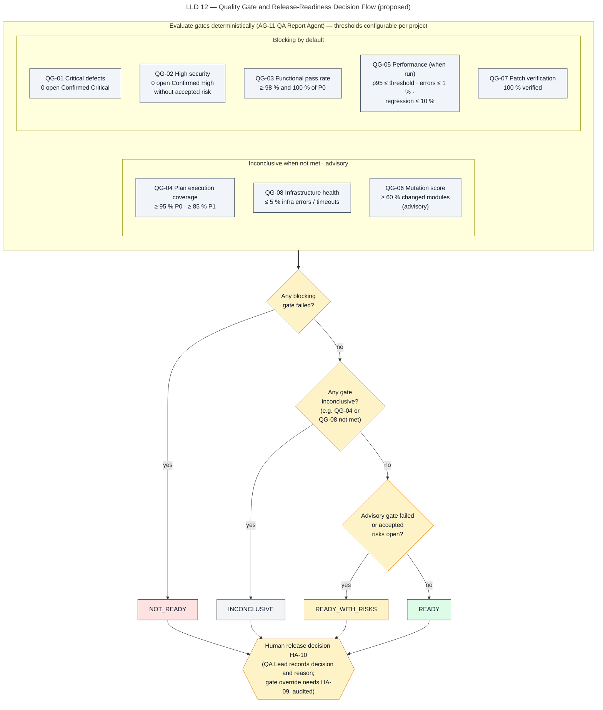

# Quality Gates and Release Readiness

> Autonomous QA Swarm · Documentation v0.1 (Concept) · Status: Proposed — nothing described here is implemented yet.

This document defines how Autonomous QA Swarm is proposed to evaluate quality gates, compute a release-readiness verdict, report residual risk, and hand the final release decision to a named human. The platform **recommends**; it never releases, merges or approves anything by itself. Quality gates are measurable checks over evidence-backed results, not a guarantee that the software is free of defects or secure. All behavior described here is **Planned (MVP)** unless marked **Future**; no item has the status **Implemented / Verified**. The relevant requirements are FR-042, FR-043, FR-044, FR-045 and FR-046 (feature F-12, with reporting in F-13).

## Inputs to gate evaluation

Gate evaluation happens in stage 12, **Quality Gates & Reporting**, and is performed by a deterministic evaluator inside the QA Report Agent (AG-11). The LLM part of the Report Agent writes narrative text only; it cannot change a gate result or the verdict. The evaluator reads:

- Findings with status, severity, confidence level and Defect Confidence Score (see [Evidence and defect analysis](01-evidence-and-defect-analysis.md)).
- TestExecution records with result statuses (`passed`, `failed`, `skipped`, `blocked`, `timed_out`, `infrastructure_error`) and the derived `flaky` classification.
- The JobPlan, with scenario priorities (P0, P1, P2) from the Requirements Analysis Agent.
- PerformanceRun and PerformanceMetric records, including baseline references and sample-size warnings.
- MutationRun and MutantResult records.
- Patch and VerificationRun records.
- Task and TaskAttempt terminal states.
- Approvals (HA-08 accepted risks, HA-09 overrides) and the project's gate configuration.

Each evaluation writes one QualityGateResult per gate, with the measured value, threshold, result state, blocking flag and links to the records that determined it. Results are available through `GET /jobs/{job_id}/quality-gates`; see [API contracts](../08-api-specifications/01-api-contracts.md).

## Quality gate catalogue

Thresholds are proposed defaults and are configurable per project. A project may make a gate stricter without approval; making a gate weaker or non-blocking is a settings change by an Org Admin or QA Lead and is recorded in the Audit Log.

| ID | Gate | Default threshold | Blocking by default |
|---|---|---|---|
| QG-01 | Critical defects | 0 open Confirmed Critical findings (any type) | Yes |
| QG-02 | High security findings | 0 open Confirmed High security findings without accepted risk | Yes |
| QG-03 | Functional pass rate | ≥ 98% of executed in-scope tests pass (flaky-quarantined excluded) AND 100% of P0 scenarios pass | Yes |
| QG-04 | Plan execution coverage | ≥ 95% of P0 and ≥ 85% of P1 planned scenarios executed (not blocked/infra error/skipped) | Yes (else INCONCLUSIVE) |
| QG-05 | Performance | p95 ≤ project threshold, error rate ≤ 1%, p95 regression ≤ 10% vs. baseline | Yes when a perf profile ran |
| QG-06 | Mutation score | ≥ 60% on changed modules | Advisory |
| QG-07 | Patch verification | 100% of patches included in the release candidate are `verified` | Yes |
| QG-08 | Infrastructure health | ≤ 5% of tasks ended `infrastructure_error`/`timed_out` | Yes (else INCONCLUSIVE) |

### Gate evaluation notes

- **QG-01** counts findings at the Confirmed level with severity Critical in an open status (`confirmed`, `reopened`, `fix_proposed`, `fix_failed`). Unlike QG-02, the threshold has no accepted-risk exemption, so a Critical finding in `accepted_risk` still counts. A finding in `fix_verified` is closed for QG-01 only when the commit being evaluated contains the verified patch (matched by patch hash); then its patch must satisfy QG-07. If the verified patch has not been merged into the evaluated commit, the finding still counts. In the sample, FND-0193 is `fix_verified` through PCH-0007 and VER-0011, but PCH-0007 is not part of commit `7c9e2a1f4b`, so FND-0193 still blocks QJ-1042.
- **QG-02** counts Confirmed High security findings in an open status. A finding in `accepted_risk` with an unexpired HA-08 approval does not count.
- **QG-03** uses executed in-scope tests as the denominator. Tests that ended `skipped`, `blocked`, `timed_out` or `infrastructure_error` were not executed to a verdict and are measured by QG-04 and QG-08 instead. Quarantined flaky tests are excluded from the denominator; non-quarantined flaky tests count as passed for this gate because their rerun passed, and are listed separately.
- **QG-04** measures whether the plan actually ran. A P0 scenario counts as executed only if at least one of its mapped test executions reached `passed` or `failed`.
- **QG-05** applies when a Performance profile ran. A run marked invalid because the generator was CPU-bound, or any endpoint below the minimum sample size (400 samples for p95), makes the relevant check `inconclusive` rather than passed.
- **QG-06** uses the mutation score formula killed / (killed + survived) × 100 over valid, completed mutants; invalid, timed-out and unexecuted mutants are excluded and reported.
- **QG-07** applies only when the release candidate includes at least one patch proposed by the platform.
- **QG-08** counts all tasks of the job, including reproduction and verification tasks. Its numerator is tasks that ended `timed_out` plus tasks that ended `failed` with error class `infrastructure_error` (written "`infrastructure_error`" for short).

## Gate result states

Every evaluated gate ends in exactly one of five result states. Before evaluation (for example while a job is still running) each gate shows a sixth value, `pending`, which never contributes to a verdict.

| State | Meaning | Typical cause |
|---|---|---|
| `passed` | Measured value meets the threshold | Normal outcome |
| `failed` | A blocking gate's threshold was not met | Open Confirmed Critical finding, pass rate below 98% |
| `advisory_failed` | A non-blocking gate's threshold was not met | Mutation score below 60% |
| `inconclusive` | Not enough valid data to decide | Coverage below QG-04 threshold, infrastructure errors above 5%, insufficient performance samples |
| `not_applicable` | The gate's precondition did not occur | No performance profile ran (QG-05), no patches in the release candidate (QG-07) |

`not_applicable` is never used to hide missing work. If a performance profile was selected but did not run because of an error, QG-05 is `inconclusive`, not `not_applicable`. Any `inconclusive` gate also makes the job end as `completed_with_warnings`.

## Verdict logic

The verdict is computed deterministically from gate results and accepted risks, as shown in Figure LLD 12 Quality Gate Decision.



*Figure LLD 12 — Quality Gate and Release-Readiness Decision Flow (proposed).*

The proposed algorithm, step by step:

1. **Evaluate all gates** and record a QualityGateResult for each.
2. **Apply hard blockers.** Aggregate scores never hide blockers: any open Confirmed Critical finding, or any open Confirmed High security finding without accepted risk, forces `NOT_READY` regardless of any other result. This duplicates QG-01 and QG-02 on purpose so that reconfiguring those gates cannot silently remove the rule.
3. **Check blocking failures.** If any blocking gate is `failed` and has no valid HA-09 override, the verdict is `NOT_READY`.
4. **Check inconclusive gates.** Otherwise, if any gate is `inconclusive`, the verdict is `INCONCLUSIVE`. The platform does not claim readiness it cannot measure.
5. **Check advisory failures and accepted risks.** Otherwise, if any advisory gate is `advisory_failed`, or any accepted risk is open, or any blocking gate passed only through an HA-09 override, the verdict is `READY_WITH_RISKS`.
6. **Otherwise** the verdict is `READY`.
7. **Hand off to a human.** The verdict is presented on the Reports & Release Readiness screen (SCR-14) as a recommendation. A QA Lead records the release decision (HA-10).

```text
if hard_blocker_present:                          verdict = NOT_READY
elif any(g.state == failed and not g.overridden): verdict = NOT_READY
elif any(g.state == inconclusive):                verdict = INCONCLUSIVE
elif any(g.state == advisory_failed) or open_accepted_risks or any_override:
                                                  verdict = READY_WITH_RISKS
else:                                             verdict = READY
```

Treating an overridden blocking gate as a reason for `READY_WITH_RISKS`, rather than `READY`, is a proposed refinement of the base verdict logic, so that an override is always visible in the verdict. Whether the hard blockers in step 2 may ever be overridden is open decision DEC-07 in [Risks, limitations and decisions](../12-risks-and-roadmap/01-risks-limitations-and-decisions.md); until it is decided, the proposed default is that they may not.

## Risk priority

Within a verdict, findings are ordered by Risk Priority so that reviewers see the most important items first:

```text
Risk Priority = Severity weight × Confidence factor × Exposure
Severity weight:   Critical 10, High 7, Medium 4, Low 2, Informational 0
Confidence factor: Confirmed 1.0, Probable 0.6, Candidate 0.3
Exposure:          1.0 changed or externally reachable code, 0.7 internal, 0.4 test-only
```

Illustrative values for sample job QJ-1042:

| Finding | Severity | Confidence | Exposure | Risk Priority |
|---|---|---|---|---|
| FND-0193 IDOR on statements endpoint | Critical (10) | Confirmed (1.0) | 1.0 | 10.0 |
| FND-0195 Duplicate transfer on Idempotency-Key reuse | High (7) | Confirmed (1.0) | 1.0 | 7.0 |
| FND-0194 PyJWT 2.3.0 (CVE-2022-29217) | High (7) | Probable (0.6) | 1.0 | 4.2 |
| FND-0196 Amount 0.005 rounds to 0.00 | Medium (4) | Confirmed (1.0) | 1.0 | 4.0 |
| FND-0199 POST /v1/transfers p95 412 ms | Medium (4) | Probable (0.6) | 1.0 | 2.4 |
| FND-0197 Possible SQL concatenation | Medium (4) | Candidate (0.3) | 0.7 | 0.84 |

Risk Priority is a sorting aid, not a gate. A low Risk Priority never removes a hard blocker, and the sum of Risk Priorities is not used as a release score.

## Residual-risk reporting

Every report includes a residual-risk section (FR-046) that states what the job did not establish. Its proposed contents:

- **Open findings below Confirmed:** Probable and Candidate findings, including scanner alerts awaiting reachability evidence.
- **Disputed findings:** findings still in `triaging` after conflict reconciliation, with the conflicting evidence.
- **Accepted risks:** each with approver, reason, expiry date and days remaining.
- **Overrides:** each overridden gate with approver and reason.
- **Coverage gaps:** P0, P1 and P2 scenarios not executed, endpoints without API tests, changed modules with no mapped tests, unsupported languages.
- **Profile limitations:** for example, Security Standard does not include DAST; no profile claims comprehensive security coverage.
- **Skipped or degraded stages:** stages not run, tasks that ended `skipped`, `timed_out` or `infrastructure_error`.
- **Performance caveats:** sample-size warnings, generator-bound runs, difference between ephemeral target and production.
- **Mutation insights:** surviving mutants in changed modules and excluded mutants.
- **Flaky and quarantined tests:** with occurrence counts.
- **Verification limitations:** checks not re-run during independent verification, with the justification recorded (as in the sample VER-0011, where performance was not re-run because the change was not on a hot path).

## Accepted risks (HA-08)

Accepting risk on a Confirmed finding is human approval HA-08: a QA Lead, plus a Security Reviewer for security findings. It is recorded through `POST /findings/{finding_id}/triage`, moving the finding to `accepted_risk`. Proposed rules:

- A reason and an expiry date are mandatory. The proposed default expiry is 90 days, aligned with the suppression expiry, and the maximum is 180 days; projects may shorten either.
- The acceptance is scoped to the finding's fingerprint. If the same fingerprint reappears in a later job before expiry, it inherits the acceptance and is listed as an open accepted risk; after expiry it returns to `confirmed` and is flagged in the next report.
- An accepted risk always keeps the verdict at `READY_WITH_RISKS` at best.
- Acceptance on a Critical finding does not satisfy QG-01 or the hard-blocker rule.
- Evidence for an accepted-risk finding is retained until the acceptance expires.
- Notifications are proposed 7 days before expiry through the Notification Service.

## Overrides (HA-09)

Overriding a failed quality gate is human approval HA-09, available to a QA Lead only, with a mandatory reason. Proposed audit content for every override:

| Field | Content |
|---|---|
| Gate and job | Gate ID, job display ID, QualityGateResult ID |
| Measured value and threshold | For example "pass rate 97.4%, threshold 98%" |
| Actor | User ID and role at the time of the action |
| Reason | Free-text reason, required, minimum length enforced |
| Scope | This job only; overrides never carry over to later jobs |
| Timestamp and audit link | UTC time and the hash-chained AuditEvent ID |

Overrides are shown on SCR-14, in every report format and on the Dashboard (SCR-01), so an override cannot be hidden by exporting to a format that omits it. The rate of overrides per project is a proposed operational metric (see [Observability and operations](03-observability-and-operations.md)).

## Release decision (HA-10)

The release decision is recorded by a QA Lead through `POST /jobs/{job_id}/release-decision` (FR-043). The record is proposed to contain the verdict at decision time, the decision taken, the decider, the reason (mandatory whenever the verdict is not `READY` or the decision departs from the recommendation), the list of accepted risks and overrides acknowledged, and the report digest the decision was based on. Binding the decision to the report digest means that if findings or gates change afterwards, the platform will show that the decision was made on an earlier state.

The decision is a record, not an action. The platform does not deploy, tag or merge. CI integrations (FR-052) may read the verdict and decision to block or allow their own pipeline steps; in that case the CI Service Account reads results and never records HA-10.

## Report contents and formats

The QA Report Agent produces one report per job, plus an addendum report when patch verification completes after the main report. Report generation is targeted at 30 seconds or less for jobs with up to 10,000 test executions (NFR-019).

### Report sections

1. Job header: display ID, repository, ref, pinned commit SHA, profiles, start and end times, final job state.
2. Verdict and gate table with result states, measured values and thresholds.
3. Findings ordered by Risk Priority, with confidence, DCS, status and evidence links.
4. Test results summary by status, including the flaky section.
5. API, security, performance and mutation summaries with tool names and versions.
6. Patches and verification results.
7. Residual risk, accepted risks and overrides.
8. Coverage analysis.
9. Narrative summary written by the Report Agent, labelled as generated text and limited to statements that link to evidence.
10. Provenance: report digest, generator version, and the release decision if recorded.

### Formats

| Format | Request | Intended use | Phase |
|---|---|---|---|
| JSON | `?format=json` | Canonical machine-readable report; source for all other formats | Planned (MVP) |
| HTML | `?format=html` | Human reading, self-contained with signed evidence links | Planned (MVP) |
| PDF | `?format=pdf` | Archival and sharing outside the platform; rendered from HTML | Planned (MVP) |
| SARIF | `?format=sarif` | Security and static findings for code-scanning tools (SARIF 2.1.0) | Planned (MVP) |
| JUnit | `?format=junit` | Test results for CI dashboards (JUnit XML) | Planned (MVP) |

All formats are generated from the same JSON report so they cannot disagree. Evidence is referenced by signed, short-lived URLs and digests; secrets are redacted before generation (SEC-008).

## Worked sample: QJ-1041 READY_WITH_RISKS

The sample job QJ-1041 on `northwind/payments-api` (Northwind Fintech, sample organization) ended `completed_with_warnings` with the verdict `READY_WITH_RISKS`. The gate outcomes below are **illustrative** sample values (commit `3b81d0c9e2`) chosen to be consistent with that state and verdict; the same values are used in the API examples and the SCR-14 mockup.

| Gate | Illustrative measured value | State |
|---|---|---|
| QG-01 Critical defects | 0 open Confirmed Critical | `passed` |
| QG-02 High security findings | 0 open Confirmed High security | `passed` |
| QG-03 Functional pass rate | 98.7% of executed in-scope tests; 100% of P0 | `passed` |
| QG-04 Plan execution coverage | 97% of P0, 88% of P1 executed | `passed` |
| QG-05 Performance | Baseline profile, POST /v1/transfers: p95 238 ms vs 300 ms threshold, error rate 0.3%, regression +4% | `passed` |
| QG-06 Mutation score | 55% on changed modules | `advisory_failed` |
| QG-07 Patch verification | No platform patches in the release candidate | `not_applicable` |
| QG-08 Infrastructure health | 2.1% of tasks ended `infrastructure_error` or `timed_out` | `passed` |

In addition, one Medium finding was in `accepted_risk`: FND-0171 "Verbose error body exposes stack trace on HTTP 500 from GET /v1/fx-rates", accepted under HA-08 by the QA Lead and a Security Reviewer until 31 January 2027 (illustrative).

Applying the verdict logic:

1. No hard blocker: no open Confirmed Critical, no open Confirmed High security finding.
2. No blocking gate failed.
3. No gate is `inconclusive`; QG-08 at 2.1% is under the 5% limit.
4. QG-06 is `advisory_failed` and one accepted risk is open, so the verdict is `READY_WITH_RISKS`.

The job state is `completed_with_warnings` because some tasks ended `infrastructure_error` or `timed_out`, even though their share stayed below the QG-08 threshold. The residual-risk section would list the low mutation score with its surviving mutants, the accepted Medium risk and its expiry, and the tasks that did not complete.

For contrast, sample job QJ-1042 is still in progress (job state `analyzing`) and its gates show "Pending". If evaluated with the sample findings and FND-0193 still `confirmed`, the hard-blocker rule would force `NOT_READY`; once PCH-0007 is `verified` (VER-0011), FND-0193 becomes `fix_verified` and QG-07 then requires PCH-0007, and any other patch included in the release candidate such as PCH-0008, to be `verified`.

## Related documents

- [Functional requirements](../03-requirements/01-functional-requirements.md)
- [Patch proposal and verification](../09-testing-workflows/05-patch-proposal-and-verification.md)
- [UI screen inventory](../02-prd-frd/03-ui-screen-inventory.md)
- [Safe-use policies](../10-security-and-threat-model/04-safe-use-policies.md)
