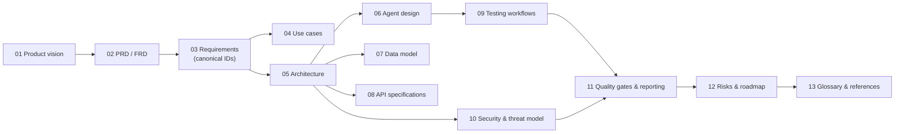

# Autonomous QA Swarm — Documentation Set

> Autonomous QA Swarm · Documentation v0.1 (Concept) · Status: Proposed — nothing described here is implemented yet.

Autonomous QA Swarm is a proposed open-source, self-hostable platform in which specialized AI agents, coordinated by a deterministic workflow engine, plan and run tests against a pinned revision of a code repository inside isolated sandboxes, correlate evidence, propose fixes for human review and independently verify them. Two principles shape every document in this set: **"Agents propose, deterministic services dispose, humans approve"** and **"No evidence, no defect."**

This README is the index of the Markdown documentation. It explains what each file covers, how the files relate to one another, and the conventions used throughout. The same content, with rendered diagrams, is also delivered as the Word document `Autonomous_QA_Swarm_Complete_Documentation.docx`; static UI concept mockups and rendered HLD/LLD diagrams are delivered as separate image packages.

## Document control

| Field | Value |
|---|---|
| Document set | Autonomous QA Swarm — Markdown documentation |
| Version | 0.1 (Concept) |
| Date | 24 October 2026 |
| Status | Proposed — for product planning and architecture review |
| Implementation status | Nothing has been implemented. No code, deployment, benchmark or user result exists. |
| Proposed project licence | Apache-2.0 (open decision DEC-01) |
| Prepared with | AI assistance; requires human review before adoption |

### Version history

| Version | Date | Change |
|---|---|---|
| 0.1 | 24 October 2026 | First complete concept set: vision, PRD/FRD, requirements, use cases, HLD/LLD, agent design, data model, API contracts, testing workflows, security and threat model, quality gates, operations, risks, roadmap, glossary |

### Implementation-status labels

Every capability in this set carries one of these labels. They are used consistently in all documents.

| Label | Meaning |
|---|---|
| **Proposed** | Design intent. Not yet validated by prototype, review or test. Every item in this set is at least Proposed. |
| **Planned (MVP)** | Intended for the MVP, which spans roadmap Phases 1–3. |
| **Future** | Intended after the MVP (Phase 4 and later). |
| **Implemented / Verified** | Reserved. Will be applied only after code exists and the related acceptance criteria pass. **No item currently has this status.** |

## How the documents relate

The set moves from *why* to *what* to *how* to *how we know it works*:

1. **Product vision** explains the problem, the vision, objectives, metrics and personas.
2. **PRD and FRD** turn the vision into features F-01 to F-15 and fifteen UI screens.
3. **Requirements** give the canonical, numbered requirements (FR, AC, NFR, SEC) and the scope boundary. Every other document references these IDs instead of redefining them.
4. **Use cases** express the requirements as user stories, fully dressed use cases and failure scenarios.
5. **Architecture**, **agent design**, **data model** and **API specifications** describe how the platform is proposed to be built.
6. **Testing workflows**, **security and threat model** and **quality gates and reporting** describe how the platform is proposed to test software safely and decide what to report.
7. **Risks and roadmap** state what could go wrong, what remains undecided and the phased plan; **glossary and references** close the set.

*Figure: reading order and dependencies between folders.*

## File index

### 01 — Product vision

| File | Purpose |
|---|---|
| [01-executive-summary.md](01-product-vision/01-executive-summary.md) | One-document overview: problem, approach, the eleven agents, MVP boundary, what is not promised, key risks and next steps |
| [02-problem-statement.md](01-product-vision/02-problem-statement.md) | Current QA workflow limitations, their impact, the proposed response and what the platform will not solve |
| [03-vision-objectives-and-metrics.md](01-product-vision/03-vision-objectives-and-metrics.md) | Vision, design principles, objectives OBJ-01–OBJ-06, success metrics MET-01–MET-10 and differentiators |
| [04-personas-and-user-journeys.md](01-product-vision/04-personas-and-user-journeys.md) | Personas PER-01–PER-06 and user journeys UJ-01–UJ-07 |

### 02 — PRD and FRD

| File | Purpose |
|---|---|
| [01-product-requirements-document.md](02-prd-frd/01-product-requirements-document.md) | PRD: goals, non-goals, MVP scope, feature summary F-01–F-15, release plan, dependencies |
| [02-functional-requirements-document.md](02-prd-frd/02-functional-requirements-document.md) | FRD: conventions and feature specifications with purpose, workflow, outcome, rules, edge cases and acceptance-criteria references |
| [03-ui-screen-inventory.md](02-prd-frd/03-ui-screen-inventory.md) | The fifteen proposed screens SCR-01–SCR-15, their states, actions and related requirements |

### 03 — Requirements

| File | Purpose |
|---|---|
| [01-functional-requirements.md](03-requirements/01-functional-requirements.md) | Canonical FR-001–FR-054 with priorities, phases and acceptance criteria AC-001–AC-162 |
| [02-non-functional-requirements.md](03-requirements/02-non-functional-requirements.md) | NFR-001–NFR-020 with measurable targets, and security requirements SEC-001–SEC-022 |
| [03-scope-assumptions-and-constraints.md](03-requirements/03-scope-assumptions-and-constraints.md) | In scope, out of scope, assumptions A-xx, dependencies D-xx and constraints C-xx |

### 04 — Use cases

| File | Purpose |
|---|---|
| [01-user-stories-and-acceptance-criteria.md](04-use-cases/01-user-stories-and-acceptance-criteria.md) | User stories US-001–US-030 with Given/When/Then criteria traced to FR and AC IDs |
| [02-use-cases-and-failure-scenarios.md](04-use-cases/02-use-cases-and-failure-scenarios.md) | Use cases UC-01–UC-12 and failure scenarios FS-01–FS-15 |

### 05 — Architecture

| File | Purpose |
|---|---|
| [01-system-context.md](05-architecture/01-system-context.md) | System boundary and external actors (diagram HLD 01) |
| [02-high-level-design.md](05-architecture/02-high-level-design.md) | Architectural style, layers, job lifecycle, decisions AD-01–AD-10, deployment topologies (HLD 02, HLD 05) |
| [03-low-level-design.md](05-architecture/03-low-level-design.md) | Workflow engine internals, state machines, task and result contracts, policy and model gateway pipelines, error codes (LLD 02, LLD 02b) |
| [04-component-architecture.md](05-architecture/04-component-architecture.md) | Component catalogue, module structure, interfaces and plug-in model (HLD 03) |
| [05-technology-options.md](05-architecture/05-technology-options.md) | Proposed technology per concern, alternatives, licences and cost notes |
| [06-integrations.md](05-architecture/06-integrations.md) | Git providers, CI/CD, test frameworks, browsers, APIs, observability, notifications |

### 06 — Agent design

| File | Purpose |
|---|---|
| [01-agent-catalogue.md](06-agent-design/01-agent-catalogue.md) | Agents AG-01–AG-11: responsibilities, inputs, outputs, permissions, boundaries, validation |
| [02-orchestration-and-recovery.md](06-agent-design/02-orchestration-and-recovery.md) | Messaging, task assignment, leases, retries, timeouts, cancellation, conflict reconciliation, recovery (HLD 04, LLD 01) |
| [03-key-design-questions.md](06-agent-design/03-key-design-questions.md) | Direct answers to the key design questions (duplication, conflicts, evidence, flakiness, isolation, secrets, approvals and more) |

### 07 — Data model

| File | Purpose |
|---|---|
| [01-data-model-and-erd.md](07-data-model/01-data-model-and-erd.md) | Entity catalogue, relationships, integrity rules, retention (LLD 03, in two parts) |

### 08 — API specifications

| File | Purpose |
|---|---|
| [01-api-contracts.md](08-api-specifications/01-api-contracts.md) | REST conventions, authentication, errors, idempotency, endpoint reference and examples, event stream and webhooks (LLD 04) |

### 09 — Testing workflows

| File | Purpose |
|---|---|
| [01-functional-and-api-testing.md](09-testing-workflows/01-functional-and-api-testing.md) | Scenario derivation, test selection, execution, flaky detection, API conformance and authorization testing (LLD 05) |
| [02-security-testing.md](09-testing-workflows/02-security-testing.md) | Quick, Standard and Deep profiles, authorization gate, triage and promotion rules (LLD 06) |
| [03-performance-testing.md](09-testing-workflows/03-performance-testing.md) | Profiles, approvals, baselines, abort rules, metrics and analysis (LLD 07) |
| [04-mutation-testing.md](09-testing-workflows/04-mutation-testing.md) | Mutant generation, classification, score calculation and the improvement loop (LLD 08) |
| [05-patch-proposal-and-verification.md](09-testing-workflows/05-patch-proposal-and-verification.md) | Patch eligibility, validation, human review and independent verification (LLD 10) |

### 10 — Security and threat model

| File | Purpose |
|---|---|
| [01-security-architecture-and-threat-model.md](10-security-and-threat-model/01-security-architecture-and-threat-model.md) | Principles, assets, trust zones and STRIDE threat register TM-01–TM-28 (HLD 06) |
| [02-identity-secrets-audit-and-data-protection.md](10-security-and-threat-model/02-identity-secrets-audit-and-data-protection.md) | Authentication, RBAC, approvals, secrets, audit log, data protection and tenant isolation (LLD 11) |
| [03-sandboxed-execution.md](10-security-and-threat-model/03-sandboxed-execution.md) | Worker lifecycle, isolation layers, limits, network policy, image supply chain, cleanup (HLD 07) |
| [04-safe-use-policies.md](10-security-and-threat-model/04-safe-use-policies.md) | Rules of engagement for security and performance testing, data handling, AI-usage and acceptable-use policies |

### 11 — Quality gates and reporting

| File | Purpose |
|---|---|
| [01-evidence-and-defect-analysis.md](11-quality-gates-and-reporting/01-evidence-and-defect-analysis.md) | Evidence types, chain of custody, Defect Confidence Score, deduplication, reproduction, flaky and false-positive handling (HLD 08, LLD 09) |
| [02-quality-gates-and-release-readiness.md](11-quality-gates-and-reporting/02-quality-gates-and-release-readiness.md) | Gates QG-01–QG-08, verdict logic, risk priority, residual risk, accepted risks, release decision (LLD 12) |
| [03-observability-and-operations.md](11-quality-gates-and-reporting/03-observability-and-operations.md) | Telemetry, dashboards, alerts, SLOs, cost tracking, backup, upgrades, troubleshooting runbook |

### 12 — Risks and roadmap

| File | Purpose |
|---|---|
| [01-risks-limitations-and-decisions.md](12-risks-and-roadmap/01-risks-limitations-and-decisions.md) | Risk register RSK-01–RSK-20, limitations of autonomous testing, open decisions DEC-01–DEC-10 |
| [02-roadmap.md](12-risks-and-roadmap/02-roadmap.md) | Phases 0–5 with goals, scope, exit criteria and indicative timing |

### 13 — Glossary and references

| File | Purpose |
|---|---|
| [01-glossary.md](13-glossary-and-references/01-glossary.md) | Definitions of platform, QA and security terms |
| [02-references.md](13-glossary-and-references/02-references.md) | Standards, guidance and tools referenced, with licence notes |

## Suggested reading paths

| Reader | Start with | Then |
|---|---|---|
| QA engineer or QA lead | Executive summary, personas and journeys | Testing workflows, evidence and quality gates, UI screen inventory |
| Product owner | Problem statement, vision, PRD | FRD, user stories, roadmap, risks |
| Architect or developer | High-level design, component architecture | Low-level design, agent design, data model, API contracts |
| Security reviewer | Security architecture and threat model | Identity and secrets, sandboxed execution, safe-use policies, security testing |
| Operator | Technology options, high-level design deployment section | Observability and operations, sandboxed execution |

## Identifier conventions

| Prefix | Meaning | Defined in |
|---|---|---|
| `FR-001`–`FR-054` | Functional requirements | 03-requirements/01 |
| `AC-001`–`AC-162` | Acceptance criteria (FR-n owns AC-(3n−2) to AC-3n) | 03-requirements/01 |
| `NFR-001`–`NFR-020` | Non-functional requirements | 03-requirements/02 |
| `SEC-001`–`SEC-022` | Security requirements | 03-requirements/02 |
| `A-xx`, `D-xx`, `C-xx` | Assumptions, dependencies, constraints | 03-requirements/03 |
| `F-01`–`F-15` | Features | 02-prd-frd/02 |
| `SCR-01`–`SCR-15` | UI screens | 02-prd-frd/03 |
| `OBJ-xx`, `MET-xx` | Objectives and success metrics | 01-product-vision/03 |
| `PER-xx`, `UJ-xx` | Personas and user journeys | 01-product-vision/04 |
| `US-xxx` | User stories | 04-use-cases/01 |
| `UC-xx`, `FS-xx` | Use cases and failure scenarios | 04-use-cases/02 |
| `AD-xx` | Architecture decisions | 05-architecture/02 |
| `AG-01`–`AG-11` | Agents | 06-agent-design/01 |
| `HA-01`–`HA-12` | Actions that require human approval | 06-agent-design/03 and 10-security-and-threat-model/02 |
| `TM-xx` | Threats | 10-security-and-threat-model/01 |
| `QG-01`–`QG-08` | Quality gates | 11-quality-gates-and-reporting/02 |
| `RSK-xx`, `DEC-xx` | Risks and open decisions | 12-risks-and-roadmap/01 |

## Diagrams

Diagrams are embedded as Mermaid source in the documents listed below and render in any Mermaid-aware Markdown viewer. Rendered high-resolution PNG versions with the same names are delivered in the separate diagrams package.

| Diagram | Document |
|---|---|
| HLD 01 System Context | 05-architecture/01-system-context.md |
| HLD 02 Platform Architecture | 05-architecture/02-high-level-design.md |
| HLD 03 Components and Integration Boundaries | 05-architecture/04-component-architecture.md |
| HLD 04 Multi-Agent Orchestration | 06-agent-design/02-orchestration-and-recovery.md |
| HLD 05 QA Job Lifecycle | 05-architecture/02-high-level-design.md |
| HLD 06 Security Trust Boundaries | 10-security-and-threat-model/01-security-architecture-and-threat-model.md |
| HLD 07 Isolated Worker Architecture | 10-security-and-threat-model/03-sandboxed-execution.md |
| HLD 08 Evidence and Reporting Flow | 11-quality-gates-and-reporting/01-evidence-and-defect-analysis.md |
| LLD 01 Agent Message Flow | 06-agent-design/02-orchestration-and-recovery.md |
| LLD 02 Job State Machine and LLD 02b Task State Machine | 05-architecture/03-low-level-design.md |
| LLD 03 Database ERD (parts 1 and 2) | 07-data-model/01-data-model-and-erd.md |
| LLD 04 API Request and Response Flow | 08-api-specifications/01-api-contracts.md |
| LLD 05 Functional and API Testing Workflow | 09-testing-workflows/01-functional-and-api-testing.md |
| LLD 06 Security Testing Workflow | 09-testing-workflows/02-security-testing.md |
| LLD 07 Performance Testing Workflow | 09-testing-workflows/03-performance-testing.md |
| LLD 08 Mutation Testing Feedback Loop | 09-testing-workflows/04-mutation-testing.md |
| LLD 09 Defect Correlation and Deduplication | 11-quality-gates-and-reporting/01-evidence-and-defect-analysis.md |
| LLD 10 Patch Approval and Verification | 09-testing-workflows/05-patch-proposal-and-verification.md |
| LLD 11 Authentication, Authorization, Secrets and Audit | 10-security-and-threat-model/02-identity-secrets-audit-and-data-protection.md |
| LLD 12 Quality Gate Decision | 11-quality-gates-and-reporting/02-quality-gates-and-release-readiness.md |

## Sample data

Examples throughout the set use one consistent, entirely fictional sample dataset: the organization *Northwind Fintech (sample org)*, the project *Payments Platform*, repositories such as `northwind/payments-api`, jobs QJ-1037 to QJ-1042, findings FND-0171 and FND-0193 to FND-0199, patches PCH-0007 and PCH-0008, and verification VER-0011. These values are illustrative only and are not results of any real execution.
